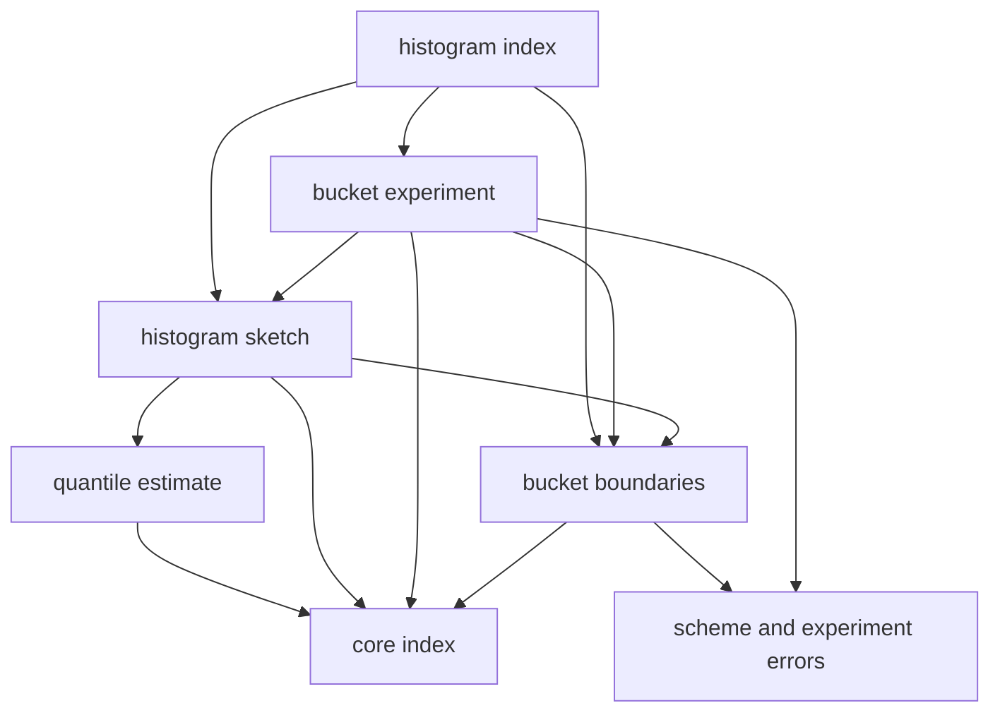
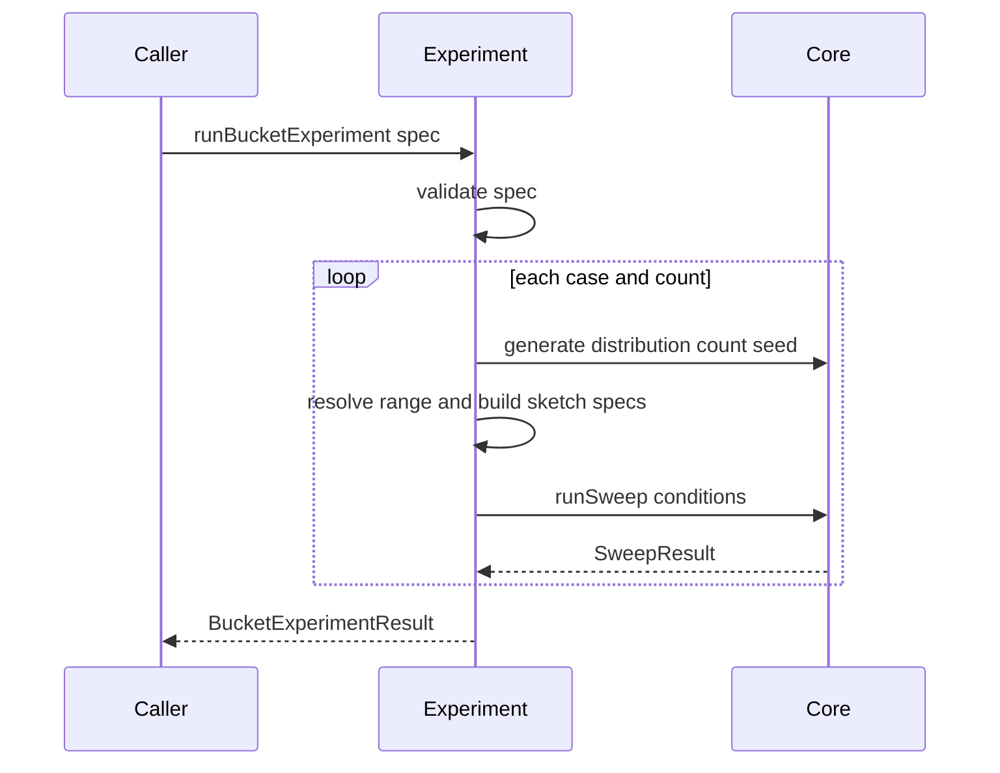

# Design Document

## Overview
Histogram Percentile は、固定バケットのヒストグラムでパーセンタイルを近似するアルゴリズムと、バケット数・境界の決め方・分布を変えたときの誤差と費用を測る実験の仕組みを提供する。バケット境界の決め方(等幅、指数幅、任意境界)を切り替えられ、分位点はバケット内の線形補間で推定する。実装は percentile-lab-core の共通操作規約、操作数・メモリの数え方、誤差指標、計測ハーネスの上に載り、独自の誤差定義や計測手段を持たない。DOM に依存しない純粋な TypeScript で、Vitest の node 環境でテストできる。

**Purpose**: 固定バケット近似の誤差の出方(裾、バケット境界付近)と、件数に依存しない計算量・メモリを、実装と実験で確かめられるようにする。
**Users**: 学習コンテンツの作者本人が、アルゴリズムを実験条件に組み込むとき、誤差の理由を文書と実験で確認するとき、後続のサイト基盤が実験データを表示に使うときに利用する。
**Impact**: `src/histogram/` 配下のモジュール群、`docs/histogram/` 配下の文書、対応するテストを新規に追加する。`src/core/` と `package.json` は変更しない。

### Goals
- 等幅・指数幅・任意境界のバケットと、バケット内の線形補間による分位点の推定を提供する(1.1〜1.9、3.1〜3.9)。
- core の共通操作規約と適合確認に従い、厳密解と入れ替えて同じ実験コードで比較できる(2.1〜2.5)。
- 投入と問い合わせの計算量、メモリの特性を操作数・メモリ見積もりで実測できる(4.1〜4.6)。
- バケット数・データ件数・分布を変えた誤差と費用を、直列化可能な構造で出力する(5.1〜5.7)。
- 誤差の出方を、文書と、文書の数値を検証するテストで説明する(6.1〜6.6)。

### Non-Goals
- 動的にバケットを調整する手法(t-digest など)と、相対誤差を保証する手法(DDSketch、HDR Histogram)。指数幅は固定の境界列であり、相対誤差の上限は保証しない。
- 学習ページ、グラフ描画、パラメータ操作 UI。
- 範囲外の値を端のバケットに寄せる、境界を自動で広げるなどの救済。範囲外は拒否する。
- バケット件数など内部状態を観察する API。要件にないため設けない。
- 厳密解、データ生成、誤差指標の定義(core の所掌)。

## Boundary Commitments

### This Spec Owns
- バケット境界の定義(`BucketScheme`)と、境界列の生成・検証(`buildBoundaries`)。
- 固定バケットのヒストグラム `PercentileSketch` の実装(値の投入、バケットの特定、件数の保持)。
- 線形補間による分位点の推定規則(バケットの選び方、補間式)。
- 投入と問い合わせの操作数の数え方(core の種別を使い、どの処理を何回と数えるか)と、メモリ見積もりに含める項目。
- ヒストグラムの `SketchSpec`(識別子の付け方、`params` の項目、`supportedRange`)。
- バケット数・データ件数・分布を変える実験の組み立て(`runBucketExperiment`)と、その結果の構造。
- 誤差の出方・費用の増え方を説明する文書(`docs/histogram/`)と、その数値を検証するテスト。

### Out of Boundary
- `PercentileSketch`、`SketchSpec`、`SketchError`、操作数の種別、メモリ見積もりの 1 個あたりの大きさ、誤差指標の定義(core の所掌。ここでは参照だけする)。
- 計測ハーネス本体、データ生成、厳密解(core の所掌。実験はこれらを呼ぶだけで、複製や拡張はしない)。
- ストリーミング分位点、相対誤差保証型の実装と、その境界の定義。
- グラフや学習ページ、結果の表示形式。
- 分散環境でのマージ。ヒストグラム同士の合算 API は持たない。

### Allowed Dependencies
- 実行時依存は `src/core/index.ts` だけ。core の内部ファイルを直接 import してはならない。
- 外部の実行時依存は追加しない。開発時依存も追加しない(`fast-check` と `vitest` は core が導入済みのものを使う)。
- 内部の依存方向: errors → boundaries → estimate → histogram → experiment → index。上位から下位への import だけを許し、逆は禁止する。
- 後続 spec は `src/histogram/index.ts` だけを import する。

### Revalidation Triggers
次の変更は、percentile-lab-site など利用側の再確認が必要になる。
- `histogramSpec` が付ける `id` の規則と `params` の項目名(結果の系列化に使われる)。
- `BucketExperimentResult` の構造と `schemaVersion`。
- 実験で使う `meta` の項目名と値(結果の絞り込みに使われる)。
- 範囲外の値を拒否する方針(受け入れる方針に変えると、誤差の意味が変わる)。
- `SchemeError`、`ExperimentError` の種別の追加・削除。

上流(core)の次の変更は、この spec の再確認が必要になる。
- `PercentileSketch`、`SketchSpec`、`SketchError`、`OperationCounter` の型・意味。
- `nearestRank` の丸め規則(バケットの選び方と、誤差の上限の保証が依存する)。
- `runBenchmark`、`runSweep`、`BenchmarkInput` の構造と、`unsupported-value` の記録方法(5.6 が依存する)。

## Architecture

### Existing Architecture Analysis
`src/core/` は、Foundation → Primitives → Domain → Harness → Entry の層構造で、後続 spec には `src/core/index.ts` だけを公開している。厳密解(`sort-exact.ts`)は、検証 → 状態更新 → 操作数の計数 → `Result` の返却という形で `PercentileSketch` を実装し、`xxxSpec()` で `SketchSpec` を作る。ヒストグラムも同じ形に揃える。

- 値の検証は `checkPositiveFinite`、分位点の検証は `isQuantile` を使う。
- 扱える値域の外は `unsupported-value`、状態は変えない。
- 引数の検査、四則演算、添字の計算、ループの制御は操作数に数えない。

### Architecture Pattern & Boundary Map
選択したパターンは、依存方向を固定した小さな層構造である。アルゴリズムの本体(境界・補間・ヒストグラム)と、実験の組み立てを分け、後者だけが core のハーネスとデータ生成を呼ぶ。



**Architecture Integration**:
- 選択したパターン: 層構造のライブラリ。境界の生成(純粋関数)、補間(純粋に近い関数)、状態を持つヒストグラム、実験の組み立てを別ファイルにする。
- 境界の分け方: 境界の生成と補間は、ヒストグラムの状態を知らずに単体でテストできる。実験は `SketchSpec` を作って core のハーネスに渡すだけで、ヒストグラムの内部を知らない。
- 維持するパターン: `Result` による入力エラーの返却、`xxxSpec()` による `SketchSpec` の作成、`OperationCounter` による計数。
- 新規コンポーネントの理由: 境界の決め方の差し替え(1.1)、補間規則の単体検証(3.1〜3.7)、実験の再現(5.1〜5.5)を、それぞれ独立に実装・確認できるようにする。
- Steering: steering の core ファイル(`product.md`、`tech.md`、`structure.md`)は未作成である。`roadmap.md` の制約(Node.js 22.12 以上、DOM 非依存、許容ライセンス)に従う。

### Technology Stack

| Layer | Choice / Version | Role in Feature | Notes |
|-------|------------------|-----------------|-------|
| 言語 | TypeScript 7.0.2(core と同じ) | 型チェックは `tsc --noEmit` | `any` を使わない。既存の `tsconfig.json` をそのまま使う |
| テスト | Vitest 5.0.5(node 環境) | 単体・統合・文書の数値の検証 | `src/**/*.test.ts` が既存の設定で拾われる |
| 性質テスト | fast-check 4.10.2(開発時のみ) | 不変条件のテスト | シードを固定する |
| 実行環境 | Node.js 22.12 以上 | core と同じ | 追加の要件なし |
| 依存 | 追加なし | — | `licenses:check` の結果は変わらない |

## File Structure Plan

### Directory Structure
```
src/histogram/
├── index.ts                  # 唯一の公開入口。後続 spec はここだけを import する
├── errors.ts                 # SchemeError、ExperimentError の型
├── boundaries.ts             # BucketScheme、buildBoundaries、MAX_BUCKETS(境界列の生成と検証)
├── boundaries.test.ts
├── estimate.ts               # estimateQuantile(バケットの選択と線形補間、操作数の計数)
├── estimate.test.ts
├── histogram.ts              # createHistogram、histogramSpec(状態、投入、メモリ、reset)
├── histogram.test.ts
├── conformance.test.ts       # 3種の境界で runConformance を通す
├── cost.test.ts              # 操作数・メモリの増え方(件数・バケット数)
├── properties.test.ts        # fast-check による不変条件
├── experiment.ts             # runBucketExperiment(データ生成、SketchSpec の列挙、core ハーネス呼び出し)
├── experiment.test.ts
├── docs-examples.test.ts     # docs/histogram/ の数値が実装の出力と一致することを確認
└── public-api.test.ts        # index.ts だけから必要な API が使えること
docs/histogram/
├── bucket-schemes.md         # 3種の境界、区間の包含規則、範囲外の扱い
├── interpolation-and-error.md # 補間式、誤差の上限、境界付近のずれ、数値例
└── experiments.md            # 裾での誤差、等幅と指数幅の比較、計算量・メモリの実測
```

> 各ファイルの責務は 1 つである。テストは対象の隣に置く(core と同じ配置)。`index.ts` を除き、他の spec から直接 import しない。

### Modified Files
なし。`src/core/`、`package.json`、`tsconfig.json`、`vite.config.ts` は変更しない。`.kiro/steering/roadmap.md` のチェックは、実装の完了後に利用者が更新する。

## System Flows

### 実験の実行(5.1〜5.6)


- 1 つの条件には、厳密解 2 方式とヒストグラム(境界の決め方 × バケット数)のすべてを同じ `BenchmarkInput.sketches` に入れる。誤差は同じデータ・同じ基準値で比べられ、費用の比較も同じ結果の中に収まる。
- 固定の範囲がデータを覆わない場合、そのヒストグラムだけが `stage: 'insert'`、`errorKind: 'unsupported-value'` で記録される。厳密解と他の条件は続行される(5.6)。実験側に独自の救済は設けない。
- 検証エラー、生成エラー、ハーネスの入力エラーは `Result` のエラーとして返し、部分的な結果は返さない(5.7)。

## Requirements Traceability

| Requirement | Summary | Components | Interfaces | Flows |
|-------------|---------|------------|------------|-------|
| 1.1 | 境界の決め方 3 種 | Boundaries | `BucketScheme`, `buildBoundaries` | — |
| 1.2 | 等幅の分割 | Boundaries | `buildBoundaries` (equal) | — |
| 1.3 | 指数幅の分割(隣り合う境界の比が一定) | Boundaries | `buildBoundaries` (exponential) | — |
| 1.4 | 任意境界 | Boundaries | `buildBoundaries` (custom) | — |
| 1.5 | 下側を含み上側を含まない。最後は両端を含む | Histogram | `locate`(内部) | — |
| 1.6 | 不正な指定でエラー、作成しない | Boundaries, Histogram | `SchemeError`, `createHistogram` | — |
| 1.7 | 範囲内の値を件数に反映 | Histogram | `insert` | — |
| 1.8 | 範囲外は拒否、状態不変 | Histogram | `insert` → `unsupported-value` | — |
| 1.9 | 扱える値域の宣言 | Histogram | `SketchSpec.supportedRange` | — |
| 2.1 | 共通規約に従う | Histogram | `PercentileSketch` | — |
| 2.2 | 3 種で適合確認を通る | Histogram | `runConformance`(テスト) | — |
| 2.3 | 同じ入力で同じ結果、シード非依存 | Histogram | 乱数を使わない | — |
| 2.4 | `reset` は境界を保ち件数と操作数を戻す | Histogram | `reset` | — |
| 2.5 | 実験条件を `params` で公開 | Histogram | `histogramSpec` の `params` | — |
| 3.1 | 目標順位の決定とバケットの選択 | Estimate | `estimateQuantile` | — |
| 3.2 | バケット内の線形補間 | Estimate | `estimateQuantile` | — |
| 3.3 | 分位点 0 は最初の非空バケットの下側の境界 | Estimate | `estimateQuantile` | — |
| 3.4 | 全件が同じバケットのときの推定 | Estimate | `estimateQuantile` | — |
| 3.5 | 推定値は有限の正の数で、選択バケット内 | Estimate | 事後条件 | — |
| 3.6 | 分位点に対して単調非減少 | Estimate | 事後条件 | — |
| 3.7 | 最近順位法の厳密値と同じバケット。誤差はバケット幅以下 | Estimate | 事後条件 | — |
| 3.8 | 空はエラー | Histogram | `query` → `empty` | — |
| 3.9 | 範囲外の分位点はエラー、状態不変 | Histogram | `query` → `quantile-out-of-range` | — |
| 4.1 | 等幅・指数幅の投入は一定の上限 | Histogram | 投入の操作数規則 | — |
| 4.2 | 任意境界の投入は対数オーダー | Histogram | 投入の操作数規則 | — |
| 4.3 | 問い合わせはバケット数に比例 | Estimate | 問い合わせの操作数規則 | — |
| 4.4 | メモリは件数に依存しない | Histogram | `memoryBytes` | — |
| 4.5 | 件数を増やした実測比較 | Experiment | `counts` | 実験の実行 |
| 4.6 | バケット数を増やした実測確認 | Experiment | `bucketCounts` | 実験の実行 |
| 5.1 | バケット数ごとに作り、厳密解と同じデータで計測 | Experiment | `runBucketExperiment` | 実験の実行 |
| 5.2 | core の結果の形式のまま返す | Experiment | `BucketExperimentResult` | 実験の実行 |
| 5.3 | 直列化可能。条件が結果から読める | Experiment | `params`, `meta` | — |
| 5.4 | 同じ条件で処理時間を除き同じ結果 | Experiment | 決定的な生成・計測 | — |
| 5.5 | 複数の分布を並べて取得 | Experiment | `cases` | — |
| 5.6 | 範囲外はその条件のエラーとして記録し続行 | Experiment | core ハーネスの記録 | 実験の実行 |
| 5.7 | 実験条件の不正でエラー | Experiment | `ExperimentError` | — |
| 6.1 | バケット幅と誤差の上限の文書化 | Docs | `interpolation-and-error.md` | — |
| 6.2 | 裾での誤差の理由と実験結果 | Docs, Tests | `experiments.md`, `docs-examples.test.ts` | — |
| 6.3 | 境界付近のずれと数値例 | Docs, Tests | `interpolation-and-error.md` | — |
| 6.4 | 等幅と指数幅の相対誤差の比較 | Docs, Tests | `experiments.md` | — |
| 6.5 | 文書の数値と実装の出力の一致 | Tests | `docs-examples.test.ts` | — |
| 6.6 | 関係の成立を性質テストで確認 | Tests | `properties.test.ts` | — |
| 7.1 | ブラウザなしで動く | 全体 | DOM を使わない | — |
| 7.2 | 1 つの操作でテストを実行 | Tests | 既存の `npm test` | — |
| 7.3 | 新たな外部依存を追加しない | 全体 | — | — |
| 7.4 | 内部構成を知らずに利用できる | Entry | `src/histogram/index.ts` | — |

## Components and Interfaces

| Component | Domain/Layer | Intent | Req Coverage | Key Dependencies (P0/P1) | Contracts |
|-----------|--------------|--------|--------------|--------------------------|-----------|
| Errors | Foundation | 境界・実験のエラー型 | 1.6, 5.7 | core `GenerateError`, `HarnessError` (P0) | State |
| Boundaries | Domain | 境界列の生成と検証 | 1.1〜1.4, 1.6 | Errors (P0), core `Result` (P0) | Service |
| Estimate | Domain | バケットの選択と線形補間 | 3.1〜3.7, 4.3 | core `nearestRank`, `OperationCounter` (P0) | Service |
| Histogram | Domain | 状態を持つ `PercentileSketch` と `SketchSpec` | 1.5〜1.9, 2.1〜2.5, 3.8, 3.9, 4.1, 4.2, 4.4 | Boundaries (P0), Estimate (P0), core 検証・計数・見積もり (P0) | Service, State |
| Experiment | Harness | 実験条件の列挙と core ハーネスの呼び出し | 4.5, 4.6, 5.1〜5.7 | Histogram (P0), Boundaries (P0), core `generate`, `runSweep`, 厳密解 (P0) | Service |
| Entry | Entry | 公開入口 | 7.4 | 全コンポーネント (P0) | — |

### Foundation

#### Errors

| Field | Detail |
|-------|--------|
| Intent | 境界の指定と実験の指定の誤りを、判別可能な型で表す |
| Requirements | 1.6, 5.7 |

```typescript
/** 境界の指定が不正。field は不正な項目(例: 'buckets', 'lower', 'boundaries') */
export type SchemeError = {
  readonly kind: 'invalid-scheme';
  readonly field: string;
  readonly reason: string;
};

export type ExperimentError =
  | SchemeError
  | { readonly kind: 'invalid-experiment'; readonly field: string; readonly reason: string }
  | { readonly kind: 'generate'; readonly error: GenerateError }
  | { readonly kind: 'harness'; readonly error: HarnessError };
```

- `reason` は人が読む説明であり、分岐には使わない(core の `unsupported-value` の `detail` と同じ扱い)。

### Domain

#### Boundaries

| Field | Detail |
|-------|--------|
| Intent | `BucketScheme` から、厳密に単調増加する境界列を作る |
| Requirements | 1.1, 1.2, 1.3, 1.4, 1.6 |

**Responsibilities & Constraints**
- 境界列は `Float64Array`(長さ バケット数 + 1)。先頭が全体の下限、末尾が全体の上限である。
- 等幅: `b[i] = lower + (upper − lower) × i / B`(`i = B` は `upper` をそのまま使う)。
- 指数幅: `b[i] = lower × (upper / lower)^(i / B)`(`i = 0` は `lower`、`i = B` は `upper` をそのまま使う)。隣り合う境界の比が一定になる。
- 任意境界: 指定された列をそのまま使い、複製して保持する(以後の外部からの変更を受けない)。
- 生成後に、すべての境界が有限の正の数で、狭義単調増加であることを検証する。浮動小数点の丸めで隣り合う境界が等しくなる場合もエラーにする。
- 部分的な結果を返さない。

**Dependencies**
- Inbound: Histogram, Experiment — 境界列の取得 (P0)
- Outbound: core `checkPositiveFinite`, `ok`, `err` — 検証と結果型 (P0)

**Contracts**: Service [x]

##### Service Interface
```typescript
export type BucketScheme =
  | { readonly kind: 'equal'; readonly lower: number; readonly upper: number; readonly buckets: number }
  | { readonly kind: 'exponential'; readonly lower: number; readonly upper: number; readonly buckets: number }
  | { readonly kind: 'custom'; readonly boundaries: readonly number[] };

/** バケット数の上限。防御的な制限であり、メモリを無制限に確保させないために置く */
export const MAX_BUCKETS = 100_000;

export function buildBoundaries(scheme: BucketScheme): Result<Float64Array, SchemeError>;
```
- Preconditions: なし(不正な入力はエラーで返す)。
- Postconditions: 成功時、長さは 2 以上 `MAX_BUCKETS + 1` 以下で、すべて有限の正の数、狭義単調増加。先頭と末尾は指定された下限・上限に等しい(任意境界は列の先頭と末尾)。
- エラー: `lower` または `upper` が有限の正の数でない、`lower >= upper`、`buckets` が 1 以上 `MAX_BUCKETS` 以下の整数でない、任意境界が 2 個未満または狭義単調増加でない、丸めで境界が区別できない、未知の `kind`。`field` に原因の項目を入れる。
- Invariants: 同じ入力から同じ列を返す。

**Implementation Notes**
- Integration: `buildBoundaries` の結果は `Histogram` が所有して以後変更しない。
- Validation: 検証は `kind` → 各数値 → 単調性の順に行い、最初の 1 件を返す。
- Risks: 指数幅は `Math.pow` を使うため、環境による最下位ビットの差がありうる。端の境界を指定値そのままにし、狭義単調増加の検証で破綻を検出する。テストでは境界の値の等式ではなく性質(比のばらつき、端点)を確認する。

#### Estimate

| Field | Detail |
|-------|--------|
| Intent | バケットの件数列から、分位点の推定値を線形補間で求める |
| Requirements | 3.1, 3.2, 3.3, 3.4, 3.5, 3.6, 3.7, 4.3 |

**Responsibilities & Constraints**
- 入力は、境界列、バケットごとの件数、総件数 `n`(1 以上)、分位点 `q`(検証済み)、`OperationCounter`。
- バケットの選択: 整数の目標順位 `k = nearestRank(n, q)`(core と同じ丸め規則。1 以上 `n` 以下)を使い、先頭から累積件数を足して、累積件数が初めて `k` 以上になるバケット `i` を選ぶ。`k` に core の丸め規則を使うのは、誤差指標と同じ目標順位でバケットを決め、浮動小数点の誤差による選択のずれを避けるためである。
- 補間: 連続の目標順位を `r = clamp(n × q, prev, cum)` とする。`prev` は `i` より前の累積件数、`cum` は `i` までの累積件数である。推定値は `lower_i + (upper_i − lower_i) × (r − prev) / count_i`。要件の「目標順位 `q × n`」と同じ値であり、`clamp` は丸めによる範囲外れだけを補正する。
- 分位点 0 は `k = 1`、`r = 0`、`prev = 0` となり、最初の非空バケットの下側の境界を返す(3.3)。
- `count_i` は `prev < k <= cum` により 1 以上であることが保証される。0 で割らない。
- 推定値は `[lower_i, upper_i]` に収める(丸め対策の `clamp`)。`lower_i` は有限の正の数なので、推定値も有限の正の数になる。
- 操作数: 先頭から調べたバケットごとに、比較を 1 回数える(「累積件数が `k` 以上か」の比較)。移動は数えない。累積の加算、補間の四則演算は数えない。比較の回数は、選ばれたバケットの位置 + 1 で、バケット数 `B` 以下である。

**Dependencies**
- Inbound: Histogram — `query` からの呼び出し (P0)
- Outbound: core `nearestRank`, `OperationCounter` (P0)

**Contracts**: Service [x]

##### Service Interface
```typescript
export function estimateQuantile(input: {
  readonly boundaries: Float64Array;
  readonly counts: Float64Array;
  readonly total: number;
  readonly quantile: number;
  readonly counter: OperationCounter;
}): number;
```
- Preconditions: `total >= 1`、`total` は `counts` の合計に等しい、`quantile` は 0 以上 1 以下。
- Postconditions:
  - 戻り値は有限の正の数で、選ばれたバケットの `[lower_i, upper_i]` に収まる(3.5)。
  - 同じ `boundaries` と `counts` に対して、`quantile` について単調非減少である(3.6)。
  - `nearest-rank` の厳密値 `x` が属するバケットは `i` と一致し、`|戻り値 − x| <= upper_i − lower_i` である(3.7)。
- Invariants: `counts`、`boundaries` を変更しない。

**Implementation Notes**
- Integration: 検証(分位点の範囲、空)は `Histogram.query` が行い、`estimateQuantile` は事前条件を前提にする。
- Validation: 3.7 の根拠は次のとおり。`nearest-rank` の厳密値は整列後の `k` 番目で、累積件数の定義により選ばれたバケットに属する。推定値も同じバケットの閉区間に収まるので、差はバケット幅以下になる。推定値が上側の境界に一致する場合、その点は次のバケットの下側の境界でもあるが、閉区間への包含として扱えば結論は変わらない。
- Risks: `r` を `clamp` で補正する分、`n × q` が整数に非常に近いときの丸めで、補間の割合が 0 または 1 になる。これは仕様の範囲内(3.5)であり、性質テストで確認する。

#### Histogram

| Field | Detail |
|-------|--------|
| Intent | 境界列とバケット件数を保持する、`PercentileSketch` の実装 |
| Requirements | 1.5, 1.6, 1.7, 1.8, 1.9, 2.1, 2.3, 2.4, 2.5, 3.8, 3.9, 4.1, 4.2, 4.4 |

**Responsibilities & Constraints**
- 状態: 境界列(不変)、バケットごとの件数(`Float64Array`、長さ `B`)、総件数、`OperationCounter`。
- `insert(value)`:
  1. `checkPositiveFinite` で検証し、不正なら `invalid-value` を返す。
  2. `value < 先頭の境界` または `value > 末尾の境界` なら、`unsupported-value` を返す。`detail` に扱える範囲を入れる。ここまでは状態も操作数も変えない。
  3. バケットを特定する(下記)。
  4. バケットの件数と総件数を 1 ずつ増やす。移動を 2 回と数える。
- バケットの区間は `[b[i], b[i+1])`。最後のバケットだけ `[b[B−1], b[B]]` で上側も含む(1.5)。
- バケットの特定と比較の数え方:
  - 等幅・指数幅: 計算で求めた添字(等幅は `floor((v − lower) / 幅)`、指数幅は `floor(ln(v / lower) / (ln(upper / lower) / B))`)を `0..B−1` に収め、境界の配列と比べて補正する。「`v < b[i]` なら `i` を 1 つ下げる」「`i < B−1` かつ `v >= b[i+1]` なら 1 つ上げる」を、成立しなくなるまで繰り返す。比較は実行した分だけ数える。計算の誤差は 1 バケット以内なので、1 回の投入での比較は最大 3 回である(4.1)。
  - 任意境界: 境界の配列に対する二分探索(`b[i] <= v` を満たす最大の `i` を `0..B−1` から探す)。比較は探索で実行した分だけ数え、最大 `ceil(log2 B)` 回である(4.2)。
- 乱数は使わない。シードは受け取っても使わない(2.3)。
- `memoryBytes()`: `estimateBytes({ numbers: B + 1, counters: B + 1 })`。境界の個数と、バケット件数 + 総件数のカウンタ個数だけで決まり、投入済みの件数に依存しない(4.4)。
- `reset()`: 件数、総件数、操作数を 0 に戻す。境界列は保つ(2.4)。
- `histogramSpec(scheme, options?)`:
  - `id`: 既定は `histogram-<kind>-<B>`(`kind` は `equal`、`exponential`、`custom`)。同じ実験で `kind` と `B` が同じ別の境界を並べるときは `options.id` で上書きする。範囲を `id` に含めないのは、実験で件数ごとに範囲が変わっても系列化(`seriesByAlgorithm`)が分断されないようにするためである。
  - `label`: `ヒストグラム(<境界の決め方>, B=<B>)` の形(既定)。`options.label` で上書きできる。
  - `params`: `{ scheme, buckets, lower, upper }`(先頭と末尾の境界)。値は有限の数と文字列だけで、`isParamRecord` を満たす(2.5)。
  - `supportedRange`: `{ min: 先頭の境界, max: 末尾の境界 }`(1.9)。

**Dependencies**
- Inbound: Experiment, 外部の利用者 — アルゴリズムの作成 (P0)
- Outbound: Boundaries — 境界列 (P0)、Estimate — 推定 (P0)、core `checkPositiveFinite`, `isQuantile`, `estimateBytes`, `OperationCounter`, `ok`, `err` (P0)

**Contracts**: Service [x] / State [x]

##### Service Interface
```typescript
export interface HistogramSpecOptions {
  readonly id?: string;
  readonly label?: string;
}

/** 境界の指定が不正なら SchemeError。成功時は共通規約に従う PercentileSketch */
export function createHistogram(scheme: BucketScheme): Result<PercentileSketch, SchemeError>;

/** 境界の指定が不正なら SchemeError。成功時の SketchSpec.create は seed を使わない */
export function histogramSpec(
  scheme: BucketScheme,
  options?: HistogramSpecOptions,
): Result<SketchSpec, SchemeError>;
```
- Preconditions: なし(不正な入力は `Result` のエラーで返す)。
- Postconditions: `query` の成功値は有限の正の数。エラー時は状態・操作数・メモリ見積もりを変えない(core の契約)。`query` は `isQuantile` → 空の順に検査し、`quantile-out-of-range`、`empty` を返す(3.8、3.9)。
- Invariants: `memoryBytes()` は投入の前後で変わらない。投入1回の移動は 2 回。比較は上記の上限以下。

##### State Management
- State model: 境界列(不変)、件数列、総件数、計数器。
- Persistence & consistency: メモリ内のみ。`insert` と `query` は同期的で、1 つのインスタンスは単一のスレッドから使う。
- Concurrency strategy: 考慮しない。複数のヒストグラムは互いに独立で、状態を共有しない。

**Implementation Notes**
- Integration: `histogramSpec` が返す `SketchSpec` は、core のハーネスと `runConformance` にそのまま渡せる。
- Validation: `runConformance` を `equal`、`exponential`、`custom` の 3 種で通す(2.2)。適合確認は `supportedRange` の内側の固定の入力列を使うので、範囲外の拒否(1.8)も確認される。
- Risks: 件数を `Float64Array` に持つのは、`Uint32Array` の上限(約 43 億)を意識せずに済ませるためである。core の生成上限(1,000 万件)では、どちらでも足りる。

### Harness

#### Experiment

| Field | Detail |
|-------|--------|
| Intent | 分布・データ件数・バケット数・境界の決め方を変えた計測条件を作り、core のハーネスで実行する |
| Requirements | 4.5, 4.6, 5.1, 5.2, 5.3, 5.4, 5.5, 5.6, 5.7 |

**Responsibilities & Constraints**
- 実験条件を検証し、`cases × counts` の各組み合わせについて、`generate` でデータを作り、`BenchmarkInput` を組み立てる。ケースごとに `runSweep` を 1 回呼び、結果を `cases` に並べる。
- 1 つの `BenchmarkInput.sketches` は、次の順に並べる。
  1. 厳密解 2 方式: `sortExactSpec({ definition })`、`quickselectExactSpec({ definition })`(`definition` は `referenceDefinition`。省略時は core の既定)。
  2. 指定された `schemes` × `bucketCounts` のヒストグラム(境界の決め方の順、バケット数の昇順)。
- 範囲の決め方(ケースごと):
  - `{ lower, upper }`: 固定。データが範囲に収まらなければ、範囲外の値でヒストグラムの投入が `unsupported-value` になり、そのヒストグラムだけが `stage: 'insert'` のエラーとして記録される(5.6)。
  - `'data-extent'`: 生成したデータの最小値と最大値を、下限・上限にする。件数ごとに値が変わる。すべての値が等しいなど `lower >= upper` になる場合は、`SchemeError` を返す。
- `meta`: `{ case, distribution, order, rangeMode }`(平坦な記録。`distribution` は分布の種類、`rangeMode` は `fixed` または `data-extent`)。結果のどの条件かを読み取れる(5.3)。`seed`、`count`、基準の定義は core の結果が持つ。
- 結果は `BenchmarkResult` と `SweepResult` をそのまま使い、新しい指標や変換を加えない(5.2)。
- 乱数は `generate` のシードだけで、同じ条件なら処理時間を除き同じ結果になる(5.4)。
- 任意境界は、配列を含む指定が実験条件の記録に収まらないため、実験の組み立て対象にしない(`histogramSpec` を直接 core のハーネスに渡して使う)。

**Dependencies**
- Inbound: 外部の利用者(percentile-lab-site を含む) — 実験の実行 (P0)
- Outbound: Histogram, Boundaries — スペックと範囲の検証 (P0)、core `generate`, `runSweep`, `sortExactSpec`, `quickselectExactSpec` (P0)

**Contracts**: Service [x]

##### Service Interface
```typescript
export type BucketRange =
  | { readonly lower: number; readonly upper: number }
  | 'data-extent';

export interface ExperimentCase {
  /** ケースの識別。実験内で重複させない */
  readonly label: string;
  readonly distribution: Distribution;
  readonly range: BucketRange;
}

export interface BucketExperimentSpec {
  readonly cases: readonly ExperimentCase[];
  /** データ件数の一覧 */
  readonly counts: readonly number[];
  readonly seed: number;
  readonly order?: DataOrder;
  readonly quantiles: readonly number[];
  /** バケット数の一覧 */
  readonly bucketCounts: readonly number[];
  readonly schemes: readonly ('equal' | 'exponential')[];
  readonly referenceDefinition?: PercentileDefinition;
}

export interface BucketExperimentResult {
  readonly schemaVersion: 1;
  readonly cases: readonly { readonly label: string; readonly sweep: SweepResult }[];
}

export function runBucketExperiment(
  spec: BucketExperimentSpec,
): Result<BucketExperimentResult, ExperimentError>;
```
- Preconditions: なし。
- Postconditions: 成功時、`cases` は入力の並びを保ち、各 `sweep.runs` はデータ件数の昇順で、各 run に厳密解 2 方式とすべてのヒストグラムの結果が入る。`JSON.stringify` に通せる。
- エラー:
  - `invalid-experiment`: `cases`、`counts`、`bucketCounts`、`schemes` のいずれかが空、`label` の重複、`schemes` に未知の値、`bucketCounts` に 1 以上の整数でない値。
  - `invalid-scheme`: 固定の範囲やバケット数が境界として成り立たない(`buildBoundaries` のエラー)。
  - `generate`: 件数やシード、分布のパラメータが不正(core の `GenerateError`)。
  - `harness`: 分位点が不正など(core の `HarnessError`)。
- 検証は、実験条件 → 各ケースと件数の生成 → 境界の生成 → ハーネスの順に行い、最初の 1 件を返す。

**Implementation Notes**
- Integration: 戻り値の `sweep` は、core の `seriesByAlgorithm` にそのまま渡せる。ヒストグラムの `id` は範囲を含まないので、件数が変わっても同じ系列に並ぶ。
- Validation: 実験条件の検査はハーネスの呼び出しより前に行い、生成の途中で失敗しても部分的な結果を返さない。
- Risks: `cases × counts × (2 + schemes × bucketCounts)` の組み合わせが多いと実行時間が延びる。上限は設けず、呼び出し側の責任とする(重い実験は後続の spec が Web Worker に載せる)。

### Entry

- `src/histogram/index.ts`: 次の API だけを再エクスポートする。内部の補助関数(`estimateQuantile` など)は公開しない。
  - `buildBoundaries`、`MAX_BUCKETS`、`BucketScheme`
  - `createHistogram`、`histogramSpec`、`HistogramSpecOptions`
  - `runBucketExperiment`、`BucketRange`、`ExperimentCase`、`BucketExperimentSpec`、`BucketExperimentResult`
  - `SchemeError`、`ExperimentError`
- 後続 spec は、このファイルだけから、ヒストグラムの作成、`SketchSpec` の取得、実験の実行を行える(7.4)。

## Data Models

### Domain Model
- 値: 有限の正の数。境界は狭義単調増加の `Float64Array`。
- バケット `i` の区間: `[b[i], b[i+1])`。最後のバケットだけ `[b[B−1], b[B]]`。
- 状態: バケットごとの件数、総件数。不変条件は「総件数 = 件数の合計」「境界列は作成後に変わらない」。
- 実験条件: `params` と `meta` は core と同じく、有限の数・文字列・真偽値だけからなる平坦な記録。
- 結果: core の `BenchmarkResult` と `SweepResult` を使い、新しい永続化の形式は持たない。

## Error Handling

### Error Strategy
- 入力の誤りは例外ではなく `Result` のエラーで返す。プログラム上の誤り(契約違反、内部の矛盾)は例外を投げてよく、core のハーネスが捕捉して記録する。

### Error Categories and Responses
- 境界の指定の誤り(`invalid-scheme`): アルゴリズムを作らずにエラーを返す(1.6)。
- 値の誤り(`invalid-value`)、範囲外の値(`unsupported-value`)、範囲外の分位点(`quantile-out-of-range`)、空(`empty`): 状態・操作数・メモリ見積もりを変えずにエラーを返す(1.8、3.8、3.9)。
- 実験条件の誤り(`invalid-experiment`、`generate`、`harness`): 部分的な結果を返さずにエラーを返す(5.7)。
- 固定の範囲がデータを覆わない場合: その条件のヒストグラムだけが `status: 'error'` として記録され、残りの条件は続行する(5.6)。実験全体のエラーにはしない。

## Testing Strategy

### Unit Tests
- `boundaries.test.ts`: 等幅の幅が一定、指数幅の隣り合う境界の比が一定(許容誤差内)、任意境界がそのまま使われること、端点が指定値に等しいこと(1.2〜1.4)。不正な指定の全区分: 非有限・非正の境界、`lower >= upper`、バケット数が整数でない・0・上限超過、任意境界の短さ・非単調、丸めで区別できない境界(1.6)。
- `estimate.test.ts`: 設計例 `[15, 25, 25, 35]`(等幅 `lower = 10`、`upper = 50`、`B = 4`)で、`q = 0, 0.25, 0.5, 0.75, 1` の推定値が 10, 20, 25, 30, 40 になること(3.1〜3.3)。全件が 1 つのバケットに入る場合(3.4)。空のバケットをまたぐ場合。分位点が整数順位に近い値(`0.07 × 100` など)でバケットの選択がずれないこと(3.1)。
- `histogram.test.ts`: 区間の包含(下側の境界を含む、上側の境界は次のバケット、最後のバケットは上側も含む)(1.5)。範囲内の投入が問い合わせの結果に反映される(件数を直接は観察しないので、推定値で確認する)(1.7)。範囲外が `unsupported-value` で状態不変(1.8)。`supportedRange` と `params`(1.9、2.5)。`reset` で境界を保って初期状態に戻る(2.4)。空と範囲外の分位点のエラー(3.8、3.9)。

### Integration Tests
- `conformance.test.ts`: `equal`、`exponential`、`custom` の 3 種で `runConformance` の失敗が 0 件(2.1、2.2)。
- `cost.test.ts`:
  - 等幅・指数幅で、投入 1 回の比較が最大 3 回、移動が 2 回。件数 1,000 と 100,000、バケット数 10 と 10,000 のどれでも同じ上限(4.1)。
  - 任意境界で、投入 1 回の比較が `ceil(log2 B)` 回以下(4.2)。
  - 問い合わせの比較が、`B` を 10 倍にすると約 10 倍になる(`q = 1` でデータが範囲全体に広がる条件)。件数を変えても増えない(4.3、4.6)。
  - `memoryBytes()` が `(2B + 2) × 8` バイトで、投入前後と件数で変わらない。厳密解は件数に比例して増える(4.4、4.5)。
- `experiment.test.ts`: 結果の構造(厳密解 2 方式とヒストグラムがすべて入る、件数の昇順、ケースの並び)(5.1、5.2、5.5)。`JSON.stringify` / `parse` を通しても等しい(5.3)。同じ条件の再実行が `withoutTiming` で等しい(5.4)。固定の範囲が狭いとき、ヒストグラムだけが `stage: 'insert'`、`errorKind: 'unsupported-value'` で記録され、厳密解と他のバケット数は続行(5.6)。不正な実験条件の全区分(5.7)。`seriesByAlgorithm` で件数をまたいで系列化できること(4.5)。
- `public-api.test.ts`: `src/histogram/index.ts` だけから、作成・`SketchSpec`・実験が使えること(7.4)。

### Property Tests(fast-check、シード固定)
- 任意の境界、任意の範囲内のデータ、任意の `q` で、推定値が有限の正の数で、選ばれたバケットの閉区間に収まる(3.5)。
- 同じデータで `q` について単調非減少(3.6)。
- `nearest-rank` の厳密値と推定値の差が、そのバケットの幅以下(3.7、6.1、6.6)。
- 等幅・指数幅の投入の比較が 3 回以下、任意境界が `ceil(log2 B)` 回以下(4.1、4.2、6.6)。
- 同じ入力で同じ推定値・操作数・メモリ見積もり(2.3)。
- 範囲内の値を 1 件だけ投入した直後は、すべての分位点の推定値が、その値を含むバケットの閉区間に収まる(1.5、1.7)。

### 文書との一致(`docs-examples.test.ts`)
- `interpolation-and-error.md` の数値例(設計例 `[15, 25, 25, 35]` と `q = 0.25, 0.75` の境界付近のずれ、誤差の上限の例)が、実装の出力と等しいこと(6.1、6.3、6.5)。
- `experiments.md` の実験結果(裾での誤差、等幅と指数幅の比較、計算量・メモリの増え方)の数値が、固定のシードでの `runBucketExperiment` の出力と等しいこと(6.2、6.4、6.5)。文書に載せる主張は、先に実測してから書く。

## Optional Sections

### Performance & Scalability
- 投入は件数・バケット数に依存しない一定の費用(等幅・指数幅)または `log B`(任意境界)。問い合わせは `O(B)`。
- バケット数の上限は `MAX_BUCKETS = 100,000`。境界列とバケット件数で、約 1.6 MB(`(2B + 2) × 8` バイト)に収まる。
- 件数 1,000,000 の投入が通常の開発機で数秒以内に終わること(目安であり、合否の基準にはしない)。

### Security Considerations
- 外部からの入力を処理する機能はなく、実行時依存も追加しない。バケット数の上限は、メモリを無制限に確保させないための防御である。
