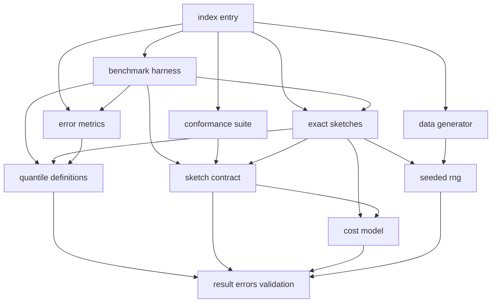
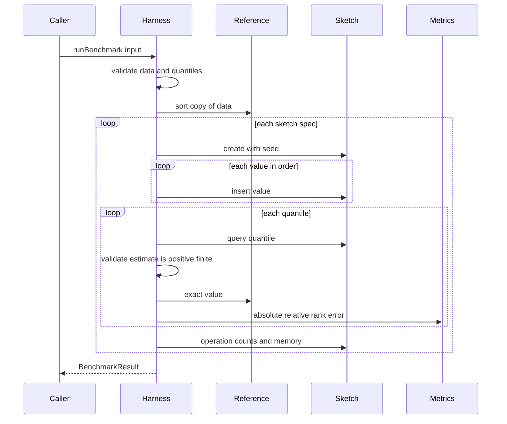

# Design Document

## Overview
Percentile Lab Core は、パーセンタイル近似アルゴリズムを同じ条件で比較するための共通基盤である。アルゴリズムの共通操作規約、シード付きの再現可能なデータ生成、誤差・操作数・メモリの統一した計測、基準となる厳密解(整列方式と quickselect 方式)を、DOM に依存しない純粋な TypeScript ライブラリとして提供する。

**Purpose**: 後続の3つのアルゴリズム spec とサイト基盤 spec に、比較可能な土台を提供する。
**Users**: 学習コンテンツの作者本人が、各アルゴリズムを実装するとき、実験を回すとき、結果を可視化するときに利用する。
**Impact**: コードがない状態から、`package.json`、TypeScript 設定、テスト設定、`src/core/` 配下のモジュール群、`docs/core/` 配下の定義文書を新規に作る。

### Goals
- すべてのアルゴリズムが従う共通の操作規約と、その適合確認を提供する(1.1〜1.9)。
- 同じ入力から同じ結果を再現できる乱数、データ生成、計測を提供する(1.8、2.9、3.4、5.4、6.4、7.4)。
- 誤差・操作数・メモリを、アルゴリズムによらず同じ定義で数える(4.1〜4.7、5.1〜5.6)。
- 厳密解2方式を基準として、計算量の違いを操作数で実測できる(2.1〜2.9)。
- 外部の実行時依存を持たず、ブラウザなしでテストできる(7.1〜7.6)。

### Non-Goals
- 近似アルゴリズム本体(ヒストグラム、GK、KLL、t-digest、DDSketch、HDR Histogram)。
- 描画、UI、結果の表示形式。
- 分散環境でのマージ性能の評価。
- 実時間や実メモリ使用量の厳密な測定(処理時間は参考値として記録するだけである)。

## Boundary Commitments

### This Spec Owns
- アルゴリズム共通の操作規約 `PercentileSketch` と、値・分位点の入力検証規則(有限の正の数、分位点は 0〜1)。
- 操作数の種別と数え方(`OperationCounter`)、メモリ見積もりの規則(`MemoryModel`)。
- パーセンタイル定義5種の意味と、順位・位置の解決規則(浮動小数点のスナップ処理を含む)。
- 厳密解2方式(`SortExactSketch`、`QuickselectExactSketch`)と、計測用の基準値計算。
- シード付き乱数、データ分布5種のジェネレータ、並び順の指定。
- 誤差指標3種(絶対誤差、相対誤差、順位誤差)の定義と計算。
- 計測ハーネスと、その結果の構造(`BenchmarkResult`)。
- 適合確認(`runConformance`)。
- プロジェクト雛形(`package.json`、`tsconfig.json`、`vite.config.ts`、`.nvmrc`)と、ライセンス確認の手順。
- 定義の文書(`docs/core/`)。

### Out of Boundary
- 近似アルゴリズムの実装と、それぞれの内部状態の観察 API。
- グラフ、ページ、UI、Web Worker への載せ替え(サイト基盤 spec が担当する)。
- Vite によるアプリケーションのエントリ(`index.html` など)。core は Vite をテスト基盤としてだけ使う。
- 分散環境でのマージ。

### Allowed Dependencies
- 実行時依存: なし(Node.js と Web 標準に共通のグローバルのみ。`performance.now` と `Float64Array`)。
- 開発時依存: `typescript`、`vitest`、`vite`、`fast-check`、`@types/node`、`license-checker-rseidelsohn`(いずれも MIT / Apache-2.0)。
- 内部の依存方向: Foundation → Primitives → Domain → Harness → Entry。下位から上位への import は禁止する(Architecture 参照)。
- 後続 spec は `src/core/index.ts` だけを import する。内部ファイルを直接 import してはならない。

### Revalidation Triggers
次の変更は、後続の4つの spec の再確認が必要になる。
- `PercentileSketch`、`SketchSpec`(`params`、`supportedRange` を含む)、`OperationCounts` の型・意味の変更。
- `SketchError` の種別の追加・削除と、`invalid-value` と `unsupported-value` の使い分けの変更。
- 値の定義域(有限の正の数)の変更。推定値にも同じ定義域を課すこと(`query` の事後条件)の変更。
- 誤差指標の定義式、順位誤差の目標順位の定め方、推定値が実データに存在しない場合の順位の定め方の変更。
- 操作数の種別や、メモリ見積もりの 1 個あたりの大きさ(8 バイト)の変更。
- `BenchmarkResult` の構造と `schemaVersion` の変更。
- 乱数生成器のアルゴリズム、またはシードの扱いの変更(保存済みの実験結果が再現できなくなる)。
- Node.js の最小バージョン、モジュール形式(ESM)、`src/core/index.ts` の公開面の変更。

## Architecture

### Architecture Pattern & Boundary Map
選択したパターンは、依存方向を固定した層構造のライブラリである。外部の実行時依存は持たず、すべて純粋関数と小さなクラスで構成する。



**Architecture Integration**:
- 依存方向: Foundation → Primitives(Rng、Cost、Quantile) → Domain(Contract、Exact、Generator、Metrics、Conformance) → Harness → Entry。各層は左(下位)だけを import する。違反は誤りとして扱う。
- 境界の分け方: アルゴリズムの契約(Contract)、基準値の計算(Quantile)、誤差の計算(Metrics)、データ生成(Generator)は互いに独立に実装できる。ハーネスだけがこれらを束ねる。
- 新規コンポーネントの理由: 後続3 spec が共有する定義(値域、誤差、操作数)をここに一本化し、重複定義を防ぐ。
- Steering: steering ファイルは未作成である。`roadmap.md` の制約(Node.js 22.12 以上、DOM 非依存、許容ライセンス)に従う。

### Technology Stack

| Layer | Choice / Version | Role in Feature | Notes |
|-------|------------------|-----------------|-------|
| 言語 | TypeScript 7.0.2 | 型チェックは `tsc --noEmit` | `any` を使わない。`lib` に DOM を含めない |
| テスト | Vitest 5.0.5(node 環境) | 単体・統合テスト | 設定は `vite.config.ts` の `test` に置く |
| 性質テスト | fast-check 4.10.2(開発時のみ) | 不変条件のテスト | `fc.assert` を `it()` 内で使い、シードを固定する |
| ビルド基盤 | Vite 8.3.x(開発時のみ) | Vitest の土台 | アプリのエントリは置かない |
| 実行環境 | Node.js 22.12 以上 | `engines` と `.nvmrc` で固定 | Vite 8 と Vitest 5 の要件を満たす |
| ライセンス確認 | license-checker-rseidelsohn 4.4.2(固定) | 一覧と許可リストによる判定 | 5.x は Node 24 以上を要求するため使わない |
| 乱数 | 自前の sfc32 | シード付きの乱数 | 実行時依存を増やさない |

> 判断の根拠と比較は `research.md` に記録した。ここでは結論だけを示す。

## File Structure Plan

### Directory Structure
```
.nvmrc                          # Node.js のメジャーバージョン(22)
.gitignore                      # node_modules、.vitest/ など
package.json                    # engines、scripts、devDependencies(実行時依存なし)
tsconfig.json                   # strict、DOM なし、types: ["node"]
vite.config.ts                  # Vitest の設定(node 環境、src 配下のテストを対象)
docs/core/
├── percentile-definitions.md   # 5定義の意味、順位の解決規則、同じデータでの結果の違い(2.5)
├── distributions.md            # 5分布の形状、正の値への限定、誤差への影響(3.8)
├── error-metrics.md            # 3誤差の定義式、目標順位、同値と実データ外の順位(4.7)
└── cost-model.md               # 操作数の種別と単位、メモリ規則、実測値との違い(5.1、5.2、5.6)
src/core/
├── index.ts                    # 唯一の公開入口。ここで再エクスポートするものだけが公開面
├── foundation/
│   ├── result.ts               # Result<T, E>、ok / err の生成関数
│   ├── errors.ts               # SketchError、GenerateError、MetricError、HarnessError
│   └── validation.ts           # isPositiveFinite、isQuantile、検証用の共通関数
├── rng/
│   └── sfc32.ts                # Rng インターフェースと sfc32 実装、シードの展開
├── cost/
│   ├── op-counter.ts           # OperationCounter(比較、移動の計数)
│   └── memory-model.ts         # BYTES_PER_NUMBER、見積もり関数
├── quantile/
│   ├── definitions.ts          # PercentileDefinition、位置の解決、順位の解決、値の合成
│   └── reference.ts            # 整列済みデータからの基準値計算(計数なし)
├── contract/
│   └── sketch.ts               # PercentileSketch、SketchSpec、ParamRecord、SupportedRange
├── exact/
│   ├── sort-exact.ts           # 整列方式の厳密解(計数付きの併合整列)
│   └── quickselect-exact.ts    # quickselect 方式の厳密解(3分割、シード付きピボット)
├── data/
│   ├── distributions.ts        # Distribution 型、パラメータ検証、1標本の生成
│   └── generate.ts             # 件数・順序・シードを受けて数値列を返す
├── metrics/
│   └── error-metrics.ts        # 絶対誤差、相対誤差、順位誤差
├── conformance/
│   └── conformance.ts          # runConformance(適合確認)
└── harness/
    ├── types.ts                # BenchmarkInput、BenchmarkResult、QueryRecord
    ├── run-benchmark.ts        # 1条件の計測
    └── run-sweep.ts            # 件数違いの複数条件の計測と、アルゴリズム別の系列化
```
各実装ファイルのテストは、同じディレクトリに `*.test.ts` として置く(例: `src/core/quantile/definitions.test.ts`)。

> 各ファイルは1つの責務だけを持つ。`foundation/` は他の層を import しない。`index.ts` 以外のファイルは、ライブラリの外から参照しない。

### Modified Files
なし(新規作成のみ)。既存のファイルは `CLAUDE.md`、`.claude/`、`.kiro/` のみで、変更しない。

## System Flows

計測ハーネスの1回の実行を示す。ハーネスだけが、基準値の計算と各アルゴリズムの呼び出しを束ねる。



**フロー上の判断**:
- 入力のデータや分位点が不正なら、アルゴリズムを1つも実行せずにエラーを返す。
- 1つのアルゴリズムで `insert` または `query` がエラーを返したり例外を投げたりした場合は、そのアルゴリズムの結果にエラーを記録し、次のアルゴリズムへ進む(6.6)。
- `query` が成功しても推定値が有限の正の数でなければ、`invalid-estimate` として同じく記録し、次のアルゴリズムへ進む。誤差の計算には進まない。
- 基準値は、整列したデータのコピーから、計数なしで計算する。アルゴリズムの操作数には含めない。

## Requirements Traceability

| Requirement | Summary | Components | Interfaces | Flows |
|-------------|---------|------------|------------|-------|
| 1.1 | 共通の操作を定める | SketchContract | `PercentileSketch` | — |
| 1.2 | 正の値を反映する | SketchContract、ExactSketches | `insert`、`query` | — |
| 1.3 | 分位点に対する推定値を返す | SketchContract、ExactSketches | `query` | — |
| 1.4 | 範囲外の分位点はエラー、状態不変 | Validation、ExactSketches | `SketchError` | — |
| 1.5 | 正の有限数以外の投入を拒否 | Validation、ExactSketches、SketchContract | `SketchError`(`invalid-value`、`unsupported-value`)、`supportedRange` | — |
| 1.6 | 空データの問い合わせはエラー | ExactSketches | `SketchError` | — |
| 1.7 | 初期化で状態を戻す | SketchContract、ExactSketches | `reset` | — |
| 1.8 | 乱数のシードを指定可能にする | SketchContract、Rng | `SketchSpec.create(seed)` | — |
| 1.9 | 適合確認を提供する | ConformanceSuite | `runConformance` | — |
| 2.1 | 厳密解2方式 | ExactSketches | `createSortExact`、`createQuickselectExact` | — |
| 2.2 | 5つの定義を選択可能 | QuantileDefinitions | `PercentileDefinition` | — |
| 2.3 | 2方式の値が一致 | ExactSketches、QuantileDefinitions | `combineOrderStatistics` | — |
| 2.4 | 既定は線形補間法 | QuantileDefinitions、ExactSketches | `DEFAULT_DEFINITION` | — |
| 2.5 | 定義の文書化 | Docs | `percentile-definitions.md` | — |
| 2.6 | 操作数で計算量の差を実測 | ExactSketches、OperationCounter | `operationCounts` | — |
| 2.7 | 1件のデータ | QuantileDefinitions、ExactSketches | `resolvePosition` | — |
| 2.8 | 重複値の一貫性 | ExactSketches | `query` | — |
| 2.9 | quickselect のシード指定 | QuickselectExact、Rng | `SketchSpec.create(seed)` | — |
| 3.1 | 5分布を提供 | DataGenerator | `Distribution` | — |
| 3.2 | 正の有限数の列を返す | DataGenerator | `generate` | — |
| 3.3 | 0 以下を採用しない | DataGenerator | `sampleNormalPositive` | — |
| 3.4 | 同条件で同じ列 | DataGenerator、Rng | `generate` | — |
| 3.5 | 異なるシードで異なる列 | DataGenerator、Rng | `generate` | — |
| 3.6 | 並び順の指定 | DataGenerator | `GenerateSpec.order` | — |
| 3.7 | 不正指定のエラー | DataGenerator、Validation | `GenerateError` | — |
| 3.8 | 分布の文書化 | Docs | `distributions.md` | — |
| 4.1 | 絶対誤差 | ErrorMetrics | `absoluteError` | — |
| 4.2 | 相対誤差 | ErrorMetrics | `relativeError` | — |
| 4.3 | 順位誤差と目標順位 | ErrorMetrics、QuantileDefinitions | `rankError`、`nearestRank` | — |
| 4.4 | 目標順位は常に最近順位法 | ErrorMetrics | `rankError` | — |
| 4.5 | 同値の順位 | ErrorMetrics | `rankError` | — |
| 4.6 | 不正入力のエラー | ErrorMetrics、Validation | `MetricError` | — |
| 4.7 | 誤差の文書化 | Docs | `error-metrics.md` | — |
| 5.1 | 操作数の種別と単位 | OperationCounter、Docs | `OperationCounts` | — |
| 5.2 | メモリ見積もりの規則 | MemoryModel、Docs | `estimateBytes` | — |
| 5.3 | 操作を種別ごとに数える | OperationCounter、ExactSketches | `operationCounts` | — |
| 5.4 | 同条件で同じ値 | OperationCounter、Rng | — | — |
| 5.5 | その時点の状態に基づく見積もり | MemoryModel、ExactSketches | `memoryBytes` | — |
| 5.6 | 実測値との違いの文書化 | Docs | `cost-model.md` | — |
| 6.1 | 同じデータを同じ順序で投入 | BenchmarkHarness | `runBenchmark` | Harness 実行 |
| 6.2 | 結果に含める項目 | BenchmarkHarness | `BenchmarkResult` | Harness 実行 |
| 6.3 | 直列化可能な構造 | BenchmarkHarness、SketchContract | `BenchmarkResult`、`ParamRecord`、推定値の検証 | Harness 実行 |
| 6.4 | 処理時間以外が同じ | BenchmarkHarness | `withoutTiming`、`params`、`meta` | — |
| 6.5 | 基準定義の指定 | BenchmarkHarness、ErrorMetrics | `referenceDefinition` | Harness 実行 |
| 6.6 | エラーを記録して続行 | BenchmarkHarness | `AlgorithmResult`、`AlgorithmErrorKind` | Harness 実行 |
| 6.7 | 件数別の結果を並べる | BenchmarkHarness | `runSweep`、`seriesByAlgorithm`、`params` | — |
| 7.1 | ブラウザなしで動く | Tooling | `tsconfig.json` の `lib` | — |
| 7.2 | Node.js のバージョン要件 | Tooling | `engines`、`.nvmrc` | — |
| 7.3 | テストを1操作で実行 | Tooling | `npm test` | — |
| 7.4 | 乱数のテストの再現性 | Rng、Tooling | known-answer テスト | — |
| 7.5 | ライセンスの一覧と判定 | Tooling | `npm run licenses`、`npm run licenses:check` | — |
| 7.6 | 単一の入口 | EntryPoint | `src/core/index.ts` | — |

## Components and Interfaces

| Component | Layer | Intent | Req Coverage | Key Dependencies | Contracts |
|-----------|-------|--------|--------------|------------------|-----------|
| Foundation(Result、Errors、Validation) | Foundation | 結果型、エラー型、値域の検証 | 1.4, 1.5, 1.6, 3.7, 4.6 | なし | Service |
| Rng | Primitives | シード付きの乱数 | 1.8, 2.9, 3.4, 3.5, 5.4, 7.4 | Foundation (P0) | Service |
| CostModel(OperationCounter、MemoryModel) | Primitives | 操作数とメモリの統一規則 | 5.1〜5.5 | Foundation (P0) | Service |
| QuantileDefinitions | Primitives | 定義5種と位置・順位の解決 | 2.2, 2.4, 2.7, 4.3 | Foundation (P0) | Service |
| SketchContract | Domain | アルゴリズム共通の操作規約 | 1.1〜1.3, 1.7, 1.8 | CostModel (P0) | Service |
| ExactSketches | Domain | 厳密解2方式 | 1.2〜1.7, 2.1, 2.3, 2.6, 2.8, 2.9, 5.3, 5.5 | QuantileDefinitions、CostModel、Rng、SketchContract (P0) | Service |
| DataGenerator | Domain | 分布・件数・シード・並び順からデータ生成 | 3.1〜3.7 | Rng、Validation (P0) | Service |
| ErrorMetrics | Domain | 3誤差の計算 | 4.1〜4.6 | QuantileDefinitions、Validation (P0) | Service |
| ConformanceSuite | Domain | 規約への適合確認 | 1.9 | SketchContract (P0) | Service |
| BenchmarkHarness | Harness | 条件の実行と結果の構造化 | 6.1〜6.7 | ExactSketches、ErrorMetrics、QuantileDefinitions (P0) | Batch |
| Tooling | 雛形 | 実行環境、テスト、ライセンス確認 | 7.1〜7.5 | — | — |
| EntryPoint | Entry | 公開面の一本化 | 7.6 | すべて (P0) | — |
| Docs | 文書 | 定義の文書化 | 2.5, 3.8, 4.7, 5.1, 5.2, 5.6 | — | — |

### Foundation

#### Result、Errors、Validation

| Field | Detail |
|-------|--------|
| Intent | 失敗を値として返す型と、値域の検証を一箇所に集める |
| Requirements | 1.4, 1.5, 1.6, 3.7, 4.6 |

**Responsibilities & Constraints**
- エラーは例外ではなく `Result` で返す。判別共用体 `kind` で種別を示す。
- 「有限の正の数」と「0 以上 1 以下の分位点」の判定は、ここだけに実装する。他の層は再実装しない。
- `SketchError` の `invalid-value` は core が定める値域(有限の正の数)の違反だけに使う。値域内だが、アルゴリズムが構造上扱えない値(HDR Histogram の追跡上限を超える値、DDSketch の索引できる最小値未満の値、固定範囲ヒストグラムの範囲外の値など)は `unsupported-value` で返す。`detail` は人が読む説明で、比較や分岐には使わない。後続 spec は新しい種別を追加せず、この2つを使い分ける。

**Contracts**: Service [x]

```typescript
type Result<T, E> =
  | { readonly ok: true; readonly value: T }
  | { readonly ok: false; readonly error: E };

type InvalidValueReason = 'not-a-number' | 'not-finite' | 'not-positive';

type SketchError =
  | { readonly kind: 'invalid-value'; readonly reason: InvalidValueReason }
  | { readonly kind: 'quantile-out-of-range' }
  | { readonly kind: 'empty' }
  | { readonly kind: 'unsupported-value'; readonly detail: string }; // 有限の正の数だが、アルゴリズムが扱える範囲の外

type GenerateError =
  | { readonly kind: 'invalid-count' }
  | { readonly kind: 'invalid-seed' }
  | { readonly kind: 'invalid-parameter'; readonly field: string; readonly reason: string }
  | { readonly kind: 'non-finite-sample' };

type MetricError =
  | { readonly kind: 'empty-data' }
  | { readonly kind: 'invalid-value'; readonly field: 'estimate' | 'exact' | 'data' }
  | { readonly kind: 'invalid-quantile' };

type HarnessError =
  | { readonly kind: 'invalid-data'; readonly reason: InvalidValueReason | 'empty' }
  | { readonly kind: 'invalid-quantile' }
  | { readonly kind: 'no-sketches' }
  | { readonly kind: 'invalid-params'; readonly field: string }; // params または meta に JSON にできない値がある

function ok<T>(value: T): Result<T, never>;
function err<E>(error: E): Result<never, E>;
function checkPositiveFinite(value: number): InvalidValueReason | undefined;
function isQuantile(q: number): boolean;
```
- Preconditions: なし。
- Postconditions: `checkPositiveFinite` は `typeof` が number でない値と `NaN` を `not-a-number`、`±Infinity` を `not-finite`、0 以下を `not-positive` として返し、有効な値では `undefined` を返す。
- Invariants: 検証関数は副作用を持たない。

### Primitives

#### Rng

| Field | Detail |
|-------|--------|
| Intent | シードから再現可能な乱数列を作る |
| Requirements | 1.8, 2.9, 3.4, 3.5, 5.4, 7.4 |

**Responsibilities & Constraints**
- sfc32 を用いる。内部状態は 4 つの 32 ビット整数で、整数演算(`Math.imul` と `>>> 0`)だけで更新する。環境によらず同じ列になる。
- シードは 0 以上 2^32 未満の整数とする。それ以外は `invalid-seed` を返す。シードの 32 ビット値は、混合関数で 4 つの状態に展開し、先頭の数十個を読み捨てる。
- 実数は `nextUint32() / 2^32` で作り、範囲は [0, 1) である。

**Contracts**: Service [x]

```typescript
interface Rng {
  nextUint32(): number;
  nextFloat(): number;           // [0, 1)
  nextFloatOpen(): number;       // (0, 1]。対数や割り算に使う
  nextIntBelow(bound: number): number; // [0, bound)、bound は正の整数
}

function createRng(seed: number): Result<Rng, { readonly kind: 'invalid-seed' }>;
```
- Preconditions: `seed` は 0 以上 2^32 未満の整数。`nextIntBelow` の `bound` は 1 以上 2^32 以下の整数。
- Postconditions: 同じシードは常に同じ列を返す。異なるシードは(実用上)異なる列を返す。
- Invariants: 乱数列の先頭は、既知の値をテストに固定する(known-answer テスト)。実装時に生成して固定し、以後の変更は Revalidation Trigger とする。

#### CostModel(OperationCounter、MemoryModel)

| Field | Detail |
|-------|--------|
| Intent | 操作数とメモリ見積もりの定義を一箇所に置く |
| Requirements | 5.1〜5.5 |

**Responsibilities & Constraints**
- 操作の種別は2つに固定する。
  - 比較(`comparisons`): 値と値の大小比較を 1 回行うごとに 1。値と区切り値の比較も含む。
  - 移動(`moves`): 数値またはカウンタを記憶領域の 1 要素へ書き込むごとに 1。2 要素の交換は 2。
- 四則演算、添字計算、ループ制御は数えない。
- メモリ見積もりは `(保持する数値の個数 + 保持するカウンタの個数) × 8 バイト` とする。配列の余白、オブジェクトの管理領域、一時的な作業領域は含まない。
- 操作数とメモリ見積もりは、アルゴリズム間の比較用のモデル値であり、処理時間や実メモリ使用量とは別の指標である(5.6)。

**Contracts**: Service [x]

```typescript
interface OperationCounts {
  readonly comparisons: number;
  readonly moves: number;
}

class OperationCounter {
  compare(times?: number): void;   // 既定は 1
  move(times?: number): void;      // 既定は 1
  snapshot(): OperationCounts;
  reset(): void;
}

const BYTES_PER_NUMBER = 8;
function estimateBytes(parts: { readonly numbers: number; readonly counters: number }): number;
```
- Preconditions: `times` は 0 以上の整数。
- Postconditions: `snapshot` は呼び出し時点の累計を、独立したオブジェクトで返す。`reset` 後は両方 0。
- Invariants: 計数は単調に増える(`reset` を除く)。

#### QuantileDefinitions

| Field | Detail |
|-------|--------|
| Intent | パーセンタイル定義5種と、位置・順位の解決規則を定める |
| Requirements | 2.2, 2.4, 2.7, 4.3 |

**Responsibilities & Constraints**
- 定義は `nearest-rank`、`linear`、`lower`、`higher`、`midpoint` の5種とする。既定は `linear`。
- 件数 n と分位点 q から、昇順に並べた値の 0 始まりの添字を次の規則で求める。
  - `nearest-rank`: 添字 `nearestRank(n, q) - 1`(下側と上側は同じ)。
  - その他4種: `h = (n - 1) × q`。下側の添字は `floor(h)`、上側の添字は `ceil(h)`、小数部は `h - floor(h)`。
- 値の合成は次のとおりとする。
  - `linear`: `xLo + (xHi - xLo) × frac`(下側値と上側値の範囲に収める)。
  - `lower`: `xLo`。`higher`: `xHi`。`midpoint`: `(xLo + xHi) / 2`。
  - `nearest-rank`: 対応する1点の値。
- 浮動小数点の誤差による順位のずれを避けるため、`n × q` と `(n - 1) × q` は、最近傍の整数との差が `1e-9 × max(1, |x|)` 以内なら、その整数に丸めてから切り上げ・切り捨てを行う(`0.1 × 10 = 1.0000000000000002` が 2 位にならないようにする)。
- 順位は 1 以上 n 以下に収める。
- `linear`、`lower`、`higher`、`midpoint` は NumPy の同名の method と同じ意味である。`nearest-rank` は NumPy の `nearest` とは異なる(`ceil(n·q)` 番目の値を取る)。

**Contracts**: Service [x]

```typescript
type PercentileDefinition = 'nearest-rank' | 'linear' | 'lower' | 'higher' | 'midpoint';
const DEFAULT_DEFINITION: PercentileDefinition; // 'linear'

interface OrderPosition {
  readonly lo: number;   // 0 始まり
  readonly hi: number;   // 0 始まり。lo <= hi <= lo + 1
  readonly frac: number; // [0, 1)
}

function resolvePosition(n: number, q: number, definition: PercentileDefinition): OrderPosition;
function combineOrderStatistics(
  definition: PercentileDefinition,
  position: OrderPosition,
  xLo: number,
  xHi: number,
): number;
function nearestRank(n: number, q: number): number; // 1 始まり、[1, n]
```
- Preconditions: `n` は 1 以上の整数。`q` は 0 以上 1 以下。
- Postconditions: `n = 1` ではどの `q` でも `lo = hi = 0`、`frac = 0`。
- Invariants: `combineOrderStatistics` の結果は `[xLo, xHi]` に収まる。

**Reference(基準値計算)**: `reference.ts` は、整列済みの `Float64Array` と `q`、定義から基準値を計算する純粋関数 `exactQuantileSorted` を提供する。計数は行わない。厳密解のアルゴリズムが使う `resolvePosition` と `combineOrderStatistics` を共有するため、2方式と基準値は同じ規則に従う。

### Domain

#### SketchContract

| Field | Detail |
|-------|--------|
| Intent | すべてのアルゴリズムが従う共通の操作規約を型で定める |
| Requirements | 1.1, 1.2, 1.3, 1.7, 1.8 |

**Contracts**: Service [x]

```typescript
interface PercentileSketch {
  insert(value: number): Result<void, SketchError>;
  query(quantile: number): Result<number, SketchError>;
  memoryBytes(): number;
  operationCounts(): OperationCounts;
  reset(): void;
}

type ParamValue = number | string | boolean;          // number は有限の数に限る
type ParamRecord = Readonly<Record<string, ParamValue>>;

interface SupportedRange {
  readonly min: number;    // 受け付ける最小値(含む)。有限の正の数
  readonly max: number;    // 受け付ける最大値(含む)。有限の正の数、または Infinity
}

interface SketchSpec {
  readonly id: string;     // 結果の識別子。重複させない
  readonly label: string;  // 表示名
  readonly params?: ParamRecord;            // ε、バケット数、圧縮率など。結果にそのまま写す
  readonly supportedRange?: SupportedRange; // 省略時は値域全体(有限の正の数すべて)を受け付ける
  readonly create: (seed: number) => PercentileSketch;
}
```
- Preconditions: `query` の `quantile` は 0 以上 1 以下。`insert` の `value` は有限の正の数。
- Postconditions: `query` が成功したとき、返す推定値は有限の正の数である(値域を推定値にも適用する)。`insert` が `unsupported-value` を返してよいのは、`supportedRange` の外の値だけである。`insert` または `query` がエラーを返したとき、内部状態、操作数、メモリ見積もりは変化しない。`reset` は、投入済みの値、操作数、メモリ見積もりを新規作成直後の状態に戻す。乱数を使う実装では、`reset` 後の乱数列も新規作成直後と同じに戻す。
- Invariants: 同じシードで作り、同じ入力列を与えれば、結果、操作数、メモリ見積もりは同じである。乱数を使わない実装はシードを無視してよい。
- 近似アルゴリズムは、`SketchSpec` を通してこの契約に従う。独自の誤差定義や計測方法を持たない。
- `params` は、同じアルゴリズムをパラメータ違いで並べたときに結果を区別し、パラメータを軸に系列を作るための記述である。`create` の振る舞いを決めるのはクロージャに閉じ込めた値であり、`params` はその写しとして同じ値を書く。厳密解の `SketchSpec` は `{ definition }` を `params` に持つ。

#### ExactSketches

| Field | Detail |
|-------|--------|
| Intent | 基準となる厳密解を、共通の操作規約に従う2方式で提供する |
| Requirements | 1.2〜1.7, 2.1, 2.3, 2.6, 2.8, 2.9, 5.3, 5.5 |

**Responsibilities & Constraints**
- 2方式とも、投入された値をすべて保持する。投入順で `Float64Array` に追加する(容量は倍々に拡張し、拡張時のコピーも移動として数える)。
- `createSortExact`: 問い合わせ時に、保持した配列が未整列なら、計数付きの併合整列(ボトムアップ)で整列してから、`resolvePosition` と `combineOrderStatistics` で値を求める。整列済みの状態は次の投入まで使い回す。整列用の作業領域は一時的なもので、メモリ見積もりに含めない。
- `createQuickselectExact`: 問い合わせごとに、保持した配列のコピーを作り(n 回の移動を数える)、そのコピー上で選択する。元の配列の投入順は変えない。
  - 選択は反復型で、3分割(基準値より小さい・等しい・大きい)を用いる。同値が多いデータでも線形時間で済む。
  - 基準値の選び方は `Rng` による無作為な添字である。シードが同じなら同じ操作数になる。
  - 上側の添字が下側より 1 大きいとき(補間を要する定義)は、選択後の `lo` より右側の最小値を計数付きで求める。右側はすべて `lo` 番目以上であるため、この最小値が `lo + 1` 番目の値になる。
- どちらも `definition` を生成時に受け取る。省略時は `DEFAULT_DEFINITION`(2.4)。
- `sortExactSpec` と `quickselectExactSpec` は、`params` に `{ definition }` を持ち、`supportedRange` は省略する(値域全体を受け付ける)。
- 1件のデータでは、どの `q` でもその値を返す(2.7)。同値が複数あっても、定義の規則に従った同じ値を返す(2.8)。
- `memoryBytes()` は `estimateBytes({ numbers: 保持している値の個数, counters: 0 })` を返す(整列方式・quickselect 方式とも、問い合わせ中の作業領域は含まない)。

**Contracts**: Service [x]

```typescript
interface ExactOptions {
  readonly definition?: PercentileDefinition;
}

function createSortExact(options?: ExactOptions): PercentileSketch;
function createQuickselectExact(seed: number, options?: ExactOptions): PercentileSketch;

function sortExactSpec(options?: ExactOptions): SketchSpec;
function quickselectExactSpec(options?: ExactOptions): SketchSpec;
```
- Preconditions: `createQuickselectExact` の `seed` は `Rng` の条件を満たす整数。
- Postconditions: 同じデータと同じ定義では、2方式の `query` は、浮動小数点の丸め誤差の範囲で等しい値を返す(2.3)。
- Invariants: 比較と移動の計数は、アルゴリズムの実行と同じ箇所で行い、実行を伴わない加算はしない。

**Implementation Notes**
- Integration: ハーネスの基準値には、アルゴリズム自体ではなく `exactQuantileSorted` を用いる。厳密解のアルゴリズムは、計算量の観察対象としてのみ `SketchSpec` から利用する。
- Validation: 2方式の一致、計数の増え方、重複値、1件、シードによる再現を Testing Strategy のとおり確認する。
- Risks: 併合整列とquickselectで「比較」と「移動」の数え方が揃わないと、比較が不公平になる。`cost-model.md` に数える箇所を明記する。

#### DataGenerator

| Field | Detail |
|-------|--------|
| Intent | 分布・件数・シード・並び順から、再現可能な正の数値列を作る |
| Requirements | 3.1〜3.7 |

**Responsibilities & Constraints**
- 分布は5種とする。パラメータは、すべて正の有限数で、下記の条件を満たす。条件に反するとき、`invalid-parameter` を返す。
  - `uniform`: `min > 0`、`max > min`。
  - `normal`: `mean > 0`、`stdDev > 0`。0 以下の標本は捨てて引き直す(棄却)。`mean > 0` なら採用確率は 1/2 以上で、棄却は平均 2 回以内に収まる。
  - `lognormal`: `mu` は有限、`sigma > 0`。標本は `exp(mu + sigma × z)`。
  - `heavy-tail`: パレート分布。`scale > 0`、`shape > 0`。標本は `scale / u^(1/shape)`(`u` は (0, 1])。
  - `multimodal`: 2 個以上の山を持つ混合分布。各山は `weight > 0`、`mean > 0`、`stdDev > 0`。重みは正規化して山を選び、その山の正規分布(上と同じ棄却)から標本を得る。
- 標準正規乱数は Box-Muller 法で作る。対数には `nextFloatOpen()` を使う。
- 標本が有限の正の数でなくなった場合(指数のあふれやアンダーフローなど)は `non-finite-sample` を返す。
- 件数は 1 以上 10,000,000 以下の整数とする。範囲外は `invalid-count`。上限は、ブラウザで扱える量を超えないための設計上の値である。
- 並び順は `random`(生成順)、`ascending`、`descending`。既定は `random`。
- 同じ分布・件数・パラメータ・シード・並び順なら、同じ列を返す。

**Contracts**: Service [x]

```typescript
type Distribution =
  | { readonly kind: 'uniform'; readonly min: number; readonly max: number }
  | { readonly kind: 'normal'; readonly mean: number; readonly stdDev: number }
  | { readonly kind: 'lognormal'; readonly mu: number; readonly sigma: number }
  | { readonly kind: 'heavy-tail'; readonly scale: number; readonly shape: number }
  | {
      readonly kind: 'multimodal';
      readonly modes: readonly { readonly weight: number; readonly mean: number; readonly stdDev: number }[];
    };

type DataOrder = 'random' | 'ascending' | 'descending';

interface GenerateSpec {
  readonly distribution: Distribution;
  readonly count: number;
  readonly seed: number;
  readonly order?: DataOrder;
}

function generate(spec: GenerateSpec): Result<Float64Array, GenerateError>;
```
- Preconditions: なし(入力検証が責務である)。
- Postconditions: 成功時は、長さ `count`、全要素が有限の正の数の `Float64Array`。
- Invariants: 乱数の消費順序は仕様の一部であり、変更は Revalidation Trigger とする。

#### ErrorMetrics

| Field | Detail |
|-------|--------|
| Intent | 3つの誤差指標を、後続の全 spec で同じ式で計算する |
| Requirements | 4.1〜4.6 |

**Responsibilities & Constraints**
- 絶対誤差: `|推定値 - 厳密値|`。
- 相対誤差: `|推定値 - 厳密値| / 厳密値`。値の定義域が正に限られるため、厳密値は常に正で、0 での割り算は起きない。
- 順位誤差: `|推定値の順位 - 目標順位| / n`。
  - 目標順位は `nearestRank(n, q)` で、厳密解のパーセンタイル定義によらない。
  - 推定値の順位は、データ中で推定値より小さい値の個数を `a`、推定値以下の値の個数を `b` として定める。
    - `b > a`(同じ値がデータにある)のとき、推定値は順位 `a + 1` から `b` までの範囲を占める。目標順位をその範囲に収めた値(最も近い位置)を推定値の順位とする(4.5)。
    - `b = a`(同じ値がデータにない)のとき、推定値の順位は `a` とする。これは経験分布関数 `F(推定値) × n` と同じ値である。
  - `a` と `b` は、整列済みデータに対する二分探索で求める。
- 順位誤差の「推定値がデータにない場合の順位」は、要件に明示がない補完である。経験分布関数に基づく定義を採用し、`error-metrics.md` に明記する(`research.md` の Design Decisions を参照)。

**Contracts**: Service [x]

```typescript
function absoluteError(estimate: number, exact: number): Result<number, MetricError>;
function relativeError(estimate: number, exact: number): Result<number, MetricError>;
function rankError(
  sortedData: Float64Array,   // 昇順。呼び出し側が整列済みであることを保証する
  estimate: number,
  quantile: number,
): Result<number, MetricError>;
```
- Preconditions: `rankError` の `sortedData` は昇順の有限の正の数。
- Postconditions: 成功時の戻り値は 0 以上の有限数。`rankError` は [0, 1] に収まる。
- Invariants: 3つの関数は副作用を持たない。

#### ConformanceSuite

| Field | Detail |
|-------|--------|
| Intent | 任意の `SketchSpec` が共通の操作規約に従うかを確認する |
| Requirements | 1.9 |

**Responsibilities & Constraints**
- テストフレームワークに依存しない関数として実装する。後続 spec のテストが `report.failures` を `expect` で確認する。
- 確認項目は次のとおりとする。各項目に対応する要件 ID を持つ。
  - 不正な値(0、負、NaN、無限大、数値でない値)の拒否と、拒否後の状態不変(1.5)。
  - 範囲外の分位点の拒否と、状態不変(1.4)。
  - 空の状態での問い合わせのエラー(1.6)。
  - 正の値の投入後に、問い合わせが成功し有限の正の数を返すこと(1.2、1.3)。
  - 固定の入力列の値(`supportedRange` に収まる値)を `unsupported-value` で拒否しないこと(1.2)。
  - `supportedRange` が指定されているとき、その外の値(`min` の半分、`max` が有限なら `max` の 2 倍)を `unsupported-value` で拒否し、拒否後の状態が変わらないこと(1.5 の補完)。
  - `params` が JSON にできる値(有限の数、文字列、真偽値)だけを含むこと(6.3)。
  - `reset` 後の状態が新規作成直後と同じこと(1.7)。
  - 同じシードと同じ入力での再現(1.8、5.4)。
  - 操作数の非負・整数・単調増加と、`reset` 後の 0(5.3)。
  - メモリ見積もりが非負の有限数であること(5.5)。

**Contracts**: Service [x]

```typescript
interface ConformanceCheck {
  readonly id: string;
  readonly requirement: string; // 例: '1.5'
  readonly passed: boolean;
  readonly detail: string;
}

interface ConformanceReport {
  readonly specId: string;
  readonly checks: readonly ConformanceCheck[];
  readonly failures: readonly ConformanceCheck[];
}

function runConformance(spec: SketchSpec, options?: { readonly seed?: number }): ConformanceReport;
```
- Preconditions: なし。
- Postconditions: 例外を投げずに報告する。アルゴリズムが例外を投げた場合は、その項目を失敗として記録する。
- Invariants: 適合確認自体は乱数を使わない。固定の入力列で実行する。固定の入力列は `supportedRange` が指定されていればその範囲内に、なければ 1 以上 1000 以下に収める。

### Harness

#### BenchmarkHarness

| Field | Detail |
|-------|--------|
| Intent | 複数のアルゴリズムを同じデータで実行し、結果を直列化可能な構造で返す |
| Requirements | 6.1〜6.7 |

**Responsibilities & Constraints**
- 入力の検証: データが空、またはデータに有限の正の数でない値を含む場合、分位点が 0〜1 にない場合、アルゴリズムの一覧が空の場合、`SketchSpec.params` または `meta` に JSON にできない値(`NaN`、`±Infinity`)がある場合は、実行せずに `HarnessError` を返す。
- 基準値: データの整列済みコピーを1回作り、`exactQuantileSorted` で、指定された定義(既定は `linear`)の基準値を得る。
- 各アルゴリズムについて、`create(seed)` で作り、データを指定の順序で全件投入し、各分位点を問い合わせる。
- 誤差は、絶対誤差と相対誤差を基準値に対して、順位誤差を最近順位法の目標順位に対して計算する。
- 記録する内容は次のとおり。
  - 投入完了時点の操作数、メモリ見積もり、投入にかかった時間。
  - 分位点ごとの推定値、基準値、3つの誤差、その問い合わせで増えた操作数、問い合わせにかかった時間。
  - 全問い合わせ後の操作数の累計とメモリ見積もり。
- 時間は、注入できる `now` 関数(既定は `performance.now`)で測る。時間の項目以外は、同じ入力なら完全に同じ結果になる(6.4)。
- 結果は JSON で保存できる構造とする。`undefined`、`NaN`、`Infinity` を含めない。構造の版は `schemaVersion` で示す。
- アルゴリズムの `insert` または `query` がエラーを返したとき、または例外を投げたときは、そのアルゴリズムの結果を `status: 'error'` とし、理由を記録して、残りのアルゴリズムの実行を続ける(6.6)。
- 推定値の検証: `query` が成功しても、推定値が有限の正の数でなければ(`checkPositiveFinite` で判定)、契約違反として `status: 'error'`、`stage: 'query'`、`errorKind: 'invalid-estimate'` を記録し、誤差を計算しない。これにより、誤差指標が `MetricError` を返す経路はハーネスでは起きず、結果に `NaN` や欠けた `QueryRecord` が入らない(6.3、6.6)。
- エラーの種別は `errorKind` に記録する。`SketchError` の `kind` をそのまま写し、契約違反の推定値は `invalid-estimate`、例外は `exception` とする。再現性の確認では `status`、`stage`、`errorKind` を使う。
- 実験条件の記録: 各 `AlgorithmResult` に `SketchSpec.params` を写す(省略時は `{}`)。`BenchmarkInput.meta` は、呼び出し側が渡した実験条件(分布、並び順、生成シードなど)で、結果の `meta` にそのまま写す(省略時は `{}`)。ハーネスは `meta` の中身を解釈しない。保存した結果だけから、どの条件の結果かを判別できるようにする(6.3、6.4)。
- `runSweep` は、件数の異なる複数の条件を順に実行し、件数の昇順に並べた結果の配列を返す。`seriesByAlgorithm` は、アルゴリズムごとに、件数順の系列へ並べ替える(6.7)。ε やバケット数などのパラメータを軸にした系列は、`params` を使ってサイト基盤 spec が組み立てる。core は件数を軸にした系列だけを提供する。

**Contracts**: Batch [x]

```typescript
interface BenchmarkInput {
  readonly data: Float64Array | readonly number[];
  readonly quantiles: readonly number[];
  readonly sketches: readonly SketchSpec[];
  readonly seed: number;                           // 各 SketchSpec.create に渡す
  readonly referenceDefinition?: PercentileDefinition;
  readonly meta?: ParamRecord;                     // 実験条件。結果にそのまま写す
  readonly now?: () => number;                     // 時間計測の注入
}

interface QueryRecord {
  readonly quantile: number;
  readonly estimate: number;
  readonly exact: number;
  readonly absoluteError: number;
  readonly relativeError: number;
  readonly rankError: number;
  readonly operations: OperationCounts; // この問い合わせで増えた分
  readonly elapsedMs: number;
}

type AlgorithmErrorKind = SketchError['kind'] | 'invalid-estimate' | 'exception';

type AlgorithmResult =
  | {
      readonly status: 'ok';
      readonly id: string;
      readonly label: string;
      readonly params: ParamRecord;
      readonly afterInsertion: { readonly operations: OperationCounts; readonly memoryBytes: number; readonly elapsedMs: number };
      readonly queries: readonly QueryRecord[];
      readonly afterQueries: { readonly operations: OperationCounts; readonly memoryBytes: number };
    }
  | {
      readonly status: 'error';
      readonly id: string;
      readonly label: string;
      readonly params: ParamRecord;
      readonly stage: 'insert' | 'query' | 'create';
      readonly errorKind: AlgorithmErrorKind;
      readonly message: string;
    };

interface BenchmarkResult {
  readonly schemaVersion: 1;
  readonly count: number;
  readonly seed: number;
  readonly referenceDefinition: PercentileDefinition;
  readonly meta: ParamRecord;
  readonly algorithms: readonly AlgorithmResult[];
}

function runBenchmark(input: BenchmarkInput): Result<BenchmarkResult, HarnessError>;
function runSweep(conditions: readonly BenchmarkInput[]): Result<SweepResult, HarnessError>;
function withoutTiming(result: BenchmarkResult): BenchmarkResult; // elapsedMs を 0 にした複製

interface SweepResult {
  readonly schemaVersion: 1;
  readonly runs: readonly BenchmarkResult[]; // count の昇順
}

interface SeriesPoint {
  readonly count: number;
  readonly result: AlgorithmResult;
}
function seriesByAlgorithm(sweep: SweepResult): Readonly<Record<string, readonly SeriesPoint[]>>;
```
- Preconditions: `SketchSpec.id` は一意。
- Postconditions: 成功時は、`algorithms` の並びが入力の `sketches` の並びと同じ。
- Invariants: 同じ `BenchmarkInput`(`now` を除く)なら `withoutTiming` を通した結果が同じ。

**Implementation Notes**
- Integration: サイト基盤 spec は、この結果の構造をそのまま表示する。構造の変更は Revalidation Trigger とする。
- Validation: 結果を `JSON.stringify` と `JSON.parse` に通して等しいこと(6.3)を統合テストで確認する。
- Risks: `message` が例外の文字列に依存するため、比較には使わない。再現性の確認では `status`、`stage`、`errorKind` を使う。

### Tooling

| Field | Detail |
|-------|--------|
| Intent | 実行環境、テスト、型チェック、ライセンス確認の手順を定める |
| Requirements | 7.1〜7.5 |

**Responsibilities & Constraints**
- `package.json`:
  - `"type": "module"`、`"engines": { "node": ">=22.12.0" }`、実行時依存は空(7.2)。
  - `scripts.test`: `vitest run`(7.3)。`scripts.typecheck`: `tsc --noEmit`。`scripts.licenses`: 一覧の出力。`scripts.licenses:check`: 許可リストによる判定(7.5)。
  - `scripts.verify`: `typecheck`、`test`、`licenses:check` を順に実行する(1 操作での総合確認)。
- `.nvmrc`: `22`。
- `tsconfig.json`: `strict`、`module: esnext`、`moduleResolution: bundler`、`target: es2023`、`noUncheckedIndexedAccess`、`verbatimModuleSyntax`、`isolatedModules`、`noEmit`、`skipLibCheck`、`types: ["node"]`、`lib: ["ES2023"]`(DOM を含めない)。DOM の API を使うと型チェックで失敗する。これにより 7.1 を機械的に守る。
- `vite.config.ts`: `vitest/config` の `defineConfig` を用い、`test.environment` は `node`、対象は `src/**/*.test.ts`。
- ライセンス判定は `license-checker-rseidelsohn` 4.4.2 を固定して使う。許可するライセンスは `MIT`、`ISC`、`BSD-2-Clause`、`BSD-3-Clause`、`Apache-2.0`、`0BSD`、`BlueOak-1.0.0` を初期値とし、実行時依存が空のため、開発時依存を含めて判定する。許可リストの拡張は、内容を確認したうえで意識的に行う。
- `.gitignore`: `node_modules/`、`.vitest/`、`dist/`。
- 型チェックには `tsc --noEmit` のみを用いる。typescript-eslint は TypeScript 7 に未対応のため、導入しない。

**Implementation Notes**
- Integration: アプリのエントリ(`index.html` など)は、サイト基盤 spec が追加する。`vite.config.ts` はそのとき拡張される。
- Validation: `npm run verify` が成功することを、雛形タスクの完了条件とする。
- Risks: 開発時依存のライセンスに許可リスト外のものが含まれる場合は、`licenses:check` が失敗する。判断は都度行う。

### EntryPoint と Docs

- `src/core/index.ts`: 上記の公開 API(型を含む)だけを再エクスポートする。内部の補助関数は公開しない。後続 spec はここだけを import する(7.6)。
- Docs: 4つの文書は日本語で書く。`percentile-definitions.md` には、同じデータで定義により結果が異なる例を載せる。例は `[10, 20, 30, 40]` と q = 0.4 とし、`nearest-rank` は 20、`linear` は 22、`lower` は 20、`higher` は 30、`midpoint` は 25 となる。この例は `definitions.test.ts` でも確認し、文書とコードを一致させる。

## Data Models

### Domain Model
- 値: 有限の正の数(`number`)。データ列は `Float64Array`。
- 分位点: 0〜1 の `number`。
- 結果: `BenchmarkResult` は、保存と受け渡しができる値オブジェクトの木である。識別子や参照を含まない。
- 不変条件: 値の定義域(有限の正の数)は、アルゴリズム、生成、誤差、ハーネスのすべてで同じ関数 `checkPositiveFinite` により判定する。投入値だけでなく、`query` の推定値にも同じ定義域を課す。
- 実験条件: `params`(アルゴリズムのパラメータ)と `meta`(データの生成条件など)は、有限の数・文字列・真偽値だけからなる平坦な記録とする。入れ子を許さないのは、表示側での比較や系列化を単純に保つためである。

## Error Handling

### Error Strategy
- 入力の誤りは、例外ではなく `Result` のエラーで返す(早期に、はっきり失敗させる)。
- プログラミング上の誤り(契約違反の呼び出し、内部の矛盾)は例外を投げてよい。ハーネスは、アルゴリズムが投げた例外を捕捉して記録する。

### Error Categories and Responses
- 入力値の誤り(`invalid-value`、`quantile-out-of-range`、`invalid-count` など): 状態を変えずにエラーを返す。
- アルゴリズムが扱えない値(`unsupported-value`): 値域内だがアルゴリズムの対応範囲外の値。状態を変えずにエラーを返す。ハーネスは `stage: 'insert'` のエラーとして記録する。
- 契約違反の推定値(`invalid-estimate`): `query` が有限の正の数でない値を返した場合。ハーネスが検出し、`stage: 'query'` のエラーとして記録する。
- 空のデータ(`empty`、`empty-data`): 問い合わせ前にエラーを返す。
- 生成の失敗(`non-finite-sample`): 部分的な列を返さずエラーにする。
- アルゴリズムの失敗: ハーネスは、そのアルゴリズムだけを `status: 'error'` で記録し、他の計測を続ける。

## Testing Strategy

### Unit Tests
- `definitions.test.ts`: 5定義の値(`[10, 20, 30, 40]`、q = 0.4 の例)、`q = 0.1, 0.7, 0.29, 0.57` と適切な n での順位のずれがないこと(1.4 の周辺、2.2、4.3)、`n = 1`(2.7)。
- `sfc32.test.ts`: 既知の列の固定(known-answer)、同シードの再現、異シードの相違、シードの検証(1.8、3.4、3.5、7.4)。
- `generate.test.ts`: 5分布の全要素が有限の正の数であること(3.1〜3.3)、同条件の再現(3.4)、並び順(3.6)、不正な件数・パラメータ・シードのエラー(3.7)、`normal` と `multimodal` で 0 以下が出ないこと。
- `error-metrics.test.ts`: 3誤差の定義式、推定値が実データにある場合・ない場合・重複がある場合・データの最小値未満・最大値超過の順位(4.1〜4.5)、不正入力(4.6)。
- `op-counter.test.ts`、`memory-model.test.ts`: 計数の加算・スナップショット・`reset`、見積もりの規則(5.1、5.2)。
- `validation.test.ts`: `checkPositiveFinite` の全区分、`isQuantile` の境界(1.4、1.5)。

### Integration Tests
- `exact.test.ts`: 2方式の値の一致(2.3)、既定が線形補間(2.4)、同値が多いデータ(2.8)、`runConformance` が通ること(1.9)。
- `conformance.test.ts`: 規約違反の模擬実装(不正値を受け入れる、状態を変える、`reset` で戻さない、推定値に 0 を返す、`supportedRange` の外の値を受け入れる、`supportedRange` の内の値を `unsupported-value` で拒否する、`params` に `NaN` を含む)が、それぞれ検出されること。
- `run-benchmark.test.ts`: 結果の項目の完全性(6.2)、`JSON.stringify` / `parse` を通しても等しいこと(6.3)、`withoutTiming` による再現(6.4)、基準定義の切り替え(6.5)、一部のアルゴリズムが失敗しても続行(6.6)、`runSweep` と `seriesByAlgorithm`(6.7)、データや分位点が不正なときのエラー。加えて、推定値に 0 や `NaN` を返す模擬実装が `invalid-estimate` として記録され、結果が JSON を往復しても等しいこと、`unsupported-value` を返す模擬実装が `stage: 'insert'` で記録されること、`params` と `meta` が結果にそのまま写ること、`params` や `meta` に `NaN` があると `invalid-params` になること。
- `public-api.test.ts`: `src/core/index.ts` だけから必要な API がすべて利用できること(7.6)。

### Property Tests(fast-check、シード固定)
- 厳密解2方式が、任意の正のデータと任意の `q` と任意の定義で、同じ値を返すこと(2.3)。
- 厳密解の値が、データの最小値以上・最大値以下で、`q` に対して単調非減少であること(1.3)。
- 順位誤差が [0, 1] に収まり、厳密解の値(`nearest-rank`)に対して 0 になること(4.3)。
- 同じ入力列では、操作数とメモリ見積もりが同じであること(5.4)。

### Performance Tests
- 計算量の違いを操作数で確認する(2.6)。件数 1,000、10,000、100,000 で、次の初期値をもとに確認し、実装時に調整する。
  - 整列方式の比較回数が `n × log2(n)` の 0.5 倍から 1.0 倍の範囲にあること。
  - quickselect 方式の比較回数が `n` の 10 倍以下であること(線形のオーダーであること)。
- 件数 1,000,000 のデータ生成と、両厳密解の問い合わせが、通常の開発機で数秒以内に終わること(目安であり、合否の基準にはしない)。

## Optional Sections

### Performance & Scalability
- 件数の上限は、生成側で 10,000,000 とする。ブラウザでの利用では、`Float64Array` で 80 MB 程度に収まる。
- 整列方式は、作業領域として 1 回の整列中だけ同じ長さの配列を追加で持つ。
- quickselect 方式は、問い合わせごとに配列のコピーを作る。これはアルゴリズムの計算量の一部として数える。

### Security Considerations
- 外部からの入力を処理する機能はない。実行時依存がないため、供給網のリスクは開発時依存に限られる。依存のバージョンは `package-lock.json` で固定する。
