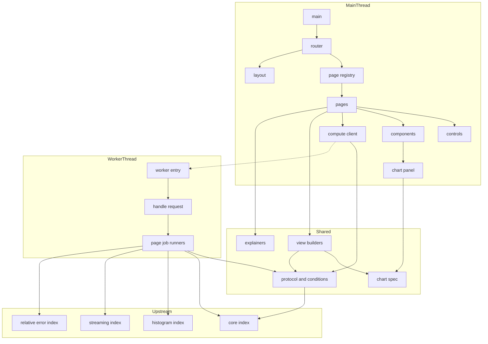
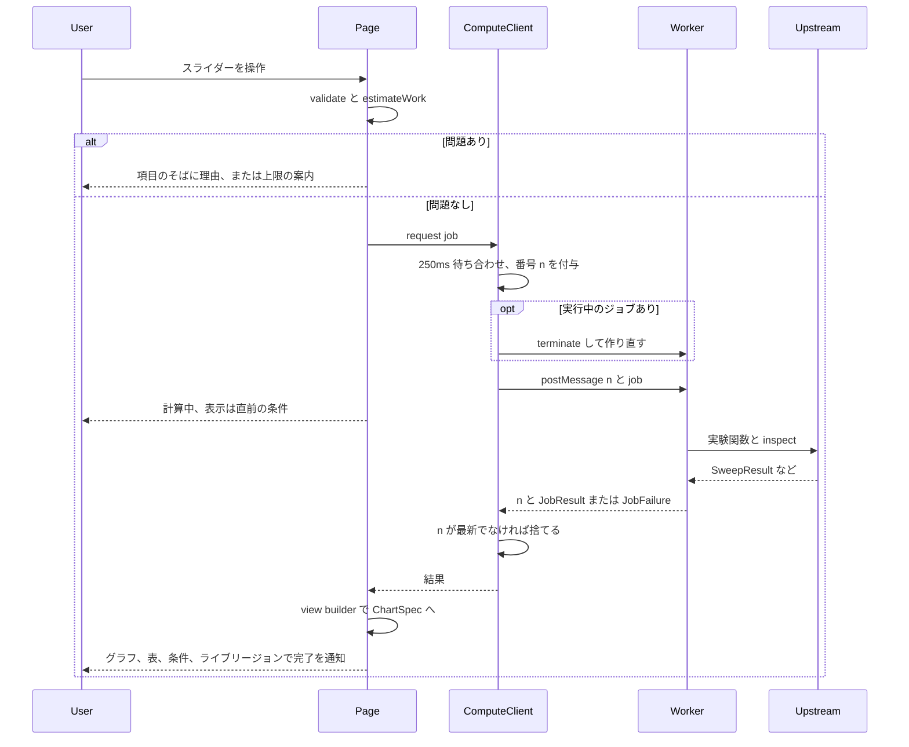
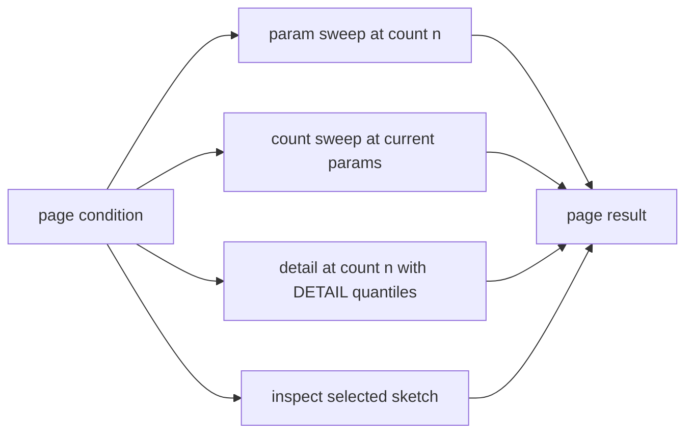

# Design Document

## Overview
Percentile Lab Site は、percentile-lab-core と 3 つのアルゴリズム系統(histogram-percentile、streaming-quantile-sketches、relative-error-sketches)の公開入口を、ブラウザで操作できる学習サイトにまとめる。利用者は分布・件数・シード・挿入順序・アルゴリズムのパラメータを操作し、誤差・操作数・メモリ見積もり・内部状態の変化をグラフと表で確かめる。横断比較ビューでは、系統をまたいだ手法に同じデータを与えた結果を並べる。各アルゴリズムの定義・保証・計算量・向き不向きを日本語で解説する。

**Purpose**: アルゴリズムの実装を、パラメータを動かしながら誤差と費用の出方を体感できる学習の場にする。
**Users**: 学習コンテンツの作者本人が、各系統の挙動の確認、系統をまたいだ比較、学習記録の読み返しに使う。
**Impact**: `index.html`、`src/site/` 配下、`scripts/check-bundle-size.mjs`、`scripts/check-main-modules.mjs`、型チェックの構成 2 つを新規に追加し、`package.json`、`tsconfig.json`、`vite.config.ts` を拡張する。`src/core/`、`src/histogram/`、`src/streaming/`、`src/relative-error/`、`docs/` は変更しない。

### Goals
- 静的配信だけで動く 5 ページのサイトと共通のレイアウト・ナビゲーション(1.1〜1.8)。
- 実験条件の操作部品、検証、既定値、条件の保持(2.1〜2.9)。
- 重い計算を Worker に移し、最新の条件の結果だけを表示する(3.1〜3.7)。
- 系統別の 3 ページと横断比較ビューのグラフ・表・内部状態の表示(4.x、5.x、6.x、8.x)。
- 軸・指標・注記の共通の規則(7.1〜7.8)、解説(9.1〜9.6)、アクセシビリティと画面幅(10.1〜10.8)、組み立てと総合確認(11.1〜11.6)。

### Non-Goals
- アルゴリズム、誤差指標、操作数・メモリ見積もり、データ生成の実装と定義(上流の所掌)。
- 新しいアルゴリズム、sketch のマージの実演、条件の URL への保存、結果の書き出し、テーマ切り替え、多言語。
- サーバー側の処理、永続化、認証、E2E の自動テスト。

## Boundary Commitments

### This Spec Owns
- サイトの配信物の構成: `index.html`、ハッシュによるルーティング、5 ページの登録(`PageModule`)、共通のレイアウト、存在しないページの表示。
- 実験条件の型(`DataCondition` と各ページの条件)、既定値、サイトとしての上限(件数 100〜1,000,000、計算量の上限)、サイトとしての検証。
- パラメータの格子(パラメータ軸・件数軸に使う値の一覧)と分位点の集合(要約用、詳細用)。
- メインスレッドと Worker の間の通信の型(`JobRequest`、`JobResult`、`JobFailure`、メッセージ)と、最新の条件だけを表示する規則(待ち合わせ、打ち切り)。
- Worker の中で上流の公開入口を呼び出す組み立て(ページごとのジョブの実行)と、上流のエラーから `JobFailure` への変換。横断比較の `SketchSpec` の並べ方、ヒストグラムの範囲(データの最小値・最大値)と HDR の自動範囲の決め方、バケットの総数が上限を超える有効桁数の除外。
- 上流の結果から表示用の仕様(`ChartSpec`、表、代替テキスト)への変換、誤差の指標・分位点の選択、対数軸の扱い、数値の書式。
- Chart.js の部品登録と描画、操作部品、状態表示、アクセシビリティ、画面幅への対応、スタイル。
- 解説の文章とページの手引き(`src/site/content/`)。
- サイトの組み立て(`vite build`)、bundle の大きさの確認、メインスレッドの bundle に上流のモジュールが入っていないことの確認、総合確認(`verify`)の拡張。

### Out of Boundary
- GK、KLL、t-digest、DDSketch、HDR Histogram、ヒストグラム、厳密解の論理、`inspect()` の内容、`SketchSpec` の `id`・`params` の規則、設定の許容範囲とその検証(上流の所掌。サイトは呼び出して結果を表示するだけ)。
- 誤差(絶対・順位・相対)、操作数、メモリ見積もり、処理時間の計測と定義(core の所掌)。サイトは `QueryRecord` と `AlgorithmResult` の値を計算し直さない。
- データ生成の乱数・分布の規則(core の `generate`)。
- 上流の文書(`docs/`)の内容。サイトの解説は要約し、詳しい文書は名前で示す。

### Allowed Dependencies
- 上流の公開入口だけ: `src/core/index.ts`、`src/histogram/index.ts`、`src/streaming/index.ts`、`src/relative-error/index.ts`。内部ファイルの import は禁止。
- 実行時依存: `chart.js@4.5.1`(MIT、推移的に `@kurkle/color`、MIT)。開発時依存: `happy-dom@20.14.5`(MIT)。それ以外は追加しない。
- サイト内の依存方向(左から右への import だけを許す):
  `shared` → `content` → `worker` / `ui`
  - `shared`: 上流の公開入口を `import type` でだけ参照する(実行時の import は禁止)。DOM と Worker の API を使わない。`shared` は `ui` からメインスレッドの bundle に入るため、上流の実行時の値(定数、関数)を 1 つでも import すると、上流の `index.ts` を経てアルゴリズムのコードがメインの bundle に入りうる(11.5 と「アルゴリズムは Worker の bundle だけ」の規則に反する)。
    - 上流の定数(`EPSILON_RANGE`、`K_RANGE`、`COMPRESSION_RANGE`、`SCALE_FUNCTIONS`、`MAX_BUCKETS`、`DEFAULT_MAX_BUCKETS`、`MAX_DD_BUCKETS`、`MAX_HDR_BUCKETS`)は `shared/limits.ts` に同じ値を書き写し、`limits.test.ts`(node のテスト。bundle に入らない)で上流の公開入口の値と等しいことを確かめる。上流の値が変わればテストが失敗する。
    - core の `seriesByAlgorithm` は呼ばず、`shared/series.ts` の `groupByAlgorithm` が同じ規則(件数の昇順の run を順に見て、`AlgorithmResult.id` ごとに初出順で集める)で系列化する。`series.test.ts` で、実際の上流の結果に対して `seriesByAlgorithm` と同じ並び・同じ値になることを確かめる。
  - `content`: 何も import しない(`shared` の型を除く)。
  - `worker`: `shared` と上流の公開入口を import する(実行時の import を許す唯一の層)。`ui` と `content` を import しない。
  - `ui`: `shared`、`content`、Chart.js を import する。上流を直接 import せず(型も `shared` 経由)、`worker` のモジュールを import しない(`worker-factory.ts` の `new URL('../../worker/entry.ts', import.meta.url)` だけが Worker を参照する)。`main.ts` も同じ規則に従う。
  - 機械的な確認: (1) `src/site/import-rules.test.ts`(node)が `src/site/shared/**`、`src/site/content/**`、`src/site/ui/**`、`src/site/main.ts` の `*.test.ts` 以外のソースを読み、上流(`core`、`histogram`、`streaming`、`relative-error`)への `import type` 以外の import と `export … from` がないことを確かめる。(2) 組み立て後に `scripts/check-main-modules.mjs` が、メインスレッドの bundle を構成するモジュールの一覧に `src/core/`、`src/histogram/`、`src/streaming/`、`src/relative-error/` のファイルが 1 つもないことを確かめる(BuildConfig)。
- `ui` の中: `components`・`controls` → `pages` → `page-registry` → `router`・`layout` → `main.ts`。`compute` は `components` と同じ段で、`pages` から使う。

### Revalidation Triggers
このサイトは最下流で、他の spec からの利用はない。次の変更は、このサイトの再確認が必要になる(上流の Revalidation Triggers の転記)。
- core: `BenchmarkResult`、`SweepResult`、`AlgorithmResult`、`QueryRecord` の構造と `schemaVersion`、`runSweep`・`seriesByAlgorithm` の並び、`generate` の検証と `GenerateError`、`HarnessError`。
- histogram: `runBucketExperiment` の入出力、`histogramSpec` の `id`・`params`、`MAX_BUCKETS`、`ExperimentError`・`SchemeError`。
- streaming: `runStreamingExperiment` の入出力と `meta`、`streamingSketchSpec` と `StreamingSketchConfig`、`GkState`・`KllState`・`TDigestState`、`EPSILON_RANGE`・`K_RANGE`・`COMPRESSION_RANGE`・`SCALE_FUNCTIONS`、`ConfigError`・`StreamingExperimentError`。
- relative-error: `runRelativeErrorExperiment` の入出力(`RelativeErrorExperimentSpec` の `alphas`・`maxBucketsList`・`significantDigitsList` の項目名を含む)と `BucketStatsRecord`、`ddsketchSpec`・`hdrSpec` の `id`・`params`、`createHdrLayout`・`HdrLayout`(`subBucketCount`、`totalBuckets`)と総数の上限の検証、`DDSketchSnapshot`・`HdrSnapshot`・`BucketView`、`DEFAULT_MAX_BUCKETS`・`MAX_DD_BUCKETS`・`MAX_HDR_BUCKETS`、`ConfigError`・`RelativeErrorExperimentError` とその `field` の書式(`invalid-config` は設定の項目名、`invalid-experiment` は実験の項目名)。
- 全系統: `AlgorithmResult.id` の書式(`exact-sort-<定義>`、`exact-quickselect-<定義>`、`histogram-<kind>-<buckets>`、`gk-eps-<ε>`、`kll-k-<k>`、`tdigest-<scale>-c<δ>`、`ddsketch-a<α>-m<m>`、`hdr-d<d>`)。サイトは `id` の接頭辞で手法の系統を決める(Series の `familyOf`)ので、書式が変わったら系列の分け方を確認し直す。上流の定数の値(`limits.ts` に書き写した値)。
- このサイト内: `JobRequest`・`JobResult` の変更は、`worker` と `ui` の両方を同時に確認する。

## Architecture

### Existing Architecture Analysis
- 上流は `src/<系統>/index.ts` だけを公開し、DOM 非依存の純粋な TypeScript で、`Result` でエラーを返す。結果は core の `SweepResult` / `BenchmarkResult` の形で、`JSON.stringify` に通せる(Worker の `postMessage` の構造化複製にもそのまま通る)。
- 既存の `tsconfig.json` は `lib: ["ES2023"]`、`types: ["node"]` で DOM を含めない。アルゴリズムの DOM 非依存をこの構成で守っているため、サイトの DOM・Worker コードは別の構成で検査する。
- `vite.config.ts` は `vitest/config` の `defineConfig` で、テストは node 環境・`src/**/*.test.ts`。core の設計で、アプリのエントリの追加とこのファイルの拡張はサイト基盤 spec の担当とされている。
- steering の `product.md`、`tech.md`、`structure.md` は未作成である。`roadmap.md` の制約(Node.js 22.12 以上、UI フレームワーク不使用、Chart.js 4.x の部品登録、許容ライセンス、日本語)に従う。

### Architecture Pattern & Boundary Map
選択したパターンは、DOM 非依存の共有層(shared)、計算層(worker)、表示層(ui)の 3 層である。計算と表示は、型付きのメッセージだけでつながる。



**Architecture Integration**:
- 選択したパターン: 3 層。計算は Worker、表示はメインスレッド、両者が共有する型と変換は DOM 非依存の shared に置き、node のテストで検証する。
- 境界の分け方: `worker` は上流を呼ぶだけで表示を知らない。`ui` は上流の実装を知らず、`JobResult` と `ChartSpec` だけを扱う。ページごとの差は「条件の型」「ジョブの実行」「表示の変換」「ページの部品配置」の 4 か所に閉じ、ページ同士は互いを import しない。
- 維持するパターン: 上流の `index.ts` だけの import、`Result` による入力エラー、DOM 非依存コードの node テスト。
- 新規コンポーネントの理由: Worker の分離(3.1)、最新の条件だけの表示(3.3)、表示仕様の一般化(7.x、10.3)、上流の結果の構造を変えずに表示へ変換する層(7.7)。

### Technology Stack

| Layer | Choice / Version | Role in Feature | Notes |
|-------|------------------|-----------------|-------|
| 言語 | TypeScript 7.0.2(既存) | 3 つの構成で型チェック | `any` を使わない |
| 組み立て | Vite 8.3.5(既存) | 開発サーバー、静的な配信物、Worker の bundle | `base: './'`、`worker.format: 'es'` |
| グラフ | Chart.js 4.5.1(新規、MIT) | 折れ線、散布図、棒、線形・対数軸 | 部品だけを `Chart.register`。`chart.js/auto` は使わない |
| 計算の分離 | Web Worker(モジュール) | 上流の実験関数の実行 | `new Worker(new URL(...), { type: 'module' })` |
| テスト | Vitest 5.0.5(既存)、happy-dom 20.14.5(新規、開発時のみ、MIT) | shared・worker は node、ui は happy-dom | DOM テストはファイル単位で環境を指定 |
| 実行環境 | Node.js 22.12 以上(既存)、モダンブラウザ(モジュール Worker 対応) | 開発と配信 | 静的配信(GitHub Pages 等) |

## File Structure Plan

### Directory Structure
```
index.html                         # エントリ。<div id="app"> と src/site/main.ts の読み込み、lang="ja"
scripts/
├── check-bundle-size.mjs          # dist/ の .js を gzip して合計が 200 KB 以下か確かめる(Node 標準の zlib)
└── check-main-modules.mjs         # dist/.vite/main-modules.json を読み、メインの bundle に上流のモジュールがないか確かめる
tsconfig.site.json                 # DOM 用。src/site/main.ts、src/site/ui/**、src/site/shared/**、src/site/content/**
tsconfig.worker.json               # WebWorker 用。src/site/worker/**、src/site/shared/**
src/site/
├── main.ts                        # 起動: スタイル読み込み、chart-setup、router の開始
├── shared/                        # DOM・Worker の API を使わない。ルートの tsconfig でも検査する
│   ├── conditions.ts              # DataCondition、各ページの条件型、DEFAULT_* の既定値、DistributionPreset
│   ├── limits.ts                  # COUNT_RANGE、SEED_RANGE、WORK_LIMIT、TRIALS_RANGE、上流の定数の書き写し(上流と等しいことを limits.test.ts で確認)
│   ├── grids.ts                   # パラメータの格子、件数の格子、SUMMARY_QUANTILES、DETAIL_QUANTILES、REFERENCE_DEFINITION
│   ├── validate.ts                # サイトとしての条件の検証 → FieldIssue[]
│   ├── workload.ts                # estimateWork(job, hdr?) と上限の判定(HDR のバケットの総数の項を含む)
│   ├── protocol.ts                # JobRequest、JobResult、JobFailure、WorkerRequestMessage、WorkerResponseMessage
│   ├── format.ts                  # 有効数字 3 桁、桁区切りの整数、単位つきの表示
│   ├── metric.ts                  # ErrorSelection(指標と分位点)、QueryRecord から誤差の値を選ぶ
│   ├── chart-spec.ts              # ChartSpec 型、prepareForScale(対数軸の 0 以下の除外と注記)、表と代替テキストの生成
│   ├── series.ts                  # 共通の系列化: groupByAlgorithm、familyOf、パラメータ軸、件数軸、分位点軸、メモリと誤差、失敗の注記
│   └── views/
│       ├── histogram-view.ts      # HistogramPageResult → ChartSpec[]
│       ├── streaming-view.ts      # StreamingPageResult → ChartSpec[] と内部状態の表示モデル
│       ├── relative-view.ts       # RelativePageResult → ChartSpec[] と縮約・バケットの表示モデル
│       └── compare-view.ts        # CompareResult → ChartSpec[] と比較表
├── import-rules.test.ts           # shared・content・ui・main.ts が上流を import type でだけ参照することの確認
├── content/
│   ├── algorithms.ts              # 9 項目の AlgorithmExplainer(定義、保証、計算量、向き不向き、注意、文書名)
│   └── guides.ts                  # ページごとの手引き、トップページの概要とグラフの読み方
├── worker/
│   ├── entry.ts                   # self.onmessage → handleRequest → postMessage(唯一 Worker の API を触る)
│   ├── handle-request.ts          # JobRequest の振り分け、検証と上限の再確認、例外の捕捉
│   ├── error-map.ts               # 上流のエラー → JobFailure
│   ├── data-extent.ts             # データの最小値・最大値、HDR の自動範囲と有効桁数の除外(planHdr)
│   ├── run-histogram-page.ts      # runBucketExperiment を 3 回(パラメータ、件数、詳細)
│   ├── run-streaming-page.ts      # runStreamingExperiment を 3 回 + 内部状態(createGk / createKll / createTDigest の inspect)
│   ├── run-relative-page.ts       # runRelativeErrorExperiment を 3 回 + 内部状態(createDDSketch / createHdrHistogram の inspect)
│   └── run-compare.ts             # xxxSpec で SketchSpec を並べ、core の runSweep を 2 回(件数軸、詳細)
└── ui/
    ├── router.ts                  # ハッシュ → PageModule、hashchange、存在しないページ
    ├── layout.ts                  # 見出し、ナビゲーション(現在のページを aria-current)、本文の枠、ライブリージョン
    ├── page-registry.ts           # PAGES: PageModule[](5 ページ + 見つからないページ)
    ├── condition-store.ts         # ページごとの最後の条件をメモリに保持
    ├── compute/
    │   ├── compute-client.ts      # 待ち合わせ、番号付け、打ち切り(terminate)、結果の配送
    │   └── worker-factory.ts      # new Worker(new URL('../../worker/entry.ts', import.meta.url), { type: 'module' })
    ├── controls/
    │   ├── slider.ts              # range + 数値表示 + aria-valuetext、離散値(格子)対応
    │   ├── choice.ts              # select とラジオ・チェックボックスの群
    │   ├── number-field.ts        # 数値入力(シード、範囲の下限・上限など)
    │   ├── distribution-editor.ts # 分布の種類とパラメータの入力
    │   └── field-errors.ts        # 項目のそばの理由表示(aria-describedby)
    ├── components/
    │   ├── chart-setup.ts         # Chart.register(使う部品だけ)
    │   ├── chart-panel.ts         # ChartSpec → 描画、軸の切り替え、表、代替テキスト、描画層の差し替え
    │   ├── status-bar.ts          # 計算中・古い結果・失敗・再実行、ライブリージョンへの通知
    │   ├── condition-summary.ts   # 表示中の結果の条件
    │   ├── error-selector.ts      # 指標と分位点の選択
    │   ├── state-table.ts         # 内部状態・バケットの表(行数の上限と省略の表示)
    │   └── explainer.ts           # AlgorithmExplainer と手引きの表示
    ├── pages/
    │   ├── page-kit.ts            # 各ページ共通の骨組み(操作部品の列、結果の列、状態、compute の配線)
    │   ├── home-page.ts
    │   ├── histogram-page.ts
    │   ├── streaming-page.ts
    │   ├── relative-page.ts
    │   ├── compare-page.ts
    │   └── not-found-page.ts
    └── styles/
        └── site.css               # 色とコントラストのトークン、フォーカス、2 列/1 列のレイアウト、reduced-motion
```

テストは対象の隣に `*.test.ts` で置く。`ui/` のテストはファイルの先頭に `// @vitest-environment happy-dom` を付ける。

### Modified Files
- `package.json` — `dependencies` に `chart.js: 4.5.1`、`devDependencies` に `happy-dom: 20.14.5`。`scripts` に `dev: vite`、`build: vite build`、`preview: vite preview`、`size:check: node scripts/check-bundle-size.mjs`、`bundle:check: node scripts/check-main-modules.mjs`。`typecheck` を `tsc --noEmit && tsc --noEmit -p tsconfig.site.json && tsc --noEmit -p tsconfig.worker.json` に、`verify` を `npm run typecheck && npm test && npm run build && npm run size:check && npm run bundle:check && npm run licenses:check` に変える。
- `tsconfig.json` — `exclude` に `src/site/ui/**`、`src/site/main.ts`、`src/site/worker/entry.ts` を加える(DOM のコードと、Worker の API を触る唯一のファイルを ES2023 だけの構成から外す)。`src/site/shared/`、`src/site/content/`、`src/site/worker/` の他のファイルは DOM・Worker の API を使わないので、ルートの構成でも検査する。それ以外の設定は変えない。
- `vite.config.ts` — `base: './'`、`build: { outDir: 'dist', target: 'es2022' }`、`worker: { format: 'es' }` と、メインの bundle のモジュールの一覧を書き出す小さなプラグイン(`plugins` に置く。BuildConfig)を加える。`test` の設定(node 環境、`src/**/*.test.ts`)は変えない。

## System Flows

### 条件の変更から表示まで(2.4、3.1〜3.7)

- 打ち切り: 新しい要求の時点で実行中なら Worker を `terminate()` し、次の要求のときに作り直す。ページを離れるときは `dispose()` で終了する(3.7)。
- 失敗: `JobFailure` または Worker の `error` イベントで、状態を失敗にし、直前の結果は残して再実行ボタンを出す(3.6)。

### ページのジョブの中身

- ヒストグラムのページは内部状態を持たない(上流に `inspect()` がない)。横断比較は件数軸と詳細だけ。

## Requirements Traceability

| Requirement | Summary | Components | Interfaces | Flows |
|-------------|---------|------------|------------|-------|
| 1.1 | 静的配信のみ | ViteConfig、Router | `base: './'`、ハッシュ | — |
| 1.2 | 5 ページ | PageRegistry | `PAGES` | — |
| 1.3 | 共通のナビゲーション | Layout | `renderLayout` | — |
| 1.4 | 直接アクセスと再読み込み | Router | `resolveRoute` | — |
| 1.5 | サブパス配置 | ViteConfig、Router | 相対の配信物、ハッシュ | — |
| 1.6 | 見つからないページ | Router、NotFoundPage | `resolveRoute` | — |
| 1.7 | トップページ | HomePage、Guides | `HOME_CONTENT` | — |
| 1.8 | 日本語 | 全ページ、Content | — | — |
| 2.1 | 共通の条件の操作 | DistributionEditor、PageKit、Conditions | `DataCondition` | — |
| 2.2 | スライダーと値の表示 | Slider | `createSlider` | — |
| 2.3 | 件数 100〜1,000,000 | Limits、Slider | `COUNT_RANGE` | — |
| 2.4 | 初回の既定条件 | Conditions、PageKit | `DEFAULT_*` | 条件の変更 |
| 2.5 | 受け付けない値の理由 | Validate、ErrorMap、FieldErrors | `FieldIssue`、`JobFailure` | 条件の変更 |
| 2.6 | 既定に戻す | PageKit、Conditions | `DEFAULT_*` | — |
| 2.7 | 同じ条件で同じ結果 | Runners、Grids | シードの受け渡し | — |
| 2.8 | 条件の表示 | ConditionSummary | `describeCondition` | — |
| 2.9 | 条件の保持 | ConditionStore | `ConditionStore` | — |
| 3.1 | 操作を止めない | ComputeClient、WorkerEntry | `ComputeClient` | 条件の変更 |
| 3.2 | 計算中と古い結果 | StatusBar | `ComputeStatus` | 条件の変更 |
| 3.3 | 最新の結果だけ | ComputeClient | `requestId` | 条件の変更 |
| 3.4 | 待ち合わせ | ComputeClient | `DEBOUNCE_MS` | 条件の変更 |
| 3.5 | 計算量の上限 | Workload、PageKit、HandleRequest、DataExtent | `estimateWork`(HDR の項)、`WORK_LIMIT`、`planHdr` | 条件の変更 |
| 3.6 | 失敗と再実行 | ComputeClient、StatusBar | `JobFailure`、`retry` | 条件の変更 |
| 3.7 | 移動で打ち切り | ComputeClient、PageKit | `dispose` | 条件の変更 |
| 4.1 | 対象の手法 | RunHistogramPage | `HistogramPageCondition` | ページのジョブ |
| 4.2 | バケットと範囲の操作 | HistogramPage | `HistogramPageCondition` | — |
| 4.3 | バケット数ごとの誤差 | RunHistogramPage、HistogramView | `buildHistogramCharts` | ページのジョブ |
| 4.4 | 件数ごとの操作数とメモリ | RunHistogramPage、HistogramView、Series | `countAxisSeries` | ページのジョブ |
| 4.5 | 累積分布と推定値 | HistogramView | `cdfChart` | — |
| 4.6 | 範囲外のヒストグラム | Series、HistogramView | `unavailableNotes` | — |
| 5.1 | 対象と選択 | StreamingPage、RunStreamingPage | `StreamingPageCondition` | ページのジョブ |
| 5.2 | パラメータの操作 | StreamingPage | `StreamingPageCondition` | — |
| 5.3 | パラメータごとの誤差とメモリ | RunStreamingPage、StreamingView | `paramAxisSeries` | ページのジョブ |
| 5.4 | メモリと誤差の関係 | StreamingView、Series | `tradeoffSeries` | — |
| 5.5 | 分位点ごとの誤差 | StreamingView、Series | `quantileAxisSeries` | — |
| 5.6 | 挿入順序の比較 | RunStreamingPage、StreamingView | `orderComparisonChart` | ページのジョブ |
| 5.7 | KLL の試行のばらつき | RunStreamingPage、StreamingView | `trialDispersionChart` | ページのジョブ |
| 5.8 | 内部状態 | RunStreamingPage、StreamingView、StateTable | `StreamingInspection` | ページのジョブ |
| 5.9 | ε の基準線 | StreamingView | `ReferenceLine` | — |
| 6.1 | 対象と選択 | RelativePage、RunRelativePage | `RelativePageCondition` | ページのジョブ |
| 6.2 | 設定の操作 | RelativePage | `RelativePageCondition` | — |
| 6.3 | 分位点ごとの相対誤差、α と 1/S、保証の始まり | RelativeView、DataExtent | `ReferenceLine`、`HdrDigitsInfo` | — |
| 6.4 | α・有効桁数ごと、除いた有効桁数 | RunRelativePage、DataExtent、RelativeView | `bucketStats` の系列、`planHdr`、`hdrNotices` | ページのジョブ |
| 6.5 | 縮約の表示 | RelativeView | `CollapseNotice` | — |
| 6.6 | バケットの状態 | RunRelativePage、RelativeView、StateTable | `RelativeInspection` | ページのジョブ |
| 6.7 | 範囲外の HDR | Series、RelativeView | `unavailableNotes` | — |
| 6.8 | 件数ごとのメモリと操作数 | RunRelativePage、RelativeView | `countAxisSeries` | ページのジョブ |
| 7.1 | 線形と対数 | ChartPanel、ChartSpec | `AxisSpec.scale` | — |
| 7.2 | 指標と分位点の選択 | ErrorSelector、Metric | `ErrorSelection` | — |
| 7.3 | 軸の名前と単位 | ChartSpec、ChartPanel | `AxisSpec` | — |
| 7.4 | 点の詳細 | ChartPanel | Tooltip、表 | — |
| 7.5 | 失敗を 0 にしない | Series | `unavailableNotes` | — |
| 7.6 | 対数軸の 0 以下 | ChartSpec | `prepareForScale` | — |
| 7.7 | 上流の値をそのまま | Metric、Series | `pickError` | — |
| 7.8 | 数値の書式 | Format | `formatSig3`、`formatInt` | — |
| 8.1 | 対象の選択とパラメータ | ComparePage、Conditions | `CompareCondition` | — |
| 8.2 | 同じデータ | RunCompare | `runSweep` に 1 つのデータ | ページのジョブ |
| 8.3 | 誤差・メモリ・操作数・時間 | CompareView | `comparisonTable` | — |
| 8.4 | 分位点ごとの重ね描き | CompareView、Series | `quantileAxisSeries` | — |
| 8.5 | 件数ごとのメモリと時間 | RunCompare、CompareView | `countAxisSeries` | ページのジョブ |
| 8.6 | 時間は参考値 | ComparePage、Guides | 注記 | — |
| 8.7 | 対象なし | Validate、ComparePage | `FieldIssue` | — |
| 8.8 | 扱えないデータ | Series、CompareView、RunCompare、DataExtent | `unavailableNotes`、`hdrPlan.excluded` | ページのジョブ |
| 9.1 | 4 項目の解説 | Algorithms、Explainer | `AlgorithmExplainer` | — |
| 9.2 | 同じページに配置 | Pages、Explainer | `PageModule.explainers` | — |
| 9.3 | 上流と矛盾しない | Algorithms | 内容の確認 | — |
| 9.4 | 簡略化と保証の例外 | Algorithms | `caveats` | — |
| 9.5 | 文書の名前 | Algorithms | `docRefs` | — |
| 9.6 | 手引き | Guides、Explainer | `PAGE_GUIDES` | — |
| 10.1 | キーボード操作とフォーカス | Controls、SiteCss | ネイティブの入力部品 | — |
| 10.2 | 名前と値 | Slider、Choice、NumberField | `label`、`aria-valuetext` | — |
| 10.3 | 代替テキストと表 | ChartSpec、ChartPanel | `toTable`、`altText` | — |
| 10.4 | 色以外の区別 | ChartPanel | `SERIES_STYLES` | — |
| 10.5 | コントラスト | SiteCss | 色のトークン | — |
| 10.6 | 状態の通知 | StatusBar、Layout | ライブリージョン | — |
| 10.7 | 動きを減らす | ChartPanel、SiteCss | `prefers-reduced-motion` | — |
| 10.8 | 画面幅 | SiteCss、ChartPanel | 768px の切り替え | — |
| 11.1 | 総合確認 | PackageScripts | `verify` | — |
| 11.2 | 組み立て | ViteConfig、PackageScripts | `build` | — |
| 11.3 | 許容ライセンス | PackageScripts | `licenses:check` | — |
| 11.4 | 外部通信なし | SiteCss、IndexHtml | 外部の読み込みなし | — |
| 11.5 | 圧縮後 200 KB | BundleSizeCheck、MainModulesCheck、ImportRules、ChartSetup | `size:check`、`bundle:check`、`import-rules.test.ts` | — |
| 11.6 | 既存のテストを変えない | TsconfigRoot、PackageScripts | `npm test` | — |

## Components and Interfaces

| Component | Domain/Layer | Intent | Req Coverage | Key Dependencies (P0/P1) | Contracts |
|-----------|--------------|--------|--------------|--------------------------|-----------|
| Conditions・Limits・Grids | shared | 条件の型、既定値、上限(上流の定数の書き写し)、格子 | 2.1, 2.3, 2.4, 2.6, 2.7, 4.2, 5.2, 6.2, 8.1, 11.5 | 上流の型 (P0、`import type` のみ) | State |
| Validate | shared | サイトとしての検証 | 2.5, 8.7 | Conditions (P0) | Service |
| Workload | shared | 計算量の見積もりと上限(HDR のバケットの総数の項を含む) | 3.5 | Grids (P0) | Service |
| Protocol | shared | Worker との通信の型 | 3.3, 3.6 | 上流の結果の型 (P0) | Event |
| Format・Metric | shared | 書式、誤差の選択 | 7.2, 7.7, 7.8 | core `QueryRecord` (P0) | Service |
| ChartSpec・Series | shared | 表示の仕様と共通の系列化 | 4.4, 4.6, 5.4, 5.5, 6.7, 7.1, 7.3, 7.5, 7.6, 8.4, 8.8, 10.3, 11.5 | core の結果の型 (P0、`import type` のみ。`seriesByAlgorithm` と同じ規則を自前で持つ) | Service |
| Views(4 種) | shared | ページの結果 → ChartSpec | 4.3〜4.6, 5.3〜5.9, 6.3〜6.8, 8.3〜8.5 | Series (P0) | Service |
| Algorithms・Guides | content | 解説と手引き | 1.7, 8.6, 9.1〜9.6 | なし | State |
| WorkerEntry・HandleRequest・ErrorMap | worker | 要求の受け付け、振り分け、エラーの変換 | 2.5, 3.1, 3.5, 3.6 | Protocol (P0) | Event, Service |
| DataExtent | worker | データの範囲、HDR の自動範囲、上限を超える有効桁数の除外 | 3.5, 6.2, 6.3, 6.4, 8.2, 8.8 | core `generate` (P0)、relative-error `createHdrLayout` (P0) | Service |
| RunHistogramPage | worker | ヒストグラムのページのジョブ | 2.7, 4.1, 4.3, 4.4, 4.5 | histogram `runBucketExperiment` (P0) | Batch |
| RunStreamingPage | worker | ストリーミングのページのジョブ | 2.7, 5.1, 5.3, 5.5〜5.8 | streaming の実験と作成関数 (P0) | Batch |
| RunRelativePage | worker | 相対誤差型のページのジョブ | 2.5, 2.7, 3.5, 6.1, 6.3〜6.8 | relative-error の実験と作成関数 (P0) | Batch |
| RunCompare | worker | 横断比較のジョブ | 2.7, 3.5, 8.2, 8.3, 8.5, 8.8 | core `runSweep`、各 `xxxSpec` (P0) | Batch |
| ComputeClient・WorkerFactory | ui | 待ち合わせ、最新だけの配送、打ち切り | 3.1〜3.4, 3.6, 3.7 | Protocol (P0) | Service, State |
| Router・Layout・PageRegistry・ConditionStore | ui | ページ構成と移動、条件の保持 | 1.2〜1.6, 1.8, 2.9, 10.6 | Pages (P0) | Service, State |
| Controls | ui | 操作部品 | 2.1, 2.2, 2.5, 10.1, 10.2 | Limits (P0) | Service |
| ChartPanel・ChartSetup | ui | 描画、軸の切り替え、表 | 7.1, 7.3, 7.4, 10.3, 10.4, 10.7, 10.8, 11.5 | Chart.js (P0), ChartSpec (P0) | Service |
| StatusBar・ConditionSummary・ErrorSelector・StateTable・Explainer | ui | 状態、条件、選択、表、解説の表示 | 2.8, 3.2, 3.6, 5.8, 6.6, 7.2, 9.2, 10.6 | Format (P0) | — |
| PageKit・Pages | ui | 各ページの組み立て | 1.7, 2.4, 2.6, 3.5, 3.7, 4.x, 5.x, 6.x, 8.x | 上記すべて (P0) | — |
| SiteCss・IndexHtml | ui | スタイルとエントリ | 1.8, 10.1, 10.5, 10.7, 10.8, 11.4 | なし | — |
| BuildConfig(ViteConfig、Tsconfig 3 種、PackageScripts、BundleSizeCheck、MainModulesCheck、ImportRules) | infra | 組み立てと総合確認、メインの bundle に上流のコードがないことの確認 | 1.1, 1.5, 11.1〜11.6 | Vite、TypeScript (P0) | Batch |

### shared

#### Conditions・Limits・Grids

**Responsibilities & Constraints**
- 条件はすべて JSON にでき、`postMessage` で送れる平坦な値と配列からなる。
- 既定値: 分布は対数正規(`mu = 0`、`sigma = 1`)、件数 10,000、シード 1、順序 `random`。各ページの既定は下の型のコメントのとおり。
- 上限: `COUNT_RANGE = { min: 100, max: 1_000_000 }`(整数)、`SEED_RANGE = { min: 0, max: 2^32 − 1 }`(整数)、`TRIALS_RANGE = { min: 1, max: 10 }`、`WORK_LIMIT = 40_000_000`。アルゴリズムのパラメータの範囲は上流の定数(`EPSILON_RANGE`、`K_RANGE`、`COMPRESSION_RANGE`、`SCALE_FUNCTIONS`、`MAX_BUCKETS`、`DEFAULT_MAX_BUCKETS`、`MAX_DD_BUCKETS`、`MAX_HDR_BUCKETS`)と同じ値を `limits.ts` に書き写して使う(メインの bundle に上流の実行時コードを入れないため。Allowed Dependencies)。値は独自に決めず、`limits.test.ts` が上流の公開入口から import した値と等しいことを確かめる。有効桁数は 0〜5。
- 分位点: `SUMMARY_QUANTILES = [0.001, 0.01, 0.1, 0.25, 0.5, 0.75, 0.9, 0.99, 0.999]`、`DETAIL_QUANTILES = [0, 0.001, 0.005, 0.01, 0.02, …, 0.99(0.01 刻み), 0.995, 0.999, 1]`。基準の定義は `REFERENCE_DEFINITION = 'nearest-rank'`。
- 格子(現在の値を必ず含め、昇順・重複なしにする):
  - 件数: `[100, 1_000, 10_000, 100_000, 1_000_000]` のうち現在の件数以下 ∪ {現在の件数}。
  - バケット数: `[4, 8, 16, 32, 64, 128, 256, 512, 1024, 2048, 4096]`。
  - ε: `[0.1, 0.05, 0.02, 0.01, 0.005, 0.002, 0.001]`。k: `[8, 16, 32, 64, 128, 256, 512, 1024]`。δ: `[10, 20, 50, 100, 200, 500, 1000]`。
  - α: `[0.1, 0.05, 0.02, 0.01, 0.005, 0.002, 0.001]`。有効桁数: `[0, 1, 2, 3, 4]` ∪ {現在の値}。
- スライダーの離散値: 件数は 1-2-5 の系列(100, 200, 500, …, 1,000,000)、他は上の格子の値と許容範囲の端を選べる。数値入力でも同じ範囲の任意の値を受け付ける。

**Contracts**: State [x]

```typescript
import type { DataOrder, Distribution } from '../../core';
import type { ScaleFunctionKind } from '../../streaming';

export interface DataCondition {
  readonly distribution: Distribution;
  readonly count: number;
  readonly seed: number;
  readonly order: DataOrder;
}

export type HistogramRangeMode = { readonly kind: 'data-extent' } | { readonly kind: 'fixed'; readonly lower: number; readonly upper: number };

export interface HistogramPageCondition {
  readonly data: DataCondition;
  /** 既定 32 */
  readonly buckets: number;
  /** 既定 ['equal', 'exponential'] */
  readonly schemes: readonly ('equal' | 'exponential')[];
  readonly range: HistogramRangeMode;
}

export type StreamingMethod = 'gk' | 'kll' | 'tdigest';

export interface StreamingPageCondition {
  readonly data: DataCondition;
  /** 既定 ['gk', 'kll', 'tdigest'] */
  readonly methods: readonly StreamingMethod[];
  /** 既定 0.01 */
  readonly epsilon: number;
  /** 既定 200 */
  readonly k: number;
  /** 既定 100 */
  readonly compression: number;
  /** 既定 ['k1'] */
  readonly scales: readonly ScaleFunctionKind[];
  /** 既定 1 */
  readonly trials: number;
  /** 内部状態を表示する手法。既定 'gk'。t-digest は scales の先頭を使う */
  readonly inspectTarget: StreamingMethod;
}

export type HdrRangeMode = { readonly kind: 'auto' } | { readonly kind: 'manual'; readonly lowest: number; readonly highest: number };

export interface RelativePageCondition {
  readonly data: DataCondition;
  /** 既定 ['ddsketch', 'hdr'] */
  readonly methods: readonly ('ddsketch' | 'hdr')[];
  /** 既定 0.01 */
  readonly alpha: number;
  /** 既定 DEFAULT_MAX_BUCKETS(2048) */
  readonly maxBuckets: number;
  /** 既定 2 */
  readonly significantDigits: number;
  readonly hdrRange: HdrRangeMode;
  /** 既定 'ddsketch' */
  readonly inspectTarget: 'ddsketch' | 'hdr';
}

export type CompareAlgorithm =
  | { readonly kind: 'exact-sort' }
  | { readonly kind: 'exact-quickselect' }
  | { readonly kind: 'histogram'; readonly scheme: 'equal' | 'exponential'; readonly buckets: number }
  | { readonly kind: 'gk'; readonly epsilon: number }
  | { readonly kind: 'kll'; readonly k: number }
  | { readonly kind: 'tdigest'; readonly compression: number; readonly scale: ScaleFunctionKind }
  | { readonly kind: 'ddsketch'; readonly alpha: number; readonly maxBuckets: number }
  | { readonly kind: 'hdr'; readonly significantDigits: number };

export interface CompareCondition {
  readonly data: DataCondition;
  /** 既定: 厳密解(整列)、ヒストグラム(指数幅, 64)、GK(0.01)、KLL(200)、t-digest(100, k1)、DDSketch(0.01, 2048)、HDR(2) */
  readonly algorithms: readonly CompareAlgorithm[];
  readonly hdrRange: HdrRangeMode;
}

export type PageId = 'home' | 'histogram' | 'streaming' | 'relative' | 'compare';

/** 条件を持つページと条件の型の対応(ConditionStore が使う) */
export interface PageConditionMap {
  readonly histogram: HistogramPageCondition;
  readonly streaming: StreamingPageCondition;
  readonly relative: RelativePageCondition;
  readonly compare: CompareCondition;
}
```
- 分布のプリセット(`DistributionPreset`): 種類ごとの既定のパラメータ。一様 `{1, 1000}`、正規 `{100, 15}`、対数正規 `{0, 1}`、重い裾 `{1, 1.5}`、多峰(2 山 `{1, 50, 5}`、`{1, 200, 20}`)。多峰の山は 2 個に固定し、各山の重み・平均・標準偏差を編集できる。

#### Validate

**Contracts**: Service [x]

```typescript
export interface FieldIssue {
  /** UI の項目の識別。例: 'data.count'、'data.distribution.sigma'、'epsilon'、'algorithms' */
  readonly field: string;
  readonly reason: string;
}

export function validateData(data: DataCondition): readonly FieldIssue[];
export function validateHistogramPage(c: HistogramPageCondition): readonly FieldIssue[];
export function validateStreamingPage(c: StreamingPageCondition): readonly FieldIssue[];
export function validateRelativePage(c: RelativePageCondition): readonly FieldIssue[];
export function validateCompare(c: CompareCondition): readonly FieldIssue[];
```
- 検査するのは、サイトが定める条件だけ: 件数の範囲と整数、シードの範囲と整数、試行の範囲、選択が 1 つ以上(`methods`、`schemes`、`scales`、`algorithms`。8.7)、`inspectTarget` が `methods` に含まれること、固定・手動の範囲の数値が有限の正の数で下限 < 上限、横断比較の `algorithms` に同じ種類・同じパラメータの重複がないこと(上流の `id` の重複を防ぐ)。
- 分布のパラメータとアルゴリズムの設定の条件は、サイトで検証し直さず、Worker の中で上流が返すエラー(`generate` の `invalid-parameter`、`invalid-config`、`invalid-scheme`)を `JobFailure` として受け取って項目に対応づける(2.5、境界)。

#### Workload

```typescript
export interface HdrWorkInput {
  /** 実行する有効桁数 → その範囲での HdrLayout.totalBuckets(除いた有効桁数は含めない) */
  readonly totalBuckets: ReadonlyMap<number, number>;
}

export interface WorkEstimate {
  /** 投入の項 Σ(データ件数 × その件数で動く sketch の数。厳密解を含む)+ HDR の項 */
  readonly units: number;
  /** HDR のバケットの総数の項を含めたか(hdr を渡したときだけ true) */
  readonly includesHdrTerm: boolean;
  readonly withinLimit: boolean;
  /** 上限を超えたときの減らし方の案内(日本語) */
  readonly suggestions: readonly string[];
}

export function estimateWork(job: JobRequest, hdr?: HdrWorkInput): WorkEstimate;
```
- 投入の項: パラメータの掃引(件数 n × (2 + 格子の手法数))+ 件数の掃引(Σ 件数の格子 × (2 + 現在の手法数))+ 詳細(n × (2 + 手法数) × 順序の数 × 試行の数)+ 内部状態(n × 1)。relative-error は観察のための再投入があるので DDSketch と HDR を 2 倍に数える。
- HDR の項(relative と compare。`hdr` を渡したときだけ): HDR は作成時に長さ `totalBuckets` の件数の配列を確保し、問い合わせ 1 回ごとに最大 `totalBuckets` 個を走査する(relative-error の設計の `memoryBytes`・`query` の規則)。これを件数によらない費用として、HDR のインスタンスごとに `totalBuckets × (1 + 答える分位点の数)` を足す。
  - relative: 実験の各件数・各有効桁数について、ハーネスのインスタンス(`totalBuckets × (1 + 分位点の数)`)と、観察のための再投入のインスタンス(`totalBuckets × 2`。確保と `inspect()` の走査)を数える。3 回の実験(パラメータの掃引は件数 n × 有効桁数の格子、件数の掃引は件数の格子 × 現在の有効桁数、詳細は件数 n × 現在の有効桁数で `DETAIL_QUANTILES`)すべてに足す。`inspectTarget` が `hdr` のときは内部状態のインスタンスの `totalBuckets × 2` も足す。
  - compare: HDR の各手法について、件数の格子の各件数で `totalBuckets × (1 + SUMMARY_QUANTILES の数)`、件数 n の詳細で `totalBuckets × (1 + DETAIL_QUANTILES の数)`(`runSweep` を直接呼ぶので観察のインスタンスはない)。
- HDR の範囲(自動のとき)は Worker の中でデータを作るまで決まらないので、UI の事前判定(`hdr` なし)は投入の項だけの下限の見積もりにする。Worker は範囲と有効桁数を決めた後(DataExtent の `planHdr`)に `hdr` を渡して再判定し、超えたら実験を始めずに `over-limit` を返す。UI は事前判定と同じ案内として表示する(3.5)。
- `withinLimit` は `units <= WORK_LIMIT`。超えたら `suggestions` に「件数を減らす」「試行の回数を減らす」「比較の対象を減らす」「HDR の有効桁数を下げるか、追跡する範囲を狭める」(HDR の項が上限の超過に効いているとき)のうち該当するものを入れる(3.5)。
- 既定の条件はすべてのページで、HDR の項を含めても上限内に収まる(テストで確認する。既定のデータ(対数正規、件数 10,000、シード 1)の自動範囲で、有効桁数 0〜4 の総数は最大でも約 23 万)。

#### Protocol

**Contracts**: Event [x]

```typescript
import type { SweepResult } from '../../core';
import type { BucketExperimentResult } from '../../histogram';
import type { StreamingExperimentResult, GkState, KllState, TDigestState } from '../../streaming';
import type { RelativeErrorExperimentResult, DDSketchSnapshot, HdrSnapshot } from '../../relative-error';

export type JobRequest =
  | { readonly kind: 'histogram'; readonly condition: HistogramPageCondition }
  | { readonly kind: 'streaming'; readonly condition: StreamingPageCondition }
  | { readonly kind: 'relative'; readonly condition: RelativePageCondition }
  | { readonly kind: 'compare'; readonly condition: CompareCondition };

export interface HistogramPageResult {
  readonly kind: 'histogram';
  readonly paramSweep: BucketExperimentResult;
  readonly countSweep: BucketExperimentResult;
  readonly detail: BucketExperimentResult;
}

export type StreamingInspection =
  | { readonly algorithm: 'gk'; readonly state: GkState }
  | { readonly algorithm: 'kll'; readonly state: KllState }
  | { readonly algorithm: 'tdigest'; readonly state: TDigestState };

export interface StreamingPageResult {
  readonly kind: 'streaming';
  readonly paramSweep: StreamingExperimentResult;
  readonly countSweep: StreamingExperimentResult;
  /** orders は ['random', 'ascending', 'descending']、trialSeeds は [seed, seed + 1, …] */
  readonly detail: StreamingExperimentResult;
  readonly inspection: StreamingInspection;
}

export type RelativeInspection =
  | { readonly algorithm: 'ddsketch'; readonly snapshot: DDSketchSnapshot }
  | { readonly algorithm: 'hdr'; readonly snapshot: HdrSnapshot }
  /** HDR の範囲がデータを覆わず、観察できなかった */
  | { readonly algorithm: 'hdr'; readonly rejected: true; readonly reason: string };

/** 実行した有効桁数ごとの HDR の構造の要点(Worker が createHdrLayout から作る) */
export interface HdrDigitsInfo {
  readonly significantDigits: number;
  /** HdrLayout.subBucketCount(S)。相対誤差の保証の上限は 1 / S */
  readonly subBucketCount: number;
  readonly totalBuckets: number;
  /** 相対誤差の保証が始まる値 half × L(half = S / 2) */
  readonly guaranteeFrom: number;
}

/** 範囲の決め方と、実行した・除いた有効桁数(DataExtent の planHdr の結果) */
export interface HdrPlanSummary {
  readonly range: { readonly lowest: number; readonly highest: number };
  readonly mode: 'auto' | 'manual';
  /** auto のとき、L を決める基準にした有効桁数(この値以下の有効桁数では、データの最小値が half × L 以上)。manual は null */
  readonly referenceDigits: number | null;
  /** auto で、どの基準の有効桁数でも範囲が作れず、下限 L を切り詰めたとき true(L より小さいデータの値は HDR の範囲外)。manual は false */
  readonly lowestClamped: boolean;
  readonly included: readonly HdrDigitsInfo[];
  /** バケットの総数が MAX_HDR_BUCKETS を超えるため除いた有効桁数と、上流の reason */
  readonly excluded: readonly { readonly significantDigits: number; readonly reason: string }[];
}

export interface RelativePageResult {
  readonly kind: 'relative';
  readonly hdrRange: { readonly lowest: number; readonly highest: number };
  readonly hdrPlan: HdrPlanSummary;
  readonly paramSweep: RelativeErrorExperimentResult;
  readonly countSweep: RelativeErrorExperimentResult;
  readonly detail: RelativeErrorExperimentResult;
  readonly inspection: RelativeInspection;
}

export interface CompareResult {
  readonly kind: 'compare';
  readonly hdrRange: { readonly lowest: number; readonly highest: number };
  /** 除いた HDR の手法は excluded に入り、SketchSpec に並べない(表と注記で理由を示す。8.8) */
  readonly hdrPlan: HdrPlanSummary;
  readonly countSweep: SweepResult;
  readonly detail: SweepResult;
}

export type JobResult = HistogramPageResult | StreamingPageResult | RelativePageResult | CompareResult;

export type JobFailure =
  | { readonly kind: 'invalid-condition'; readonly issues: readonly FieldIssue[] }
  | { readonly kind: 'over-limit'; readonly estimate: WorkEstimate }
  | { readonly kind: 'exception'; readonly message: string };

export interface WorkerRequestMessage {
  readonly requestId: number;
  readonly job: JobRequest;
}

export type WorkerResponseMessage =
  | { readonly requestId: number; readonly status: 'ok'; readonly result: JobResult }
  | { readonly requestId: number; readonly status: 'failed'; readonly failure: JobFailure };
```
- 結果は上流の結果の構造をそのまま入れ、サイトで指標を足したり変換したりしない(7.7)。すべて構造化複製と JSON に通る。
- `requestId` はページの `ComputeClient` が単調増加で振る。Worker は受け取った番号をそのまま返す。

#### Format・Metric

```typescript
/** 有効数字 3 桁。0 は '0'。絶対値が 1e-4 未満または 1e6 以上は指数表記(例: '1.23e-5') */
export function formatSig3(value: number): string;
/** 桁区切りの整数(例: '1,000,000') */
export function formatInt(value: number): string;
/** バイトの表示。整数の桁区切り + 'バイト'。グラフの目盛りは formatSig3 */
export function formatBytes(value: number): string;

export type ErrorMetric = 'absolute' | 'rank' | 'relative';
export type QuantilePick = { readonly kind: 'at'; readonly quantile: number } | { readonly kind: 'max' };
export interface ErrorSelection {
  readonly metric: ErrorMetric;
  readonly pick: QuantilePick;
}
/** 既定: 順位誤差・全分位点の最大(相対誤差型のページは相対誤差・最大) */
export const DEFAULT_ERROR_SELECTION: ErrorSelection;

/** QueryRecord の absoluteError / rankError / relativeError をそのまま読む。'max' は queries の最大値。該当する分位点がなければ null */
export function pickError(queries: readonly QueryRecord[], selection: ErrorSelection): number | null;
export function metricLabel(metric: ErrorMetric): string;
```
- `pickError` は値を選ぶだけで、誤差を計算し直さない(7.7)。`'max'` は「計算したすべての分位点での最大値」と表示上で明記する(7.2)。

#### ChartSpec・Series

**Contracts**: Service [x]

```typescript
export type AxisScale = 'linear' | 'log';

export interface AxisSpec {
  /** 量の名前。例: 'バケット数'、'順位誤差' */
  readonly label: string;
  /** 例: '件'、'回'、'バイト'、'ミリ秒'、'' (無次元) */
  readonly unit: string;
  readonly scale: AxisScale;
  /** 利用者が切り替えられるか(7.1) */
  readonly toggleable: boolean;
}

export interface ChartPoint {
  readonly x: number | string;
  readonly y: number;
  /** ツールチップと表に出す追加情報(条件など) */
  readonly detail?: string;
}

export interface SeriesSpec {
  readonly id: string;
  readonly label: string;
  readonly points: readonly ChartPoint[];
  /** 表示の形 */
  readonly kind: 'line' | 'scatter' | 'bar';
}

export interface ReferenceLine {
  readonly axis: 'y' | 'x';
  readonly value: number;
  readonly label: string;
}

export interface ChartSpec {
  readonly id: string;
  readonly title: string;
  readonly x: AxisSpec;
  readonly y: AxisSpec;
  readonly series: readonly SeriesSpec[];
  readonly referenceLines: readonly ReferenceLine[];
  /** 計算できなかった手法、除外した点などの注記 */
  readonly notes: readonly string[];
  /** 内容の要約(代替テキスト) */
  readonly summary: string;
}

/** 対数軸で 0 以下の点を除き、除いた点を notes に足した新しい ChartSpec を返す(7.6) */
export function prepareForScale(spec: ChartSpec, scales: { readonly x: AxisScale; readonly y: AxisScale }): ChartSpec;

export interface TableModel {
  readonly caption: string;
  readonly columns: readonly string[];
  readonly rows: readonly (readonly string[])[];
}
/** 系列 × 点を表にする。数値は Format で整形する(10.3) */
export function toTable(spec: ChartSpec): TableModel;
export function altText(spec: ChartSpec): string;

// 共通の系列化
/** core の seriesByAlgorithm と同じ規則(runs を件数の昇順に並べ、AlgorithmResult.id ごとに初出順で集める)。上流を実行時に import しないための書き写し */
export function groupByAlgorithm(sweep: SweepResult): Readonly<Record<string, readonly { readonly count: number; readonly result: AlgorithmResult }[]>>;

export type AlgorithmFamily = 'exact' | 'histogram' | 'gk' | 'kll' | 'tdigest' | 'ddsketch' | 'hdr';
/** id の最初の '-' より前の部分が AlgorithmFamily のいずれかならそれを返し、それ以外は null */
export function familyOf(id: string): AlgorithmFamily | null;
/** 系統の中の系列の識別。exact と histogram と tdigest は id の先頭 2 区切り(例: 'exact-sort'、'histogram-equal'、'tdigest-k1')、他は familyOf と同じ。該当なしは null */
export function variantOf(id: string): string | null;

export interface UnavailableAlgorithm {
  readonly id: string;
  readonly label: string;
  readonly reason: string;
}
/** status: 'error' の結果を集める。reason は stage と errorKind と message から日本語で作る */
export function unavailableNotes(sweep: SweepResult): readonly UnavailableAlgorithm[];
/** 件数軸: groupByAlgorithm を使い、値を選ぶ関数で y を作る */
export function countAxisSeries(
  sweep: SweepResult,
  value: (r: Extract<AlgorithmResult, { status: 'ok' }>) => number,
  filter?: (id: string) => boolean,
): readonly SeriesSpec[];
/** パラメータ軸: 1 つの run の結果を、groupKey(params から作る系列名)ごとに paramKey の値で並べる */
export function paramAxisSeries(
  run: BenchmarkResult,
  groupKey: (r: AlgorithmResult) => string | null,
  paramKey: string,
  value: (r: Extract<AlgorithmResult, { status: 'ok' }>) => number | null,
): readonly SeriesSpec[];
/** 分位点軸: 手法ごとに queries の分位点を x、選んだ指標を y */
export function quantileAxisSeries(run: BenchmarkResult, metric: ErrorMetric, filter?: (id: string) => boolean): readonly SeriesSpec[];
/** メモリと誤差: 手法の系統ごとに (afterInsertion.memoryBytes, pickError) の点 */
export function tradeoffSeries(run: BenchmarkResult, selection: ErrorSelection, groupKey: (r: AlgorithmResult) => string | null): readonly SeriesSpec[];
```
- 失敗した手法は系列に点を作らず(0 として描かない)、`notes` に「<label>: 計算できませんでした(<理由>)」を入れる(4.6、6.7、7.5、8.8)。
- 系統の分け方(`groupKey` の規則): `paramAxisSeries` と `tradeoffSeries` に渡す `groupKey` は、`AlgorithmResult.id` の接頭辞だけから作る。上流の `id` の書式は次のとおり(core の `src/core/exact/sort-exact.ts`・`quickselect-exact.ts`、histogram の `src/histogram/histogram.ts`、streaming と relative-error の design.md で確認):
  | 系統 | `id` の書式 | 例 | `familyOf` | `variantOf` |
  |------|-------------|-----|------------|-------------|
  | 厳密解 | `exact-sort-<定義>`、`exact-quickselect-<定義>` | `exact-sort-nearest-rank` | `exact` | `exact-sort`、`exact-quickselect` |
  | ヒストグラム | `histogram-<kind>-<buckets>` | `histogram-equal-32` | `histogram` | `histogram-equal`、`histogram-exponential` |
  | GK | `gk-eps-<ε>` | `gk-eps-0.01` | `gk` | `gk` |
  | KLL | `kll-k-<k>` | `kll-k-200` | `kll` | `kll` |
  | t-digest | `tdigest-<scale>-c<δ>` | `tdigest-k1-c100` | `tdigest` | `tdigest-k0`、`tdigest-k1`、`tdigest-k2` |
  | DDSketch | `ddsketch-a<α>-m<m>` | `ddsketch-a0.01-m2048` | `ddsketch` | `ddsketch` |
  | HDR | `hdr-d<d>` | `hdr-d2` | `hdr` | `hdr` |
  - 規則: `familyOf(id)` は `id.slice(0, id.indexOf('-'))` が上の 7 つのいずれかならそれ、それ以外(`-` がない、未知の接頭辞)は `null`。`groupKey` が `null` を返した結果は系列に入れない。照合は最初の区切りまでの完全一致で行い、`startsWith` の部分一致は使わない(`hdr-` と `histogram-` のような接頭辞の取り違えを防ぐ)。
  - パラメータ軸(`paramAxisSeries`)は `variantOf` を `groupKey` に使う(ヒストグラムは境界の決め方ごと、t-digest はスケール関数ごとの系列。5.3、4.3)。メモリと誤差(`tradeoffSeries`)は、ストリーミングでは `familyOf`(手法ごと。t-digest はスケール関数をまとめず `variantOf`)、相対誤差型では `familyOf` を使う。パラメータの値(x)は `id` から読まず、`params` の項目(`buckets`、`epsilon`、`k`、`compression`、`alpha`、`significantDigits`)から読む。
  - サイトは上流の `xxxSpec` に `id` の上書き(`SketchSpecOptions.id`、`HistogramSpecOptions.id`)を渡さない。`id` の書式は Revalidation Triggers に入れ、`series.test.ts` で実際の上流の結果の `id` に対する `familyOf`・`variantOf` の値を固定して変更を検出する。
- 値の取り出しに使う量: 操作数は `afterInsertion.operations.comparisons + moves`(投入)と `queries` の合計(問い合わせ)、メモリは `afterInsertion.memoryBytes`、処理時間は `afterInsertion.elapsedMs + Σ queries.elapsedMs`。足し算は表示のための集計であり、指標の再定義ではない(凡例と表に「比較 + 移動」「投入 + 問い合わせ」と内訳を書く)。
- 既定の軸: 件数・誤差・操作数・メモリは対数、分位点・処理時間は線形(7.1)。

#### Views

**Contracts**: Service [x]

```typescript
export interface ViewOptions {
  readonly selection: ErrorSelection;
}

export function buildHistogramCharts(result: HistogramPageResult, condition: HistogramPageCondition, options: ViewOptions): readonly ChartSpec[];

export interface InspectionView {
  readonly chart: ChartSpec;
  readonly table: TableModel;
  /** 表の行数の上限(200)を超えて省略したとき true */
  readonly truncated: boolean;
  readonly facts: readonly { readonly label: string; readonly value: string }[];
}
export function buildStreamingCharts(result: StreamingPageResult, condition: StreamingPageCondition, options: ViewOptions): {
  readonly charts: readonly ChartSpec[];
  readonly inspection: InspectionView;
};

export interface CollapseNotice {
  readonly collapsed: boolean;
  /** 縮約の影響の上限(DDSketchSnapshot.collapsedUpperBound)。縮約なしは null */
  readonly upperBound: number | null;
  readonly collapseCount: number;
}
export function buildRelativeCharts(result: RelativePageResult, condition: RelativePageCondition, options: ViewOptions): {
  readonly charts: readonly ChartSpec[];
  readonly inspection: InspectionView | { readonly rejected: string };
  readonly collapse: CollapseNotice | null;
  /** HDR の範囲と有効桁数の通知(除いた有効桁数とその理由、自動範囲の基準を下げたこと)。HDR を選んでいないときは空(6.4) */
  readonly hdrNotices: readonly string[];
};

export interface ComparisonRow {
  readonly id: string;
  readonly label: string;
  readonly status: 'ok' | 'error';
  readonly error: number | null;
  readonly memoryBytes: number | null;
  readonly insertOperations: number | null;
  readonly queryOperations: number | null;
  readonly elapsedMs: number | null;
  readonly reason: string | null;
}
export function buildCompareCharts(result: CompareResult, condition: CompareCondition, options: ViewOptions): {
  readonly charts: readonly ChartSpec[];
  readonly rows: readonly ComparisonRow[];
};
```
各ページが作るグラフ(すべて `ChartSpec`):
- ヒストグラム(4.3〜4.5): (a) バケット数 × 誤差、系列は境界の決め方(`params.scheme`、x は `params.buckets`)。厳密解は誤差 0 なので系列にしない。(b) 件数 × 操作数、(c) 件数 × メモリ(厳密解 2 方式と現在のバケット数のヒストグラム)。(d) 累積分布: 詳細の run で、厳密解(整列)の `queries[].exact` を x、分位点を y とする折れ線と、各ヒストグラムの `estimate` を x とする点。x 軸は値(既定は対数、切り替え可)。(e) 分位点 × 誤差。
- ストリーミング(5.3〜5.9): (a) 手法ごとのパラメータ × 誤差(GK は `epsilon`、KLL は `k`、t-digest はスケール関数ごとの系列で `compression`)と (b) パラメータ × メモリ。(c) メモリ × 誤差(手法ごとの系列、5.4)。(d) 分位点 × 誤差(詳細の `random`・最初の試行)。(e) 順序 × 誤差の棒(手法ごと、詳細の 3 つの順序・最初の試行。各順序の結果は上流の実験が同じ値の集まりを並べ替えて作ったもの)。(f) KLL の試行ごとの誤差(`trials >= 2` のとき、x は試行の番号、`BenchmarkResult.seed` で区別。5.7)。順位誤差のグラフには、GK を表示しているとき y = ε の基準線(5.9)。(g) 内部状態: GK は値 × `g + delta` の点と表(value、g、delta)、KLL は段 × 保持数と容量の棒と表(level、weight、capacity、保持数)、t-digest は平均値 × 重みの点と表(mean、weight)、事実(件数、タプル数・段数・centroid 数、バッファ件数)。
- 相対誤差型(6.3〜6.8): (a) 分位点 × 相対誤差(DDSketch と HDR)と、y = α(「DDSketch の保証の上限 α」)と y = 1 / S(「HDR の保証の上限 1/S(d = <現在>)」、`hdrPlan.included` の現在の有効桁数の `subBucketCount`)の基準線(6.3)。詳細の run で厳密値(`queries[].exact`)が `guaranteeFrom`(half × L)未満の分位点があれば、`notes` に「分位点 <最小>〜<最大> の値は half × L = <値> 未満で、HDR の 1/S の保証の対象外(絶対誤差 L/2 以下)」を入れる。(b) α × 誤差・α × バケット数(`bucketStats.bucketCount`)・α × メモリ、(c) 有効桁数 × 誤差・バケット数・メモリ(6.4)。(c) の誤差のグラフには、`hdrPlan.included` の各有効桁数の `1 / subBucketCount` を点とする破線の系列「保証の上限 1/S」を重ねる(有効桁数ごとに値が変わるので基準線ではなく系列)。除いた有効桁数は点を作らず、(c) の `notes` と `hdrNotices` に「有効桁数 <d>: バケットの総数が上限(4,194,304)を超えるため除きました(<上流の reason>)」を入れる。(d) 件数 × メモリ・操作数(厳密解を含む、6.8)。(e) バケットの状態: x は代表値(対数軸)、y は件数。表は index、lower、upper、representative、count(6.6)。縮約があれば、`CollapseNotice` と、x = 縮約の影響の上限の基準線(6.5)。HDR を観察しているときは x = `guaranteeFrom` の基準線(「HDR の保証の始まり half × L」)と x = L の基準線を描く(6.3)。`hdrPlan.mode` が `auto` で、`referenceDigits` が実行した有効桁数(`hdrPlan.included` の有効桁数。`planHdr` に渡した有効桁数の格子 ∪ {現在} から除いたものを引いたもので、現在の有効桁数を含む)の最大値より小さいときは、`hdrNotices` に「バケットの総数の上限のため、範囲の下限 L は有効桁数 <referenceDigits> を基準に決めました。それより大きい有効桁数では、最小値付近の値が保証の対象外になりえます」を入れる。有効桁数の格子の最大値とは比べない(現在の有効桁数が格子の最大値より大きいと通知が漏れるため)。`hdrPlan.lowestClamped` が真のときは、`hdrNotices` に「データの値の幅が広すぎるため、範囲の下限 L を <L> に切り詰めました。L より小さい値は HDR の範囲外です」を入れる。
- 横断比較(8.3〜8.5): (a) 手法 × 誤差、手法 × メモリ、手法 × 操作数(投入・問い合わせ)、手法 × 処理時間の棒。(b) 分位点 × 誤差の重ね描き。指標が相対誤差のときは、選んだ DDSketch の α と HDR の 1 / S(手法ごと)を基準線にし、HDR の `guaranteeFrom` 未満の分位点を `notes` に書く(相対誤差型のページと同じ規則)。(c) 件数 × メモリ、件数 × 処理時間。比較表は `ComparisonRow[]`。`hdrPlan.excluded` の HDR の手法は、表に `status: 'error'` 相当の行(理由は上限の超過)として出し、グラフでは注記にする(8.8)。

**Implementation Notes**
- Integration: 系列の識別は上流の `AlgorithmResult.id`、表示名は `label` をそのまま使う。パラメータの読み取りは `params` の項目名(上流の Revalidation Trigger)だけに依存する。
- Validation: 小さな条件で実際の上流の実験関数を呼んで結果を作り、各ビルダーの系列の数、点の x、y が `QueryRecord` の値と等しいこと、失敗の注記を確かめる。
- Risks: 上流 2 系統の `params` の項目名が実装で変わると系列が空になる。ビルダーのテストで項目名を固定して検出する。

### content

#### Algorithms・Guides

**Contracts**: State [x]

```typescript
export type ExplainerId =
  | 'exact-sort' | 'exact-quickselect' | 'histogram-equal' | 'histogram-exponential'
  | 'gk' | 'kll' | 'tdigest' | 'ddsketch' | 'hdr';

export interface AlgorithmExplainer {
  readonly id: ExplainerId;
  readonly name: string;
  readonly page: Exclude<PageId, 'home' | 'compare'>;
  readonly definition: string;
  readonly guarantee: string;
  readonly complexity: string;
  readonly suitability: string;
  /** 簡略化した点と保証が成り立たない条件(9.4) */
  readonly caveats: readonly string[];
  /** 詳しい文書の相対パス。例: 'docs/streaming/gk.md'(9.5) */
  readonly docRefs: readonly string[];
}

export const ALGORITHM_EXPLAINERS: readonly AlgorithmExplainer[];

export interface PageGuide {
  readonly page: PageId;
  readonly intro: string;
  /** 「〜を動かすと〜が見える」の形の手引き(9.6) */
  readonly tryThis: readonly string[];
}
export const PAGE_GUIDES: readonly PageGuide[];
export const HOME_CONTENT: { readonly families: readonly { readonly title: string; readonly summary: string; readonly page: PageId }[]; readonly howToRead: readonly string[] };
```
- 内容は上流の設計と文書の記述に合わせる(9.3)。要点の例: GK は順位誤差 ε 以下の決定的な保証(簡略版の圧縮で空間の上限は証明されない)、KLL は確率的な保証と乱数(同じシードで再現)、t-digest は順位誤差の上限なし・裾で精度が高い・まとめの向きは昇順だけ、DDSketch は縮約がなければ相対誤差 α 以下・縮約の影響の上限以下の値では保証なし、HDR Histogram は `half × L` 以上で `1/S`、それ未満は絶対誤差 `L/2`・推定値は中点(元の実装は上端)、ヒストグラムは範囲外の値を扱えない・等幅は裾の広い分布で粗い、厳密解はメモリが件数に比例。
- `docRefs` は `docs/core/`、`docs/histogram/`、`docs/streaming/`、`docs/relative-error/` の既存または上流の設計で予定された文書だけを指す。
- 横断比較の注記(8.6): 処理時間は環境と実行ごとに変わる参考値、操作数は環境によらない目安、という文を `PAGE_GUIDES` の compare に入れ、ページの結果の上に常に表示する。

### worker

#### WorkerEntry・HandleRequest・ErrorMap

**Contracts**: Event [x] / Service [x]

```typescript
// handle-request.ts(Worker の API を触らない純粋な関数)
export function handleRequest(message: WorkerRequestMessage): WorkerResponseMessage;

// error-map.ts
export function fromGenerateError(e: GenerateError, prefix: string): FieldIssue;
export function fromHarnessError(e: HarnessError): FieldIssue;
// 実験のエラーの型は 3 系統で名前が異なる(histogram は ExperimentError、streaming は StreamingExperimentError、
// relative-error は RelativeErrorExperimentError)。histogram の ExperimentError だけを分かりやすい別名で import する
// import type { ExperimentError as HistogramExperimentError } from '../../histogram';
// import type { StreamingExperimentError } from '../../streaming';
// import type { RelativeErrorExperimentError } from '../../relative-error';
// 設定のエラーは streaming と relative-error がどちらも ConfigError という名前で公開するので、別名で import する
// import type { ConfigError as StreamingConfigError } from '../../streaming';
// import type { ConfigError as RelativeConfigError } from '../../relative-error';
export function fromExperimentError(
  e: HistogramExperimentError | StreamingExperimentError | RelativeErrorExperimentError,
  fieldMap: (upstreamField: string) => string,
): FieldIssue;
/** 内部状態の観察(createGk など)、横断比較の xxxSpec、planHdr の createHdrLayout が返す設定のエラー */
export function fromConfigError(e: StreamingConfigError | RelativeConfigError, fieldMap: (upstreamField: string) => string): FieldIssue;
```
- `entry.ts` は `self.onmessage = (ev) => self.postMessage(handleRequest(ev.data))` だけ。
- `handleRequest`: (1) サイトの検証(`validate*`)、問題があれば `invalid-condition`。(2) `estimateWork`(投入の項)、超えたら `over-limit`(UI での判定の再確認)。(3) ジョブの実行。relative と compare のジョブは、実験の前に `planHdr` で範囲と有効桁数を決め、`estimateWork(job, { totalBuckets })` で HDR の項を含めて再判定し、超えたら実験を始めずに `over-limit` を返す。上流が `err` を返したら `ErrorMap` で `invalid-condition` にし、部分的な結果を返さない。(4) 例外は捕捉して `exception`。
- 項目の対応(`fieldMap`): `generate` の `invalid-parameter` の `field`(例: `sigma`、`modes[1].stdDev`)は `data.distribution.<field>`、`invalid-count` は `data.count`、`invalid-seed` は `data.seed`、`non-finite-sample` は `data.distribution`(理由はサイトが付ける「この分布のパラメータでは、正の有限の数にならない値ができました。パラメータ(σ など)を小さくしてください」)。streaming の `sketches[<i>].<項目>` は `epsilon`・`k`・`compression`・`scales`、histogram の `invalid-scheme` の `buckets`・`lower`・`upper` は `buckets`・`range.lower`・`range.upper`。対応のないものは `'general'`(条件の表示の近くに出す)。
- relative-error の対応: 上流の `field` は接頭辞も添字もない素の名前であることを前提にする(relative-error の design.md の Errors で固定)。`fieldMap` は次の 2 組だけを持ち、完全一致で引く。
  - `invalid-config`(`RelativeConfigError`、`RelativeErrorExperimentError` の `invalid-config`)の `field` は設定の項目名: `alpha` → `alpha`、`maxBuckets` → `maxBuckets`、`significantDigits` → `significantDigits`、`lowest` → `hdrRange.lowest`、`highest` → `hdrRange.highest`。HDR の範囲の項目名は `lowest`・`highest` であり、histogram の `lower`・`upper` とは別(混同しない)。`createHdrLayout` は比(`highest / lowest`)の誤りを `highest`、バケットの総数の超過を `significantDigits` で返す。
  - `invalid-experiment` の `field` は `RelativeErrorExperimentSpec` の項目名: `alphas` → `alpha`、`maxBucketsList` → `maxBuckets`、`significantDigitsList` → `significantDigits`、`cases`・`counts`・`quantiles` → `'general'`(サイトが組み立てる項目なので、利用者の入力の誤りではない)。
  - 横断比較では、`ddsketchSpec`・`hdrSpec` の設定のエラーを `algorithms[<i>].<上の対応先>` に対応づける(`<i>` は条件の `algorithms` の添字)。範囲の誤り(`lowest`・`highest`)は共通の `hdrRange.lowest`・`hdrRange.highest`。
- 上流の `reason` は日本語の説明なので、そのまま表示に使う。

#### DataExtent

```typescript
export interface Extent {
  readonly min: number;
  readonly max: number;
  /** 正の値の最小値。正の値がなければ null */
  readonly minPositive: number | null;
}
export function dataExtent(data: Float64Array): Extent;

/** 有効桁数 d の half = S / 2。createHdrLayout({ lowest: 1, highest: 2, significantDigits: d }) の subBucketCount / 2 から得る(S の式は書き写さない)。d = 0..5 で 1, 16, 128, 1024, 16384, 131072 */
export function hdrHalf(significantDigits: number): number;

/** auto の範囲(基準の有効桁数 d_ref を指定)。
 *  lowest = 10^floor(log10(minPositive / hdrHalf(d_ref)))、highest = max(10^ceil(log10(max)), 2 × lowest)。
 *  minPositive が null なら lowest = 1、highest = 2(HDR は範囲外として失敗が記録される)。
 *  値の幅が極端なとき、lowest が 0 に下位桁あふれし、highest や highest / lowest が有限でなくなりうる(そのまま返し、planHdr が切り詰める) */
export function autoHdrRange(extent: Extent, referenceDigits: number): { readonly lowest: number; readonly highest: number };

/** 範囲を決め、各有効桁数を createHdrLayout で検証し、総数の上限を超える有効桁数を除く */
export function planHdr(mode: HdrRangeMode, extent: Extent, digits: readonly number[]): Result<HdrPlanSummary, FieldIssue>;
```
- 自動範囲の理由: HDR の相対誤差 `1 / S` の保証は `x >= half × L` の値にだけ成り立ち、それ未満は絶対誤差 `L / 2` になる(relative-error の `HdrLayout` の事後条件)。以前の規則 `L = 10^floor(log10(min))` では、例えば対数正規(0, 1)・件数 10,000 で約 6 割の値が `half × L` 未満になり、保証の外の領域を見せてしまう。そこで `L <= minPositive / half` となるよう、`L = 10^floor(log10(minPositive / half))` とする。これで `minPositive >= half × L`(データ全体が保証の領域)になる。
- `planHdr` の手順(`digits` はジョブで使う有効桁数の一覧。相対誤差型のページは有効桁数の格子 ∪ {現在}、横断比較は HDR の手法の有効桁数、HDR の手法がなければ `[2]`):
  1. `manual` なら範囲は指定のまま、`referenceDigits = null`、`lowestClamped = false`。`auto` なら、`d_ref` の開始値を「`digits` のうち 0〜5 の整数の最大値」とする。`digits` に 0〜5 の整数が 1 つもないとき(例: 横断比較の HDR の有効桁数が 2.5 だけ)は、開始値を 2 とする。`d_ref` を開始値から 0 まで 1 ずつ下げながら `autoHdrRange(extent, d_ref)` を作り、`createHdrLayout({ lowest, highest, significantDigits: d_ref })` が成功する最初の `d_ref` を採る(`d_ref` 以下のすべての有効桁数で、データの最小値が `half × L` 以上になる)。`lowestClamped = false`。
     - どの `d_ref` でも成功しないことがある。core の `generate` は正の有限の値だけを返すが、値の幅は極端になりうる(例: 対数正規で σ ≈ 175 なら約 1e-300〜1e300)。このとき `lowest` が 0 に下位桁あふれするか、`highest / lowest` が有限でなくなり、`d = 0` でも失敗する。そこで `d = 0` でも失敗したら、下限を切り詰める: `H0 = min(10^ceil(log10(max)), Number.MAX_VALUE)`、`lowest = max(autoHdrRange(extent, 0).lowest, H0 / 10^300, Number.MIN_VALUE)`、`highest = max(H0, 2 × lowest)` とし、`referenceDigits = 0`、`lowestClamped = true` とする。比は 10^300 以下で有限になり、`d = 0` の総数は `2 + K`(K は約 1,000 以下)で `MAX_HDR_BUCKETS` に収まるので、この範囲は構成上 `d = 0` の検証を通る。L より小さいデータの値は HDR の範囲外になり、上流のハーネスが HDR だけを `status: 'error'` として記録する(6.7、8.8)。ほかの手法とページ全体は失敗しない。
     - 切り詰めた範囲でも `d = 0` の `createHdrLayout` が失敗したとき(構成上は起きない防御)は、`hdrRange.lowest` の `FieldIssue`(理由「データの値の幅が広すぎるため、HDR の範囲を決められません」)を返す。
  2. 範囲そのものの検証として `createHdrLayout({ lowest, highest, significantDigits: 0 })` を呼ぶ。失敗したら(`lowest`・`highest`・比の誤り。手動の範囲で起きる)、`fromConfigError` で `hdrRange.lowest` / `hdrRange.highest` の `FieldIssue` を返す。
  3. `digits` の各値 `d` について `createHdrLayout({ lowest, highest, significantDigits: d })` を呼ぶ。成功したら `included` に `{ significantDigits: d, subBucketCount, totalBuckets, guaranteeFrom: (subBucketCount / 2) × lowest }` を入れる。`d` が 0〜5 の整数で、エラーの `field` が `significantDigits` なら、総数が `MAX_HDR_BUCKETS` を超えたものとして `excluded` に入れる(範囲の誤りは手順 2 で除いてあり、0〜5 の整数なら `significantDigits` の誤りは総数の超過だけ)。0〜5 の整数でない `d`(手入力の誤り)は除かずにそのまま上流に渡し、上流の `invalid-config` を `significantDigits` の項目の失敗として表示する(2.5)。
- `auto` の範囲は、ジョブの中で最大の件数のデータ(`generate` で作る)の範囲から決め、ジョブ内のすべての実験で同じ値を使う。ランダムの順序では小さい件数のデータは同じ乱数列の先頭なので、範囲に収まる。昇順・降順でも値の集まりは同じなので収まる。core の `generate` は正の有限の値だけを返し、そうでない標本ができたら `non-finite-sample` を返す(ジョブは実験を始めずに `data.distribution` の `invalid-condition` になる。2.5)。そのため `minPositive` が null になるのは防御の場合だけで、`dataExtent` と `autoHdrRange` の単体テストで扱う。
- 決めた範囲と `HdrPlanSummary` は結果の `hdrRange`・`hdrPlan` に入れ、条件の表示に出す。

#### RunHistogramPage・RunStreamingPage・RunRelativePage・RunCompare

**Contracts**: Batch [x]

```typescript
export function runHistogramPage(c: HistogramPageCondition): Result<HistogramPageResult, readonly FieldIssue[]>;
export function runStreamingPage(c: StreamingPageCondition): Result<StreamingPageResult, readonly FieldIssue[]>;
/** HDR の項を含む計算量の再判定があるので、失敗は JobFailure('invalid-condition' または 'over-limit')で返す */
export function runRelativePage(c: RelativePageCondition): Result<RelativePageResult, JobFailure>;
export function runCompare(c: CompareCondition): Result<CompareResult, JobFailure>;
```
すべて `referenceDefinition: 'nearest-rank'` を渡し、ケースは 1 つ(`label: 'site'`)。
- ヒストグラム: `runBucketExperiment` を (1) `counts: [n]`、`bucketCounts: バケット数の格子 ∪ {現在}`、`quantiles: SUMMARY`、(2) `counts: 件数の格子`、`bucketCounts: [現在]`、`quantiles: SUMMARY`、(3) `counts: [n]`、`bucketCounts: [現在]`、`quantiles: DETAIL` で呼ぶ。`schemes` は条件のまま、`range` は `data-extent` なら `'data-extent'`、固定なら `{ lower, upper }`。
- ストリーミング: `runStreamingExperiment` を (1) `counts: [n]`、`sketches`: 選んだ手法の格子(GK は ε の格子 ∪ {現在}、KLL は k の格子 ∪ {現在}、t-digest は選んだスケール関数 × δ の格子 ∪ {現在})、(2) `counts: 件数の格子`、`sketches`: 現在の値の手法、(3) `counts: [n]`、`orders: ['random', 'ascending', 'descending']`、`trialSeeds: [seed, …, seed + trials − 1]`(2^32 − 1 を超える分は先頭へ折り返す)、`quantiles: DETAIL`、`sketches`: 現在の値の手法、で呼ぶ。内部状態は `generate({ ...data })` のデータを、`inspectTarget` の手法の `createGk` / `createKll`(`seed` は試行の最初のシード)/ `createTDigest`(スケール関数は `scales` の先頭)に投入して `inspect()` する。
- 相対誤差型: 最初に最大の件数のデータで `dataExtent` を求め、`planHdr(mode, extent, 有効桁数の格子 ∪ {現在})` で範囲と実行する有効桁数を決める(`methods` に `'hdr'` がないときは、表示しない HDR の設定で失敗しないよう、手動の指定にかかわらず `auto` を使う。`auto` の `planHdr` は下限の切り詰めにより範囲の失敗を返さないので、HDR を選んでいないページが HDR の範囲で失敗することはない。防御の `FieldIssue` が返ったときは、上流の実験が HDR の範囲を必ず検証し HDR を外して呼べないため、HDR の選択にかかわらず `invalid-condition` を返す)。続いて HDR の項を含む `estimateWork` で再判定する。そのうえで `runRelativeErrorExperiment` を (1) `counts: [n]`、`alphas: α の格子 ∪ {現在}`、`maxBucketsList: [現在]`、`significantDigitsList: 有効桁数の格子 ∪ {現在} から hdrPlan.excluded を除いたもの`、(2) `counts: 件数の格子`、`alphas: [現在]`、`maxBucketsList: [現在]`、`significantDigitsList: [現在]`、(3) `counts: [n]`、現在の値だけ、`quantiles: DETAIL` で呼ぶ。ケースは 1 つで、`hdrRange` は `hdrPlan.range`。
  - 有効桁数の除外の理由: 上流の実験は、呼び出しの前にすべての `case × significantDigitsList` を `createHdrLayout` で検証し、1 つでも失敗すると部分的な結果を返さずに実験全体をエラーにする。格子の 1 つの有効桁数(例: 広い範囲での `d = 4`)が総数の上限を超えるだけでページ全体が失敗しないよう、サイトが先に除き、除いた値を `hdrPlan.excluded` で通知する(6.4)。
  - 現在の有効桁数が除かれたとき: `methods` に `'hdr'` があれば、上流の `reason` を持つ `significantDigits` の `invalid-condition` を返す(利用者が選んだ設定が扱えない。2.5)。`'hdr'` がなければ、(2)・(3) の `significantDigitsList` に `included` の最小の有効桁数を代わりに使う(表示しない)。上流の実験関数は DDSketch と HDR の両方を必ず含めるので、選ばれていない手法は表示の段階(Views)で除く。内部状態は `createDDSketch` / `createHdrHistogram` に投入して `inspect()`。HDR の投入が `unsupported-value` で拒否されたら `rejected` を返す(6.7)。
- 横断比較: 件数の格子の各件数について `generate` でデータを作り、選んだ手法の `SketchSpec` を並べた `BenchmarkInput` を作って core の `runSweep` を呼ぶ(件数軸、`quantiles: SUMMARY`)。続いて件数 n の `BenchmarkInput` を `DETAIL` で `runSweep` に渡す(詳細)。`SketchSpec` は `sortExactSpec` / `quickselectExactSpec`(`{ definition: 'nearest-rank' }`)、`histogramSpec`(範囲はその件数のデータの `dataExtent`)、`streamingSketchSpec`、`ddsketchSpec`、`hdrSpec`(範囲は `planHdr` の `range`。`planHdr` の `excluded` に入った有効桁数の HDR は `SketchSpec` に並べず、`hdrPlan` で理由を返す。8.8)で作る。ほかの手法と同じく、範囲の決定の後に HDR の項を含む `estimateWork` で再判定する。`BenchmarkInput.seed` はデータのシード、`meta` は `{ distribution: 種類, order, hdrLowest, hdrHighest }`。同じ手法・同じパラメータの重複は `id` が重複するので、UI の段階で追加を拒む(`validateCompare` が `algorithms` の重複を検出する)。
- Postconditions: 同じ条件からは処理時間を除き同じ結果(上流の決定性とシードの受け渡しによる。2.7)。

**Implementation Notes**
- Integration: 上流の結果をそのまま `JobResult` に入れる。範囲がデータを覆わない手法は、上流のハーネスが `status: 'error'` として記録する(4.6、6.7、8.8)。
- Validation: 各ジョブを小さな件数(1,000)で実行し、結果の構造(run の数、手法の数、分位点の数)と、同じ条件の 2 回の実行が `withoutTiming` で等しいことを確かめる。
- Risks: 上流 2 系統が未実装の間は、`run-streaming-page.ts` と `run-relative-page.ts` を実装・テストできない。タスクの順序で上流の完了を前提にする。

### ui

#### ComputeClient・WorkerFactory

**Contracts**: Service [x] / State [x]

```typescript
export interface WorkerLike {
  postMessage(message: WorkerRequestMessage): void;
  terminate(): void;
  onmessage: ((ev: { readonly data: WorkerResponseMessage }) => void) | null;
  onerror: ((ev: { readonly message: string }) => void) | null;
}

export type ComputeStatus =
  | { readonly state: 'idle' }
  | { readonly state: 'pending' }   // 待ち合わせ中または計算中(表示は直前の結果)
  | { readonly state: 'done'; readonly result: JobResult }
  | { readonly state: 'failed'; readonly failure: JobFailure };

export interface ComputeClient {
  /** 待ち合わせのあとで送る。既定 250ms。immediate は初回表示と再実行に使う */
  request(job: JobRequest, options?: { readonly immediate?: boolean }): void;
  /** 最後に送った条件で計算し直す */
  retry(): void;
  /** 状態が変わるたびに呼ばれる。最新の requestId の結果だけを配送する */
  subscribe(listener: (status: ComputeStatus) => void): () => void;
  /** 待ち合わせの取り消しと Worker の終了 */
  dispose(): void;
}

export const DEBOUNCE_MS = 250;
export function createComputeClient(factory: () => WorkerLike, timers?: { setTimeout: typeof setTimeout; clearTimeout: typeof clearTimeout }): ComputeClient;
```
- 状態: 最新の `requestId`、実行中の番号(なければ null)、Worker(遅延して作る)、待ち合わせのタイマー、最後の要求。
- `request`: タイマーを掛け直す。発火時に番号を 1 増やし、実行中があれば `terminate()` して Worker を捨て、新しい Worker に送る。状態を `pending` にする。
- 応答: `requestId` が最新と等しいときだけ `done` / `failed` を配送し、実行中を null にする。古い番号は捨てる(3.3)。
- `onerror`: 実行中の番号が最新なら `failed`(`exception`)を配送し、Worker を捨てる(3.6)。
- `dispose`: タイマーを止め、Worker を `terminate()` し、以後の配送をしない(3.7)。
- `worker-factory.ts` は `() => new Worker(new URL('../../worker/entry.ts', import.meta.url), { type: 'module' })` を返すだけ。テストは偽の `WorkerLike` を渡す。

#### Router・Layout・PageRegistry・ConditionStore

**Contracts**: Service [x] / State [x]

```typescript
export interface PageContext {
  readonly store: ConditionStore;
  readonly announce: (message: string) => void;   // ライブリージョンへの通知(10.6)
  readonly createCompute: () => ComputeClient;
}

export interface PageInstance {
  /** ページを離れるときに呼ぶ。計算の打ち切り、グラフの破棄 */
  unmount(): void;
}

export interface PageModule {
  readonly id: PageId | 'not-found';
  /** ハッシュのパス。例: '/'、'/histogram'、'/streaming'、'/relative-error'、'/compare' */
  readonly path: string | null;
  readonly title: string;
  readonly navLabel: string | null;
  mount(container: HTMLElement, context: PageContext): PageInstance;
}

export const PAGES: readonly PageModule[];

/** '#/streaming' → streaming のページ。'' と '#' と '#/' はトップ。それ以外の未知のパスは not-found */
export function resolveRoute(hash: string): PageModule;
export function startRouter(root: HTMLElement, context: PageContext): () => void;

export interface ConditionStore {
  get<T extends keyof PageConditionMap>(page: T): PageConditionMap[T] | undefined;
  set<T extends keyof PageConditionMap>(page: T, condition: PageConditionMap[T]): void;
}
```
- ナビゲーションは `<a href="#/streaming">` の通常のリンク(キーボードとサブパスに強い)。現在のページに `aria-current="page"`。ページの切り替えで `document.title` を更新し、本文の見出しにフォーカスを移す。
- ハッシュの使用で、直接開く・再読み込み・サブパス配置でも同じページを表示する(1.4、1.5)。
- `ConditionStore` はメモリ内の `Map` で、再読み込みでは既定値に戻る(永続化しない。2.9)。

#### Controls

**Contracts**: Service [x]

```typescript
export interface ControlBase<T> {
  readonly element: HTMLElement;
  value(): T;
  setValue(value: T): void;
  setIssue(reason: string | null): void;   // 項目のそばの理由(aria-invalid、aria-describedby)
  onChange(listener: (value: T) => void): void;
}

export interface SliderOptions {
  readonly id: string;
  readonly label: string;
  readonly unit?: string;
  /** 離散値の列(昇順)。スライダーは添字を動かし、数値入力は範囲内の任意の値を受け付ける */
  readonly values: readonly number[];
  readonly allowFreeInput: boolean;
  readonly format: (v: number) => string;
}
export function createSlider(options: SliderOptions, initial: number): ControlBase<number>;
export function createChoice<T extends string>(options: { readonly id: string; readonly label: string; readonly choices: readonly { readonly value: T; readonly label: string }[]; readonly multiple: boolean }, initial: readonly T[]): ControlBase<readonly T[]>;
export function createNumberField(options: { readonly id: string; readonly label: string; readonly min?: number; readonly max?: number; readonly integer: boolean }, initial: number): ControlBase<number>;
export function createDistributionEditor(initial: Distribution): ControlBase<Distribution>;
```
- ネイティブの `<input type="range">`、`<input type="number">`、`<select>`、`<fieldset>` + `<input type="checkbox">` を使い、`<label for>` で名前を付ける(10.1、10.2)。スライダーは `aria-valuetext` に整形した値と単位を入れ、隣の `<output>` に数値を常に表示する(2.2)。
- 数値入力が受け付けない値(数値でない、範囲外)のときは `setIssue` で理由を出し、`onChange` を呼ばない(2.5)。

#### ChartPanel・ChartSetup

**Contracts**: Service [x]

```typescript
export interface ChartRenderer {
  render(canvas: HTMLCanvasElement, spec: ChartSpec, options: { readonly animate: boolean }): void;
  update(spec: ChartSpec): void;
  destroy(): void;
}

export interface ChartPanel {
  readonly element: HTMLElement;
  update(spec: ChartSpec): void;
  destroy(): void;
}

export function createChartPanel(spec: ChartSpec, renderer?: ChartRenderer): ChartPanel;
export const SERIES_STYLES: readonly { readonly color: string; readonly dash: readonly number[]; readonly pointStyle: 'circle' | 'rect' | 'triangle' | 'rectRot' | 'cross' | 'star' | 'crossRot' }[];
```
- `chart-setup.ts` は `Chart.register(LineController, ScatterController, BarController, LineElement, PointElement, BarElement, LinearScale, LogarithmicScale, CategoryScale, Tooltip, Legend, Title)` だけを行う。`chart.js/auto` は使わない(11.5)。基準線は折れ線の系列(破線、点なし)として描き、注釈プラグインを使わない。
- パネルの構成: 見出し、`<canvas role="img" aria-label={altText}>`、軸ごとの線形/対数の切り替え(`toggleable` のときのボタン群、`aria-pressed`)、注記の一覧、`<details><summary>数値の表</summary><table>`(`toTable`)。切り替えで `prepareForScale` を通して描き直す(7.1、7.6、10.3)。
- 軸の題は「<label>(<unit>)」。ツールチップは系列名、x、y、`detail` を出す。Chart.js の既定でキーボードによるツールチップはないため、同じ内容を表で確認できることでキーボード利用者の 7.4 を満たす(表の各行が点 1 つ)。
- 系列のスタイルは `SERIES_STYLES` を順に割り当て、色・破線・点の形の組を変える(10.4)。色はコントラスト 3:1 以上(図形)を満たすトークンから選ぶ。
- `matchMedia('(prefers-reduced-motion: reduce)')` が真なら `animation: false`(10.7)。`responsive: true`、`maintainAspectRatio: false` でパネルの幅に合わせる(10.8)。

#### StatusBar・ConditionSummary・ErrorSelector・StateTable・Explainer
- StatusBar: `ComputeStatus` を表示する。`pending` は「計算中。表示は直前の条件の結果です」と結果の領域の `aria-busy="true"`(3.2)。`failed` は理由と「もう一度計算する」ボタン(3.6)。`over-limit` は上限と `suggestions`(3.5)。完了と失敗のときに `announce` で通知する(10.6)。
- ConditionSummary: 結果を作った条件(分布とパラメータ、件数、シード、順序、手法のパラメータ、基準の定義、HDR の範囲)を、計算の要求時ではなく結果の受け取り時に更新する(2.8)。
- ErrorSelector: 指標(絶対・順位・相対)と分位点(`SUMMARY_QUANTILES` の各値と「すべての分位点での最大」)。変更は再計算せず、手元の結果からグラフだけを作り直す(7.2)。
- StateTable: `TableModel` を表にし、`truncated` なら「先頭 100 行と末尾 100 行を表示(全 N 行)」と書く。
- Explainer: `AlgorithmExplainer` を見出し付きの 4 項目(定義、保証、計算量、向き不向き)+ 注意 + 文書名で表示する。`PageGuide` を「試してみること」として表示する(9.1、9.2、9.5、9.6)。

#### PageKit・Pages
- `page-kit.ts`: 2 列(操作部品の列、結果の列)の骨組み、`ConditionStore` からの条件の復元(なければ既定値。2.4、2.9)、「既定に戻す」ボタン(2.6)、条件の変更 → `validate*` → `estimateWork` → `ComputeClient.request` の配線、`unmount` での `dispose` とグラフの破棄(3.7)、結果の受け取り → view builder → パネルの更新。
- 各ページは、操作部品の配置と、条件の型への写し、どのビルダーと解説を使うかだけを持つ。
  - histogram-page(4.1〜4.6): バケット数のスライダー(格子 + `MAX_BUCKETS` までの自由入力)、境界の決め方、範囲の決め方(固定のときは下限・上限の数値入力)。解説: exact-sort、exact-quickselect、histogram-equal、histogram-exponential。
  - streaming-page(5.1〜5.9): 手法の選択、ε・k・δ のスライダー(範囲は上流の定数)、スケール関数、試行の回数、内部状態の対象。解説: gk、kll、tdigest。
  - relative-page(6.1〜6.8): 手法の選択、α・バケット数の上限・有効桁数、HDR の範囲(自動・手動)、内部状態の対象。縮約の通知の領域。解説: ddsketch、hdr。
  - compare-page(8.1〜8.8): 手法を追加・削除する一覧(種類の選択とパラメータの入力)、共通の HDR の範囲、比較表、時間の注記。解説は各ページの解説への案内。
  - home-page(1.7): `HOME_CONTENT` と各ページへのリンク。not-found-page(1.6)。

#### SiteCss・IndexHtml
- 色のトークンは、本文の文字と背景の比 4.5:1 以上で定める(10.5)。`:focus-visible` で 2px 以上の輪郭(10.1)。
- `@media (max-width: 767px)` で 1 列、操作部品とグラフの幅は 100%、表は横に長いときだけ表の枠の中でスクロールする(本文は横スクロールしない。10.8)。
- `@media (prefers-reduced-motion: reduce)` で CSS の遷移を止める(10.7)。
- フォントはシステムフォントだけで、外部のフォントやスクリプトを読み込まない(11.4)。`index.html` は `lang="ja"`、`<meta name="viewport">`、外部 URL を含まない。

### infra

#### BuildConfig
- `vite.config.ts`、`tsconfig.json`、`tsconfig.site.json`、`tsconfig.worker.json`、`package.json` の変更は Modified Files のとおり。
- `tsconfig.site.json`: `extends: ./tsconfig.json`、`compilerOptions.lib: ["ES2023", "DOM", "DOM.Iterable"]`、`types: ["node", "vite/client"]`、`include: ["src/site/main.ts", "src/site/ui/**/*.ts", "src/site/shared/**/*.ts", "src/site/content/**/*.ts"]`、`exclude: []`。
- `tsconfig.worker.json`: `extends: ./tsconfig.json`、`lib: ["ES2023", "WebWorker"]`、`types: []`、`include: ["src/site/worker/**/*.ts", "src/site/shared/**/*.ts"]`、`exclude: ["src/site/worker/**/*.test.ts"]`(テストはルートの構成で node として検査する)。
- ルートの `tsconfig.json` は `src/site/worker/**/*.test.ts` を検査対象に残すため、`exclude` は `src/site/ui/**`、`src/site/main.ts`、`src/site/worker/entry.ts` とする(`entry.ts` だけが Worker の API を触る)。worker の他のファイルは DOM・Worker の API を使わない。
- `scripts/check-bundle-size.mjs`: `dist/` 以下のすべての `.js` を `zlib.gzipSync` で圧縮した合計を表示し、200 × 1024 バイトを超えたら終了コード 1(11.5)。
- メインの bundle の確認(MainModulesCheck、11.5): `vite.config.ts` の `plugins`(メインの組み立てだけに効く。Worker は `worker.plugins` の別の組み立て)に、`generateBundle` で各 chunk の `moduleIds` を集め、リポジトリのルートからの相対パスの一覧を `dist/.vite/main-modules.json` に書き出す小さなプラグインを置く(依存は増やさない)。`scripts/check-main-modules.mjs` はこの一覧を読み、(1) `src/site/main.ts` を含むこと(空の一覧で素通りしないため)、(2) `src/core/`、`src/histogram/`、`src/streaming/`、`src/relative-error/` で始まるパスが 1 つもないこと、を確かめ、違反があればそのパスを表示して終了コード 1。Worker の bundle には上流のモジュールが入ってよい。
- 静的な import の規則の確認(ImportRules): `src/site/import-rules.test.ts` が Allowed Dependencies の (1) を node のテストで確かめる。上流への `import type` は許し、`import { … }`、`import * as`、副作用の `import '…'`、`export … from` を禁止する。組み立て後の確認(MainModulesCheck)と合わせて、型だけの import が実行時の import に変わったときにも検出する。
- `verify` の順序: 型チェック → テスト → 組み立て → 大きさの確認 → メインの bundle の確認 → ライセンス(11.1)。

## Data Models

### Domain Model
- 条件(`*PageCondition`): ページの状態の唯一の源。`ConditionStore` が保持し、`JobRequest` に入れて Worker に送る。JSON にできる値だけからなる。
- 結果(`JobResult`): 上流の `SweepResult`、`BucketExperimentResult`、`StreamingExperimentResult`、`RelativeErrorExperimentResult` と `inspect()` の結果をそのまま持つ。サイトは保存しない。
- 表示モデル(`ChartSpec`、`TableModel`、`ComparisonRow`、`InspectionView`): 結果と表示の選択(`ErrorSelection`、軸の尺度)から毎回作る派生値。
- 不変条件: 表示中の結果と条件の表示は、同じ `requestId` の応答から作る。

### Data Contracts & Integration
- メインスレッドと Worker の間は、`WorkerRequestMessage` / `WorkerResponseMessage` の構造化複製だけ。関数、クラスのインスタンス、`Float64Array` 以外の型付き配列を送らない(上流の結果は JSON にできることが上流の設計で保証されている)。

## Error Handling

### Error Strategy
- サイトの条件の誤り: 送る前に `validate*` で検出し、項目のそばに出す。計算しない(2.5、8.7)。
- 上流の検証エラー: Worker が `invalid-condition` として返し、`field` の対応で項目のそばに出す。対応のない項目は条件の表示の近くに出す(2.5)。
- 計算量の超過: 送る前に `estimateWork` で検出し、`over-limit` の案内を出す。Worker でも再確認する(3.5)。
- 手法ごとの失敗(範囲外など): 上流のハーネスが記録した `status: 'error'` を注記と表に出し、他の手法は表示する(4.6、6.7、7.5、8.8)。
- 例外と Worker の異常終了: `exception` として失敗を表示し、再実行を出す。直前の結果は消さない(3.6)。

### Error Categories and Responses
- 利用者の入力: 項目のそばの理由(`aria-invalid`、`aria-describedby`)。
- 条件の規模: 上限と減らし方。
- 計算の失敗: 理由と再実行。ライブリージョンで通知(10.6)。

## Testing Strategy

### Unit Tests(node)
- `grids.test.ts`、`limits.test.ts`: 格子に現在の値が含まれ昇順・重複なし、件数の格子が現在の件数以下(2.3)、`limits.ts` に書き写した定数が上流の公開入口から import した値と等しいこと(11.5)。
- `validate.test.ts`: 件数 99・100・1,000,000・1,000,001・小数、シードの範囲、選択 0 件(8.7)、固定・手動の範囲の下限 ≥ 上限(2.5)。
- `workload.test.ts`: 各ページの既定の条件が上限内(relative と compare は既定のデータの `planHdr` の総数を渡した HDR の項を含めて)、件数 1,000,000・試行 10 のストリーミングが上限超で `suggestions` を持つこと、`hdr` を渡すと HDR の項(観察のための再投入のインスタンスを含む)が手計算の値と一致し、総数の大きい HDR で上限を超えると「HDR の有効桁数を下げるか、追跡する範囲を狭める」を案内すること、`hdr` なしでは `includesHdrTerm: false` であること(3.5)。
- `format.test.ts`: `formatSig3(0.012345)` が `'0.0123'`、`formatSig3(1.23456e-5)` が `'1.23e-5'`、`formatSig3(1234.5)` が `'1230'`、`formatInt(1000000)` が `'1,000,000'`(7.8)。
- `metric.test.ts`: `pickError` が `QueryRecord` の値をそのまま返し、`'max'` が最大値、分位点がなければ null(7.2、7.7)。
- `chart-spec.test.ts`: `prepareForScale` が対数軸で 0 以下の点を除き注記する、線形では除かない(7.6)。`toTable` の行数が点の数、`altText` が題名・系列名を含む(10.3)。
- `series.test.ts`: `status: 'error'` の手法に点がなく注記があること(7.5)、件数軸・パラメータ軸・分位点軸・メモリと誤差の系列の x と y が上流の値と等しいこと。`groupByAlgorithm` が実際の上流の結果に対して core の `seriesByAlgorithm` と同じキー・並び・値を返すこと(11.5)。8 種の `id`(上流の `xxxSpec` で作った実物)に対する `familyOf`・`variantOf` の値と、未知の接頭辞(`'foo-1'`、`'hdr'`)で `null` になること。
- `import-rules.test.ts`: shared・content・ui・`main.ts` のソースに、上流への `import type` 以外の import と `export … from` がないこと(11.5)。
- `content/algorithms.test.ts`: 9 項目すべてに 4 項目と `docRefs` があり、`docRefs` のファイルが存在すること、各ページの解説の対象が決まっていること(9.1、9.2、9.5)。`PAGE_GUIDES` が 5 ページ分あること(9.6、8.6)。

### Integration Tests(node、上流の実関数)
- `worker/handle-request.test.ts`: 4 種のジョブを件数 1,000 で実行し、構造(run の数、手法の数、分位点の数、`inspection` の種類)を確かめる。同じ要求の 2 回の結果が `withoutTiming` で等しい(2.7)。分布のパラメータの誤り(`sigma: -1`)が `data.distribution.sigma` の `invalid-condition` になる、ε の範囲外が `epsilon` になる(2.5)。上限超が `over-limit` になる(3.5)。
- `worker/run-histogram-page.test.ts`: 固定の範囲がデータを覆わないとき、ヒストグラムだけが `status: 'error'`(4.6)。
- `worker/run-relative-page.test.ts`: 狭い手動の範囲で HDR が `status: 'error'`、`inspection` が `rejected`(6.7)。m を小さくすると `inspection.snapshot.collapsed` が真(6.5)。極端に広い手動の範囲(`lowest = 1e-100`、`highest = 1e100`、現在の有効桁数 2)で `d = 4` が `hdrPlan.excluded` に入り、残りの有効桁数で結果が返ること(6.4)。同じ範囲で現在の有効桁数が除かれる場合に、HDR を選んでいれば `significantDigits` の `invalid-condition`、選んでいなければ結果が返ること。HDR を選ばず手動の範囲を誤らせても、値の幅が極端な分布(対数正規で σ を大きくする)でも、ページ全体が失敗せず結果が返ること(6.4)。
- `worker/run-compare.test.ts`: すべての手法の結果が同じ run に入り、同じ件数・同じ厳密値(`queries[].exact`)を持つ(8.2)。`dataExtent` の範囲で作ったヒストグラムの `params.lower`・`upper` が histogram の `'data-extent'` の実験と等しい。
- `worker/data-extent.test.ts`: `planHdr` の自動の範囲がデータを覆い、`highest >= 2 × lowest`、`referenceDigits` 以下の有効桁数で `minPositive >= guaranteeFrom`(対数正規(0, 1)・件数 10,000 で、すべての値が half × L 以上)。`hdrHalf` が d = 0..5 で 1, 16, 128, 1024, 16384, 131072。基準の有効桁数で総数が上限を超えるとき `referenceDigits` が下がること。手動の範囲で `highest < 2 × lowest` が `hdrRange.highest` の `FieldIssue` になること。正の値がないデータ(防御。`minPositive = null`)で `lowest = 1` になること。値の幅が極端なデータ(`minPositive = 1e-300`、`max = 1e300`、および `max` が 1e308 を超えるもの)で、`d = 0` まで下げても失敗した後に下限が切り詰められ、`lowestClamped: true`、`referenceDigits: 0`、範囲が有限の正の数で `highest / lowest <= 10^300`、`d = 0` が `included` に入ること。`digits` に 0〜5 の整数がないとき(`[2.5]`)基準の有効桁数が 2 から始まり、2.5 は `excluded` に入らず(上流の `significantDigits` の失敗として表示する)。
- `worker/error-map.test.ts`: relative-error の `invalid-config`(`alpha`、`maxBuckets`、`significantDigits`、`lowest`、`highest`)と `invalid-experiment`(`alphas`、`maxBucketsList`、`significantDigitsList`、`cases`、`counts`、`quantiles`)が設計どおりの項目に対応すること。`generate` の `non-finite-sample` が `data.distribution` と日本語の理由に対応すること(2.5)。
- `shared/views/*.test.ts`: 各ページのビルダーが、上の結果から期待した枚数の `ChartSpec` を作り、基準線(ε、α、HDR の 1/S、HDR の保証の始まり half × L、縮約の上限)と有効桁数ごとの 1/S の系列を含み、選ばれていない手法を除くこと、除いた有効桁数が `hdrNotices` と注記に出ること。基準を下げた通知は `referenceDigits` が `hdrPlan.included` の最大値(現在の有効桁数を含む)より小さいときだけ出ること(現在の有効桁数が格子の最大値より大きく、`referenceDigits` が格子の最大値に等しい場合にも出ること)、`lowestClamped` が真のとき切り詰めの通知が出ること(4.3〜4.5、5.3〜5.9、6.3〜6.6、6.8、8.3〜8.5)。

### UI Tests(happy-dom)
- `compute-client.test.ts`(偽の Worker と偽のタイマー): 連続した要求で送信が 1 回(3.4)、実行中の新しい要求で `terminate` が呼ばれ、古い応答が配送されない(3.3)、`onerror` で `failed`(3.6)、`dispose` で終了し以後配送しない(3.7)。
- `router.test.ts`: 5 つのハッシュと空のハッシュ、未知のパスで not-found(1.2、1.4、1.6)、`aria-current`(1.3)。
- `controls/*.test.ts`: ラベルと `aria-valuetext`、値の常時表示、キー操作(矢印キーの `input` イベント)で値が変わる、受け付けない値で理由が出て `onChange` が呼ばれない(2.2、2.5、10.1、10.2)。
- `chart-panel.test.ts`(偽の描画層): 軸の切り替えで描画層に渡る `ChartSpec` の尺度が変わる、表と `aria-label` がある、reduced-motion で `animate: false`(7.1、10.3、10.7)。
- `pages/*.test.ts`(偽の ComputeClient): 初回に既定の条件で要求する(2.4)、既定に戻す(2.6)、ページを離れて戻ると条件が残る(2.9)、結果の受け取りで条件の表示が更新される(2.8)、`pending` で古い結果の表示(3.2)、上限超で要求しない(3.5)、比較の対象 0 件で要求しない(8.7)、解説と手引きがある(9.2、9.6)。

### Build and Manual Checks
- `npm run verify` が成功する(11.1〜11.3、11.5、11.6)。`bundle:check` が、メインの bundle に上流のモジュールがないことを確かめる(11.5)。既存の `src/core/`、`src/histogram/` などのテストが変わらず通る(11.6)。
- `npm run build` の後、`npm run preview` で開き、次を目で確かめる: 5 ページの移動と再読み込み、件数 1,000,000 でスライダーを動かしても操作が止まらないこと、計算中の表示、グラフの対数軸、幅 320px と 768px の表示、キーボードだけの操作、外部への通信がないこと(開発者ツールのネットワーク)(1.1、1.5、3.1、10.1、10.8、11.4)。サブパスの確認は `dist/` を 1 段下のフォルダに置いて静的に配信して行う。

## Optional Sections

### Performance & Scalability
- 計算量の上限 `WORK_LIMIT = 40,000,000` 単位(件数 × sketch)。既定の件数 10,000 では、どのページも 1 秒前後で結果が出ることを目安とする(合否の基準にはしない)。
- 待ち合わせ 250ms、実行中の打ち切りで、最後の操作から結果までの遅れを最小にする。
- グラフは結果の受け取り時に `update` で差し替え、パネルを作り直さない。内部状態の表は 200 行までにし、図は全点を描く(DDSketch の保持範囲は最大 100,000 だが、件数 1 以上のバケットだけ)。
- bundle: メインは Chart.js(部品のみ)と UI と shared(上流は型だけ)、上流のアルゴリズムは Worker の bundle だけに入る。`bundle:check` でメインの bundle に上流のモジュールがないことを、`size:check` で合計が圧縮後 200 KB 以下であることを確かめる(11.5)。

### Security Considerations
- 外部への通信、外部のスクリプト・フォントの読み込みはしない(11.4)。利用者の入力は数値と選択肢だけで、`innerHTML` に入れない(表示は `textContent` で行う)。
- 実行時依存は Chart.js(と `@kurkle/color`)だけで、`licenses:check` の許可リストの範囲(11.3)。
