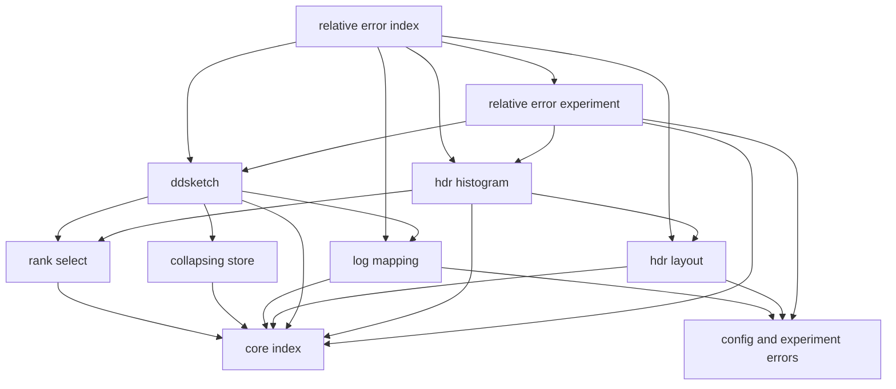
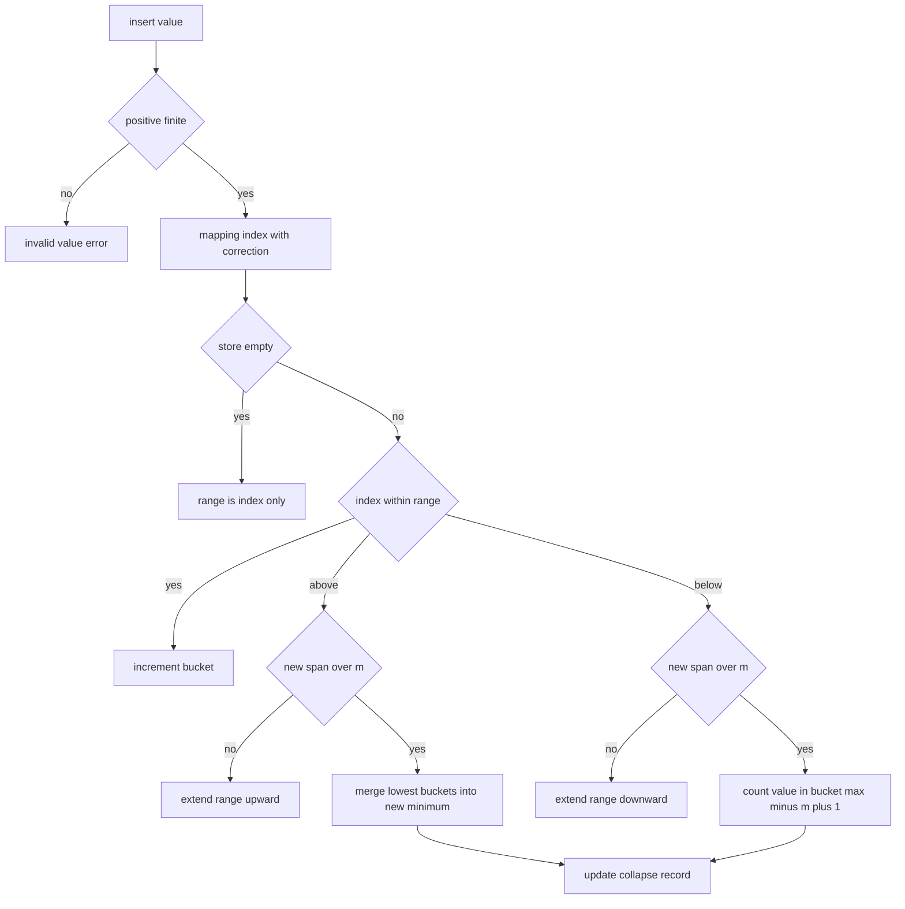
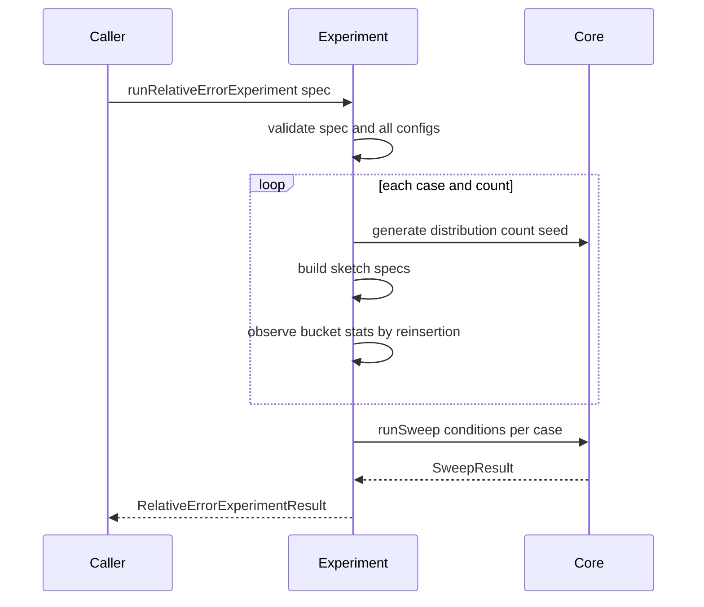

# Design Document

## Overview
Relative Error Sketches は、値の大きさに対する相対誤差を保証する2つの分位点近似手法、DDSketch と HDR Histogram を提供し、相対誤差の許容値・有効桁数・バケット数の上限・分布を変えたときの誤差、バケット数、費用を測る実験の仕組みを提供する。DDSketch は相対誤差の許容値 α から対数マッピングを作り、バケット数の上限に達したら小さい番号の側を縮約する。HDR Histogram は、有効桁数と追跡する値の範囲から固定のバケット構造を作る。どちらも、目標順位のバケットの代表値を推定値として返し、内部のバケットの状態を観察できる。実装は percentile-lab-core の共通操作規約、操作数・メモリの数え方、誤差指標、計測ハーネスの上に載り、独自の誤差定義や計測手段を持たない。DOM に依存しない純粋な TypeScript で、Vitest の node 環境でテストできる。

**Purpose**: 相対誤差の保証が値の大きさによらず成り立つこと、縮約で保証が失われる範囲、順位誤差型の手法との向き不向きを、実装と実験で確かめられるようにする。
**Users**: 学習コンテンツの作者本人が、アルゴリズムを実験条件に組み込むとき、バケットの状態を観察して保証の仕組みを確かめるとき、後続のサイト基盤が実験データと観察結果を表示に使うときに利用する。
**Impact**: `src/relative-error/` 配下のモジュール群、`docs/relative-error/` 配下の文書、対応するテストを新規に追加する。`src/core/`、`src/histogram/`、`package.json` は変更しない。

### Goals
- DDSketch の対数マッピング、バケット数の上限と縮約を提供する(1.1〜1.6、2.1〜2.8)。
- HDR Histogram の有効桁数ベースのバケット構造を提供する(3.1〜3.9)。
- 両手法で共通の推定規則と誤差の上限を保つ(4.1〜4.8)。
- core の共通操作規約と適合確認に従い、厳密解と入れ替えて同じ実験コードで比較できる(5.1〜5.6)。
- バケットの内部状態を、直列化可能な観察結果として返す(6.1〜6.5)。
- 投入と問い合わせの計算量、メモリの特性を操作数・メモリ見積もりで実測できる(7.1〜7.7)。
- 設定と分布を変えた誤差・バケット数・費用を、直列化可能な構造で出力する(8.1〜8.9)。
- 保証の成り立ち方と向き不向きを、文書と、文書の数値を検証するテストで説明する(9.1〜9.9)。

### Non-Goals
- 順位誤差型の sketch(GK、KLL、t-digest)の実装と、それらを呼び出す数値比較。比較は文書で、保証の性質と対比して説明する。
- 固定バケットのヒストグラム近似。histogram-percentile の境界の定義を再利用も変更もしない。
- sketch 同士のマージ API と、分散環境でのマージ性能の評価(文書での概念説明に留める)。
- 0 以下の値のためのストア、HDR の範囲の自動拡張、元の HdrHistogram と同じ出力(上端を返す)の再現。
- 学習ページ、グラフ描画、パラメータ操作 UI。

## Boundary Commitments

### This Spec Owns
- DDSketch の対数マッピング(`createLogMapping`): γ の決め方、値 → 番号、番号 → 下側・上側の境界・代表値、浮動小数点の端の扱い。
- DDSketch の縮約つきストア(`CollapsingStore`): 保持範囲の管理、範囲の拡張、小さい番号の側の縮約、縮約の記録。
- HDR Histogram のバケット構造(`createHdrLayout`): 副バケット数、バケットの総数、値 → 番号、番号 → 境界・代表値。
- 目標順位のスロットの選択(`selectSlot`)と、両手法の推定規則。
- DDSketch と HDR Histogram の `PercentileSketch` 実装、`SketchSpec`(識別子、`params`、`supportedRange`)、観察 API(`inspect`)と観察結果の型。
- 投入・問い合わせの操作数の数え方(core の種別を使い、どの処理を何回と数えるか)と、メモリ見積もりに含める項目。
- 設定と分布を変える実験の組み立て(`runRelativeErrorExperiment`)と、その結果の構造(バケットの統計を含む)。
- 保証、縮約、向き不向き、マージの概念を説明する文書(`docs/relative-error/`)と、その数値を検証するテスト。

### Out of Boundary
- `PercentileSketch`、`SketchSpec`、`SketchError`、操作数の種別、メモリ見積もりの 1 個あたりの大きさ、誤差指標、目標順位の丸め規則(core の所掌。参照だけする)。
- 計測ハーネス本体、データ生成、厳密解(core の所掌。実験はこれらを呼ぶだけで、複製や拡張はしない)。
- 固定バケットのヒストグラムと、その境界の定義(histogram-percentile の所掌)。
- GK、KLL、t-digest と、それらとの横断比較の定義(streaming-quantile-sketches と percentile-lab-site の所掌)。
- グラフや学習ページ、結果の表示形式。

### Allowed Dependencies
- 実行時依存は `src/core/index.ts` だけ。core の内部ファイル、`src/histogram/`、`src/streaming/` などの他の spec のファイルを import してはならない。
- 外部の実行時依存・開発時依存は追加しない(`fast-check` と `vitest` は core が導入済みのものを使う)。
- 内部の依存方向: `errors`、`snapshot` → `log-mapping`、`hdr-layout` → `collapsing-store` → `rank-select` → `ddsketch`、`hdr-histogram` → `experiment` → `index`。左から右への import だけを許し、逆は禁止する。同じ段の `log-mapping` と `hdr-layout`、`ddsketch` と `hdr-histogram` は互いに import しない。`collapsing-store` は `log-mapping` を import しない(番号だけを扱う)。
- 後続 spec は `src/relative-error/index.ts` だけを import する。

### Revalidation Triggers
次の変更は、percentile-lab-site など利用側の再確認が必要になる。
- `ddsketchSpec`、`hdrSpec` が付ける `id` の規則と `params` の項目名(結果の系列化に使われる)。
- `DDSketchSnapshot`、`HdrSnapshot`、`BucketView` の項目(観察結果の表示に使われる)。
- `RelativeErrorExperimentResult`、`BucketStatsRecord` の構造と `schemaVersion`、実験の `meta` の項目名。
- 推定規則(代表値の選び方、HDR の中点)と縮約の規則(誤差の意味が変わる)。
- `ConfigError`、`RelativeErrorExperimentError` の種別の追加・削除と、`field` に入る項目名。

上流(core)の次の変更は、この spec の再確認が必要になる。
- `PercentileSketch`、`SketchSpec`、`SketchError`、`OperationCounter`、`estimateBytes` の型・意味。
- `nearestRank` の丸め規則(スロットの選択と、誤差の上限の保証が依存する)。
- `runBenchmark`、`runSweep`、`BenchmarkInput` の構造と、`unsupported-value` の記録方法(8.8 が依存する)。

## Architecture

### Existing Architecture Analysis
`src/core/` は Foundation → Primitives → Domain → Harness → Entry の層構造で、後続 spec には `src/core/index.ts` だけを公開している。`src/histogram/` はその上に `errors → boundaries → estimate → histogram → experiment → index` の一方向の層を作り、`xxxSpec()` で `SketchSpec` を作り、実験はケースごとに `runSweep` を呼ぶ。この spec も同じ形に揃える。

- 値の検証は `checkPositiveFinite`、分位点の検証は `isQuantile` を使う。
- 扱える値域の外は `unsupported-value`、状態は変えない。
- 引数の検査、四則演算、添字の計算、ループの制御は操作数に数えない。
- 入力の誤りは `Result` のエラー、契約違反は例外(ハーネスが捕捉する)。

### Architecture Pattern & Boundary Map
選択したパターンは、依存方向を固定した小さな層構造である。写像(純粋)、ストア(状態)、推定(走査)、sketch(組み立て)、実験(ハーネス呼び出し)を分ける。



**Architecture Integration**:
- 選択したパターン: 層構造のライブラリ。写像は sketch なしで単体で計算できる(1.5、3.8)。ストアは番号と件数だけを扱い、写像を知らない。
- 境界の分け方: 両手法で共有するのは推定の走査(`selectSlot`)だけである。写像とストアは手法ごとに閉じる。実験は `SketchSpec` と観察用のファクトリを使うだけで、内部状態を直接触らない。
- 維持するパターン: `Result` による入力エラーの返却、`xxxSpec()` による `SketchSpec` の作成、`OperationCounter` による計数、ケースごとの `runSweep`。
- 新規コンポーネントの理由: 写像の単体検証(1.2、1.3、3.2〜3.4)、縮約の単体検証(2.2〜2.7)、推定規則の共有(4.1)、実験の再現(8.1〜8.6)を、それぞれ独立に実装・確認できるようにする。
- Steering: steering の core ファイル(`product.md`、`tech.md`、`structure.md`)は未作成である。`roadmap.md` の制約(Node.js 22.12 以上、DOM 非依存、許容ライセンス、日本語の文書)に従う。

### Technology Stack

| Layer | Choice / Version | Role in Feature | Notes |
|-------|------------------|-----------------|-------|
| 言語 | TypeScript 7.0.2(core と同じ) | 型チェックは `tsc --noEmit` | `any` を使わない。既存の `tsconfig.json` をそのまま使う |
| テスト | Vitest 5.0.5(node 環境) | 単体・統合・文書の数値の検証 | `src/**/*.test.ts` が既存の設定で拾われる |
| 性質テスト | fast-check 4.10.2(開発時のみ) | 不変条件のテスト | シードを固定する |
| 実行環境 | Node.js 22.12 以上 | core と同じ | 追加の要件なし |
| 依存 | 追加なし | — | `licenses:check` の結果は変わらない |

## File Structure Plan

### Directory Structure
```
src/relative-error/
├── index.ts                  # 唯一の公開入口。後続 spec はここだけを import する
├── errors.ts                 # ConfigError、RelativeErrorExperimentError の型
├── log-mapping.ts            # LogMapping、createLogMapping(DDSketch の γ、番号、境界、代表値、端の扱い)
├── log-mapping.test.ts
├── hdr-layout.ts             # HdrConfig、HdrLayout、createHdrLayout、MAX_HDR_BUCKETS(副バケット数、総数、番号、境界、代表値)
├── hdr-layout.test.ts
├── collapsing-store.ts       # CollapsingStore(保持範囲、拡張、縮約、縮約の記録、操作数の計数)
├── collapsing-store.test.ts
├── rank-select.ts            # selectSlot(nearestRank による目標順位と、累積件数の走査)
├── rank-select.test.ts
├── ddsketch.ts               # DDSketchOptions、DDSketch、DDSketchSnapshot、createDDSketch、ddsketchSpec、既定値と上限
├── ddsketch.test.ts
├── hdr-histogram.ts          # HdrHistogram、HdrSnapshot、createHdrHistogram、hdrSpec
├── hdr-histogram.test.ts
├── snapshot.ts               # BucketView、SketchSpecOptions(両 sketch が共有する観察・識別の型。実体を持たない)
├── conformance.test.ts       # DDSketch(縮約なし・あり)と HDR(複数の有効桁数)で runConformance を通す
├── cost.test.ts              # 操作数・メモリの上限と増え方(件数、範囲、α、有効桁数)
├── properties.test.ts        # fast-check による不変条件(誤差の上限、単調性、観察の一貫性)
├── experiment.ts             # runRelativeErrorExperiment(データ生成、SketchSpec の列挙、ハーネス呼び出し、バケットの統計)
├── experiment.test.ts
├── docs-examples.test.ts     # docs/relative-error/ の数値が実装の出力と一致することを確認
└── public-api.test.ts        # index.ts だけから必要な API が使えること
docs/relative-error/
├── ddsketch.md               # 対数マッピング、代表値と α の関係、桁によらない理由、縮約の規則、数値例
├── hdr-histogram.md          # 副バケット数と構造、有効桁数と上限、L 未満の領域の絶対誤差、元の実装との違い、数値例
├── experiments.md            # 桁の異なる分布での上限の確認、α・有効桁数と誤差・バケット数・メモリ、縮約の影響、計算量の実測
└── comparison.md             # 順位誤差型との向き不向き(実験の相対誤差・順位誤差と保証の性質の対比)、マージの概念
```

> `snapshot.ts` は型だけを置き、依存方向では `errors` と同じ最下段に置く(`errors`、`snapshot` → `log-mapping` …)。各ファイルの責務は 1 つである。テストは対象の隣に置く(core、histogram-percentile と同じ配置)。

### Modified Files
なし。`src/core/`、`src/histogram/`、`package.json`、`tsconfig.json`、`vite.config.ts` は変更しない。`.kiro/steering/roadmap.md` のチェックは、実装の完了後に利用者が更新する。

## System Flows

### DDSketch の投入と縮約(2.2〜2.5、7.1、7.2)


- 縮約の記録は、縮約回数の加算と、縮約の影響を受けた値の上限(合算先のバケットの上側の境界)の更新である。上限は単調に増える。
- 縮約は小さい番号の側だけで起き、最大番号のバケットは常に本来の値だけを数える(2.5)。

### 実験の実行(8.1〜8.8)


- 1 つの条件には、厳密解 2 方式、DDSketch(α × バケット数の上限)、HDR Histogram(有効桁数)のすべてを同じ `BenchmarkInput.sketches` に入れる。
- HDR の範囲がデータを覆わない場合、その HDR だけが `stage: 'insert'`、`errorKind: 'unsupported-value'` で記録され、バケットの統計は `status: 'rejected'` になる。他は続行する(8.8)。
- 実験条件と全設定の検証は、データ生成より前に行い、部分的な結果を返さない(8.9)。

## Requirements Traceability

| Requirement | Summary | Components | Interfaces | Flows |
|-------------|---------|------------|------------|-------|
| 1.1 | α を (0, 1) で受け付ける | LogMapping | `createLogMapping` | — |
| 1.2 | γ と番号 `γ^(i−1) < x <= γ^i` | LogMapping | `indexOf`, `lowerBound`, `upperBound` | — |
| 1.3 | 代表値 `2γ^i / (γ + 1)` で相対誤差 α 以下 | LogMapping | `representative` | — |
| 1.4 | 値域の制限を宣言しない | DDSketch | `ddsketchSpec`(`supportedRange` なし) | — |
| 1.5 | sketch なしで写像を計算 | LogMapping, Entry | `createLogMapping` | — |
| 1.6 | 不正な α でエラー | LogMapping, Errors | `ConfigError` | — |
| 2.1 | 上限 m と既定値 | DDSketch | `DDSketchOptions`, `DEFAULT_MAX_BUCKETS`, `MAX_DD_BUCKETS` | — |
| 2.2 | 保持範囲の長さを m 以下に保つ | CollapsingStore | `add` | 投入と縮約 |
| 2.3 | 上側への拡張で小さい側を縮約 | CollapsingStore | `add` | 投入と縮約 |
| 2.4 | 下側への拡張で範囲を超える値の扱い | CollapsingStore | `add` | 投入と縮約 |
| 2.5 | 総件数不変、大きい側は縮約しない | CollapsingStore | `add` の事後条件 | 投入と縮約 |
| 2.6 | 縮約なしの間は上限を保つ | DDSketch, RankSelect | `query` | — |
| 2.7 | 縮約の影響の上限と回数を観察 | CollapsingStore, DDSketch | `DDSketchSnapshot.collapsedUpperBound`, `collapseCount` | — |
| 2.8 | 不正な m でエラー | DDSketch, Errors | `ConfigError` | — |
| 3.1 | L、H、d を受け付ける | HdrLayout | `HdrConfig` | — |
| 3.2 | 副バケット数と構造 | HdrLayout | `createHdrLayout`, `indexOf` | — |
| 3.3 | 代表値は中点 | HdrLayout | `representative` | — |
| 3.4 | 相対誤差 `1 / S`、L 単位の領域では絶対誤差 `L / 2` | HdrLayout | 事後条件 | — |
| 3.5 | 扱える値域の宣言 | HdrHistogram | `hdrSpec` の `supportedRange` | — |
| 3.6 | 範囲外は拒否、状態不変 | HdrHistogram | `insert` → `unsupported-value` | — |
| 3.7 | バケットの総数は作成時に固定 | HdrLayout, HdrHistogram | `totalBuckets` | — |
| 3.8 | sketch なしで構造を計算 | HdrLayout, Entry | `createHdrLayout` | — |
| 3.9 | 不正な設定でエラー | HdrLayout, Errors | `ConfigError` | — |
| 4.1 | 目標順位のバケットの代表値 | RankSelect, DDSketch, HdrHistogram | `selectSlot`, `query` | — |
| 4.2 | 推定値は有限の正の数 | LogMapping, HdrLayout | `representative` の事後条件 | — |
| 4.3 | 分位点に対して単調非減少 | RankSelect | 事後条件 | — |
| 4.4 | 厳密値のバケットと一致 | RankSelect | 事後条件 | — |
| 4.5 | DDSketch は縮約の影響外で α 以下 | DDSketch | `query` の事後条件 | — |
| 4.6 | HDR は 3.4 の上限以下 | HdrHistogram | `query` の事後条件 | — |
| 4.7 | 空はエラー | DDSketch, HdrHistogram | `query` → `empty` | — |
| 4.8 | 範囲外の分位点はエラー、状態不変 | DDSketch, HdrHistogram | `query` → `quantile-out-of-range` | — |
| 5.1 | 共通規約に従う | DDSketch, HdrHistogram | `PercentileSketch` | — |
| 5.2 | 適合確認を通る | DDSketch, HdrHistogram | `runConformance`(テスト) | — |
| 5.3 | 同じ入力で同じ結果、シード非依存 | DDSketch, HdrHistogram | 乱数を使わない | — |
| 5.4 | `reset` は設定を保ち件数・操作数・縮約を戻す | DDSketch, HdrHistogram, CollapsingStore | `reset` | — |
| 5.5 | 設定を `params` で公開 | DDSketch, HdrHistogram | `ddsketchSpec`, `hdrSpec` の `params` | — |
| 5.6 | データ非依存の識別子 | DDSketch, HdrHistogram | `id` の規則 | — |
| 6.1 | DDSketch の観察項目 | DDSketch | `inspect` → `DDSketchSnapshot` | — |
| 6.2 | HDR の観察項目 | HdrHistogram | `inspect` → `HdrSnapshot` | — |
| 6.3 | 観察で状態・操作数・メモリが変わらない | DDSketch, HdrHistogram | `inspect` の事後条件 | — |
| 6.4 | 直列化可能で独立した値 | Snapshot types | `BucketView` | — |
| 6.5 | 件数の合計と昇順 | DDSketch, HdrHistogram | `inspect` の事後条件 | — |
| 7.1 | DDSketch の範囲内の投入は一定 | CollapsingStore, LogMapping | 投入の操作数規則 | — |
| 7.2 | 拡張・縮約は m に比例 | CollapsingStore | 投入の操作数規則 | 投入と縮約 |
| 7.3 | HDR の投入は一定 | HdrLayout, HdrHistogram | 投入の操作数規則 | — |
| 7.4 | 問い合わせは保持バケット数に比例 | RankSelect | 問い合わせの操作数規則 | — |
| 7.5 | メモリは件数に依存しない | DDSketch, HdrHistogram | `memoryBytes` | — |
| 7.6 | α・有効桁数でバケット数とメモリが増える | Experiment, Docs | `alphas`, `significantDigitsList`, `bucketStats` | 実験の実行 |
| 7.7 | 件数を増やした比較 | Experiment | `counts` | 実験の実行 |
| 8.1 | 設定ごとに作り、厳密解と同じデータで計測 | Experiment | `runRelativeErrorExperiment` | 実験の実行 |
| 8.2 | core の結果の形式のまま返す | Experiment | `sweep` | 実験の実行 |
| 8.3 | バケットの統計 | Experiment | `BucketStatsRecord` | 実験の実行 |
| 8.4 | 直列化可能、条件が読める | Experiment | `params`, `meta`, `bucketStats` | — |
| 8.5 | 処理時間を除き同じ結果 | Experiment | 決定的な生成・計測 | — |
| 8.6 | 複数の分布を並べる | Experiment | `cases` | — |
| 8.7 | 厳密解の定義の指定 | Experiment | `referenceDefinition` | — |
| 8.8 | HDR の範囲外はその手法のエラーとして記録し続行 | Experiment | core ハーネスの記録、`status: 'rejected'` | 実験の実行 |
| 8.9 | 実験条件の不正でエラー | Experiment, Errors | `RelativeErrorExperimentError` | — |
| 9.1 | DDSketch の写像と保証の文書 | Docs, Tests | `ddsketch.md`, `docs-examples.test.ts` | — |
| 9.2 | HDR の構造と保証の文書 | Docs, Tests | `hdr-histogram.md`, `docs-examples.test.ts` | — |
| 9.3 | 桁の異なる分布で上限が成り立つ実験 | Docs, Tests | `experiments.md`, `docs-examples.test.ts` | — |
| 9.4 | α・有効桁数と誤差・バケット数・メモリ | Docs, Tests | `experiments.md` | — |
| 9.5 | 縮約の影響 | Docs, Tests | `experiments.md` | — |
| 9.6 | 順位誤差型との向き不向き | Docs, Tests | `comparison.md` | — |
| 9.7 | マージの概念 | Docs | `comparison.md` | — |
| 9.8 | 文書の数値と実装の一致 | Tests | `docs-examples.test.ts` | — |
| 9.9 | 関係の成立を性質テストで確認 | Tests | `properties.test.ts` | — |
| 10.1 | ブラウザなしで動く | 全体 | DOM を使わない | — |
| 10.2 | 1 つの操作でテストを実行 | Tests | 既存の `npm test` | — |
| 10.3 | 新たな外部依存を追加しない | 全体 | — | — |
| 10.4 | 内部構成を知らずに利用できる | Entry | `src/relative-error/index.ts` | — |

## Components and Interfaces

| Component | Domain/Layer | Intent | Req Coverage | Key Dependencies (P0/P1) | Contracts |
|-----------|--------------|--------|--------------|--------------------------|-----------|
| Errors | Foundation | 設定・実験のエラー型 | 1.6, 2.8, 3.9, 8.9 | core `GenerateError`, `HarnessError` (P0) | State |
| Snapshot types | Foundation | 観察結果と識別の共有型 | 6.4, 5.6 | なし | State |
| LogMapping | Mapping | DDSketch の対数マッピング | 1.1〜1.3, 1.5, 1.6, 4.2, 7.1 | Errors (P0), core `OperationCounter` (P0) | Service |
| HdrLayout | Mapping | HDR の有効桁数ベースの構造 | 3.1〜3.4, 3.7〜3.9, 4.2, 7.3 | Errors (P0), core `OperationCounter` (P0) | Service |
| CollapsingStore | Store | 保持範囲と縮約 | 2.2〜2.5, 2.7, 5.4, 7.1, 7.2 | core `OperationCounter` (P0) | Service, State |
| RankSelect | Estimate | 目標順位のスロットの選択 | 4.1, 4.3, 4.4, 7.4 | core `nearestRank`, `OperationCounter` (P0) | Service |
| DDSketch | Sketch | DDSketch の `PercentileSketch`、`SketchSpec`、観察 | 1.4, 2.1, 2.6〜2.8, 4.1, 4.2, 4.5, 4.7, 4.8, 5.1〜5.6, 6.1, 6.3〜6.5, 7.5 | LogMapping, CollapsingStore, RankSelect (P0), core (P0) | Service, State |
| HdrHistogram | Sketch | HDR の `PercentileSketch`、`SketchSpec`、観察 | 3.5〜3.7, 4.1, 4.2, 4.6〜4.8, 5.1〜5.6, 6.2〜6.5, 7.3, 7.5 | HdrLayout, RankSelect (P0), core (P0) | Service, State |
| Experiment | Harness | 実験条件の列挙、ハーネスの呼び出し、バケットの統計 | 7.6, 7.7, 8.1〜8.9 | DDSketch, HdrHistogram (P0), core `generate`, `runSweep`, 厳密解 (P0) | Service |
| Entry | Entry | 公開入口 | 10.4 | 全コンポーネント (P0) | — |
| Docs | Docs | 保証・縮約・向き不向き・マージの説明 | 9.1〜9.7 | Experiment の出力 (P0) | — |

### Foundation

#### Errors

```typescript
/** 設定が不正。field は設定の項目名をそのまま入れる('alpha'、'maxBuckets'、'lowest'、'highest'、'significantDigits' のいずれか。添字や接頭辞は付けない)。reason は人が読む説明で、分岐には使わない */
export type ConfigError = {
  readonly kind: 'invalid-config';
  readonly field: string;
  readonly reason: string;
};

export type RelativeErrorExperimentError =
  | ConfigError
  /** field は RelativeErrorExperimentSpec の項目名('cases'、'counts'、'quantiles'、'alphas'、'maxBucketsList'、'significantDigitsList') */
  | { readonly kind: 'invalid-experiment'; readonly field: string; readonly reason: string }
  | { readonly kind: 'generate'; readonly error: GenerateError }
  | { readonly kind: 'harness'; readonly error: HarnessError };
```
- histogram-percentile の `SchemeError`、`ExperimentError` と同じ形にする(型は共有せず、この spec で定義する)。実験のエラー型は、histogram-percentile の `ExperimentError`、streaming-quantile-sketches の `StreamingExperimentError` と名前が衝突しないように `RelativeErrorExperimentError` とする。
- `field` の書式: `invalid-config` は設定の項目名(`HdrConfig`、`DDSketchOptions`、`createLogMapping` の引数の名前)、`invalid-experiment` は `RelativeErrorExperimentSpec` の項目名を入れる。実験の一覧の項目名(`alphas`、`maxBucketsList`、`significantDigitsList`)は設定の項目名と重ならないので、`field` だけでもどちらの誤りか区別できる。

#### Snapshot types

```typescript
/** 件数が 1 以上のバケット 1 個の観察結果。値はすべて有限の数 */
export interface BucketView {
  readonly index: number;
  readonly lower: number;
  readonly upper: number;
  readonly representative: number;
  readonly count: number;
}

/** SketchSpec の識別子と表示名の上書き */
export interface SketchSpecOptions {
  readonly id?: string;
  readonly label?: string;
}
```

### Mapping

#### LogMapping

| Field | Detail |
|-------|--------|
| Intent | α から γ を決め、値と番号、番号と境界・代表値を相互に計算する |
| Requirements | 1.1, 1.2, 1.3, 1.5, 1.6, 4.2, 7.1 |

**Responsibilities & Constraints**
- `γ = (1 + α) / (1 − α)`、`lnγ = Math.log(γ)`。
- `upperBound(i) = min(γ^i, Number.MAX_VALUE)`、`lowerBound(i) = upperBound(i − 1)`(0 に落ちうる)。累乗は `Math.exp(i × lnγ)` で計算する。
- `representative(i) = clamp(2γ^i / (γ + 1), Number.MIN_VALUE, Number.MAX_VALUE)`。`Math.exp(i × lnγ + Math.log(2 / (γ + 1)))` で計算し、`γ^i` があふれる場合でも有限にする。`x <= Number.MAX_VALUE` なので、上限への切り詰めは相対誤差を増やさない。
- `indexOf(x)`: 推定 `i = ceil(Math.log(x) / lnγ)` を、計算した境界と比べて補正する。「`x <= lowerBound(i)` なら `i` を 1 つ下げる」「`x > upperBound(i)` なら 1 つ上げる」を成立しなくなるまで繰り返す。比較は実行した分だけ `counter` に数える。計算の誤差は 1 バケット以内なので、比較は最大 3 回である。補正により `lowerBound(i) < x <= upperBound(i)` が、写像の内部で計算した境界に対して厳密に成り立つ。
- 状態を持たない。同じ入力に同じ出力を返す。

**Contracts**: Service [x]

##### Service Interface
```typescript
export interface LogMapping {
  readonly alpha: number;
  readonly gamma: number;
  /** x は有限の正の数(呼び出し側が検証する)。counter を渡すと補正の比較を数える */
  indexOf(x: number, counter?: OperationCounter): number;
  lowerBound(index: number): number;
  upperBound(index: number): number;
  representative(index: number): number;
}

export function createLogMapping(alpha: number): Result<LogMapping, ConfigError>;
```
- Preconditions: なし(不正な `alpha` はエラー)。
- Postconditions: `0 < alpha < 1` かつ有限なら成功。`indexOf(x)` の結果 `i` について `lowerBound(i) < x <= upperBound(i)`。正規化数の範囲(`x >= 2^−1022`)では `|representative(i) − x| / x <= alpha`(浮動小数点の丸めの範囲で)。`representative` は常に有限の正の数。
- エラー: `alpha` が数値でない・有限でない・0 以下・1 以上 → `invalid-config`(`field: 'alpha'`)。

**Implementation Notes**
- Integration: DDSketch が所有し、観察結果の境界・代表値の計算にも使う。
- Validation: 単体テストで、1.2 の包含、区間の両端での相対誤差が α に一致すること(許容誤差内)、`Number.MAX_VALUE`、`Number.MIN_VALUE`、2 の累乗、`γ` の累乗そのものの値で番号が正しく、境界・代表値が有限であることを確かめる。
- Risks: 非正規化数の範囲では有効桁が減り、上限が丸めの範囲で破れうる。文書に書き、性質テストの入力は正規化数に限る。

#### HdrLayout

| Field | Detail |
|-------|--------|
| Intent | L、H、d から副バケット数とバケットの総数を決め、値と番号、番号と境界・代表値を相互に計算する |
| Requirements | 3.1, 3.2, 3.3, 3.4, 3.7, 3.8, 3.9, 4.2, 7.3 |

**Responsibilities & Constraints**
- `S = 2^ceil(log2(2 × 10^d))`(`d = 0..5` で 2, 32, 256, 2048, 32768, 262144)。`half = S / 2`。
- 単位数 `u = floor(x / L)`。区間 0 は `u ∈ [0, S)` を幅 1 単位のバケット `S` 個で持つ。区間 `k >= 1` は `u ∈ [S × 2^(k−1), S × 2^k)` を幅 `2^k` 単位のバケット `half` 個で持つ。
- 区間の個数: `uMax = floor(H / L)` を含む最小の区間番号を `K` とし、バケットの総数は `S + K × half`。
- 番号: 区間 0 は `index = u`。区間 `k` は `index = S + (k − 1) × half + (floor(u / 2^k) − half)`。
- 境界: 番号から区間とその中の位置を逆算し、`lower = 下端の単位 × L`、`upper = (下端の単位 + 幅) × L`、`representative = (lower + upper) / 2`。
- `indexOf(x)`: 「`u < S` か」の比較 1 回で区間 0 を判定する。それ以外は `k` を `floor(log2(u / S)) + 1` で推定し、「`u < S × 2^(k−1)` なら下げる」「`u >= S × 2^k` なら上げる」で補正する。比較は実行した分だけ数え、最大 4 回である。
- 上限 `MAX_HDR_BUCKETS = 2^22`(4,194,304)。総数がこれを超える設定はエラーにする(防御的な制限。`d = 5` で `H / L` が約 `2^37` までに相当)。
- 状態を持たない。

**Contracts**: Service [x]

##### Service Interface
```typescript
export interface HdrConfig {
  /** 最小の識別単位 L。有限の正の数 */
  readonly lowest: number;
  /** 追跡する最大値 H。有限の正の数で 2L 以上 */
  readonly highest: number;
  /** 有効桁数 d。0 以上 5 以下の整数 */
  readonly significantDigits: number;
}

export interface HdrLayout {
  readonly lowest: number;
  readonly highest: number;
  readonly significantDigits: number;
  readonly subBucketCount: number;
  readonly totalBuckets: number;
  /** x は L 以上 H 以下(呼び出し側が検証する)。counter を渡すと比較を数える */
  indexOf(x: number, counter?: OperationCounter): number;
  lowerBound(index: number): number;
  upperBound(index: number): number;
  representative(index: number): number;
}

export const MAX_HDR_BUCKETS: number; // 2 ** 22

export function createHdrLayout(config: HdrConfig): Result<HdrLayout, ConfigError>;
```
- Postconditions: `indexOf(x)` は `0 <= index < totalBuckets`。`x >= half × L` なら `|representative − x| / x <= 1 / S`、それ未満なら `|representative − x| <= L / 2`(丸めの範囲で)。`representative` は有限の正の数(`u >= 1` なので `lower >= L`)。
- エラー(`invalid-config`): `lowest`・`highest` が有限の正の数でない、`highest < 2 × lowest`、`highest / lowest` が有限でない、`significantDigits` が 0〜5 の整数でない、総数が `MAX_HDR_BUCKETS` を超える。検証は `lowest` → `highest` → 比 → `significantDigits` → 総数の順で、最初の 1 件を返す。`field` は `lowest` の誤りが `'lowest'`、`highest` と比の誤りが `'highest'`、`significantDigits` と総数の誤りが `'significantDigits'`。

**Implementation Notes**
- Integration: HdrHistogram が所有する。
- Validation: `d = 0..5` の `S`、総数の公式、区間の境目(`u = S − 1, S, 2S − 1, 2S`)での番号と境界の連続性(隣のバケットの `upper` と次の `lower` が等しい)、`x = L`、`x = H`、`half × L` の前後での誤差の上限を単体テストで確かめる。
- Risks: `x / L` の丸めで、`L` の整数倍のごく近くの値が隣の単位に入りうる。境界・代表値も同じ `L` から計算するので、誤差は丸めの範囲に収まる。テストは相対許容誤差で比べる。

### Store

#### CollapsingStore

| Field | Detail |
|-------|--------|
| Intent | 番号ごとの件数を連続した範囲で保持し、範囲の長さを上限 m 以下に保つ |
| Requirements | 2.2, 2.3, 2.4, 2.5, 2.7, 5.4, 7.1, 7.2 |

**Responsibilities & Constraints**
- 状態: 範囲ちょうどの長さの件数配列、最小番号、総件数、縮約の回数、縮約の合算先の最大番号(なければ `null`)。
- `add(index, counter)`:
  - 空: 範囲を `[index, index]` にする。
  - 空でない: 「`index < 最小番号` か」「`index > 最大番号` か」を順に比べる(比較は実行した分だけ。最大 2 回)。
  - 範囲内: その件数に 1 を足す。
  - 上側: 新しい長さ `index − 最小番号 + 1` が `m` 以下なら範囲を広げる。超えるなら、新しい最小番号 `t = index − m + 1` より小さい番号の件数をすべて `t` に合算し(`t` が旧最大番号より大きければ全件が `t` に入る)、縮約を記録する。
  - 下側: 新しい長さ `最大番号 − index + 1` が `m` 以下なら範囲を広げる。超えるなら、値を `t = 最大番号 − m + 1` のバケットに数え(`t` が旧最小番号より小さければ範囲を `t` まで広げる)、縮約を記録する。
  - 縮約の記録: 回数に 1 を足し、合算先の最大番号を `max(現在の値, t)` に更新する。
  - 総件数に 1 を足す。
- 操作数の数え方(移動): 件数配列への書き込み 1 回ごとに 1、総件数の更新に 1。範囲を作り直すときは、新しい配列にコピーした件数 1 個ごとに 1、合算先へ書き込む合計に 1。新しい配列の 0 での初期化、最小番号や縮約の記録の更新は数えない(添字の管理とみなす)。範囲内の投入は移動 2 回、拡張・縮約を伴う投入は `m + 1` 回以下である。
- `reset()`: 範囲を空にし、総件数・縮約の記録を戻す。上限 m は保つ。
- 番号の意味(値の境界)を知らない。縮約の影響の上限を値で表すのは DDSketch の責務である。

**Contracts**: Service [x] / State [x]

##### Service Interface
```typescript
export interface StoreView {
  readonly minIndex: number | null;
  readonly span: number;
  readonly total: number;
  /** 件数配列の読み取り専用の参照。長さは span。保持しない(呼び出し側は複製してから外に出す) */
  readonly counts: ArrayLike<number>;
  readonly collapseCount: number;
  readonly collapsedUpToIndex: number | null;
}

export class CollapsingStore {
  /** maxBuckets は検証済みの 1 以上の整数 */
  constructor(maxBuckets: number);
  add(index: number, counter: OperationCounter): void;
  view(): StoreView;
  reset(): void;
}
```
- Invariants: `span <= maxBuckets`。`total` は件数の合計。`collapsedUpToIndex` は単調に増える。最大番号のバケットは縮約で合算されない。

### Estimate

#### RankSelect

| Field | Detail |
|-------|--------|
| Intent | 件数列から、最近順位法の目標順位を含むスロットを選ぶ |
| Requirements | 4.1, 4.3, 4.4, 7.4 |

**Responsibilities & Constraints**
- 目標順位 `k = nearestRank(total, quantile)`(core の関数。丸め規則が誤差指標と一致する)。
- 先頭から累積件数を足し、累積件数が初めて `k` 以上になるスロットの位置を返す。調べたスロットごとに比較を 1 回数える。移動と累積の加算は数えない。
- `quantile` について単調非減少(`k` が単調非減少のため)。整列後の `k` 番目の値は、累積件数の定義により選ばれたスロットに数えられている(4.4)。

**Contracts**: Service [x]

##### Service Interface
```typescript
/** 前提: total >= 1、total は counts の合計、quantile は 0 以上 1 以下 */
export function selectSlot(
  counts: ArrayLike<number>,
  total: number,
  quantile: number,
  counter: OperationCounter,
): number;
```
- 前提に反して見つからない場合は例外を投げる(契約違反。ハーネスが捕捉する)。

### Sketch

#### DDSketch

| Field | Detail |
|-------|--------|
| Intent | 対数マッピングと縮約つきストアによる `PercentileSketch`。観察 API を持つ |
| Requirements | 1.4, 2.1, 2.6, 2.7, 2.8, 4.1, 4.2, 4.5, 4.7, 4.8, 5.1〜5.6, 6.1, 6.3, 6.4, 6.5, 7.5 |

**Responsibilities & Constraints**
- `insert(x)`: `checkPositiveFinite` で検証し、不正なら `invalid-value`。`mapping.indexOf(x, counter)` で番号を求め、`store.add(index, counter)`。値域の制限はなく、`unsupported-value` は返さない(1.4)。
- `query(q)`: `isQuantile` → 空の順に検査し、`quantile-out-of-range`、`empty` を返す。`selectSlot(store.counts, total, q, counter)` の位置に最小番号を足した番号の `mapping.representative` を返す(4.1)。
- 縮約の影響: `collapsedUpperBound = mapping.upperBound(collapsedUpToIndex)`。推定に使ったバケットの番号がこれ以下なら保証はない(2.7、4.5)。
- `memoryBytes()`: `estimateBytes({ numbers: 4, counters: span + 2 })`。数値は γ、m、最小番号、縮約の合算先の番号。カウンタはバケットの件数 `span` 個、総件数、縮約の回数。最大で `(m + 6) × 8` バイト、作成直後は 48 バイト。件数に依存しない(7.5)。
- `reset()`: `store.reset()` と `counter.reset()`。α、m、写像は保つ(5.4)。
- 乱数を使わない。`create(seed)` の `seed` は使わない(5.3)。
- `inspect()`: ストアの状態から `DDSketchSnapshot` を新しく組み立てて返す。件数が 1 以上のバケットだけを番号の昇順に並べる。計数器を使わず、状態を変えない(6.3)。
- `ddsketchSpec(options, specOptions?)`:
  - `id`: 既定は `ddsketch-a<alpha>-m<maxBuckets>`(例: `ddsketch-a0.01-m2048`)。データに依存しない(5.6)。
  - `label`: 既定は `DDSketch(α=<alpha>, m=<maxBuckets>)`。
  - `params`: `{ alpha, gamma, maxBuckets }`(5.5)。
  - `supportedRange`: 指定しない(1.4)。
  - `create`: 毎回新しい `DDSketch` を返す。

**Contracts**: Service [x] / State [x]

##### Service Interface
```typescript
export interface DDSketchOptions {
  /** 相対誤差の許容値。0 < alpha < 1 */
  readonly alpha: number;
  /** バケット数の上限。1 以上 MAX_DD_BUCKETS 以下の整数。省略時は DEFAULT_MAX_BUCKETS */
  readonly maxBuckets?: number;
}

export const DEFAULT_MAX_BUCKETS = 2048;
export const MAX_DD_BUCKETS = 100_000;

export interface DDSketchSnapshot {
  readonly kind: 'ddsketch';
  readonly alpha: number;
  readonly gamma: number;
  readonly maxBuckets: number;
  readonly totalCount: number;
  /** 保持している範囲の長さ(最小番号から最大番号まで) */
  readonly span: number;
  readonly nonEmptyBuckets: number;
  readonly buckets: readonly BucketView[];
  readonly collapsed: boolean;
  /** この値以下の推定は相対誤差の上限を保証しない。縮約がなければ null */
  readonly collapsedUpperBound: number | null;
  readonly collapseCount: number;
}

export interface DDSketch extends PercentileSketch {
  inspect(): DDSketchSnapshot;
}

export function createDDSketch(options: DDSketchOptions): Result<DDSketch, ConfigError>;
export function ddsketchSpec(
  options: DDSketchOptions,
  specOptions?: SketchSpecOptions,
): Result<SketchSpec, ConfigError>;
```
- エラー: `alpha` は `createLogMapping` のエラー。`maxBuckets` が整数でない・1 未満・`MAX_DD_BUCKETS` 超 → `invalid-config`(`field: 'maxBuckets'`)。検証は `alpha` → `maxBuckets` の順。
- Postconditions: `query` の成功値は有限の正の数。エラー時は状態・操作数・メモリ見積もりを変えない。`inspect()` の `buckets` の件数の合計は `totalCount`(6.5)。

**Implementation Notes**
- Integration: `ddsketchSpec` の `SketchSpec` は core のハーネスと `runConformance` にそのまま渡せる。
- Validation: `runConformance` を `α = 0.01, m = 2048`(縮約なし)と `α = 0.01, m = 8`(適合確認の入力 1〜1000 で縮約が起きる)で通す。
- Risks: 範囲が極端に広い入力では m に張り付いて縮約が続く。仕様どおりで、観察 API で見える。

#### HdrHistogram

| Field | Detail |
|-------|--------|
| Intent | 固定のバケット構造による `PercentileSketch`。観察 API を持つ |
| Requirements | 3.5, 3.6, 3.7, 4.1, 4.2, 4.6, 4.7, 4.8, 5.1〜5.6, 6.2, 6.3, 6.4, 6.5, 7.3, 7.5 |

**Responsibilities & Constraints**
- 状態: 写像(不変)、長さ `totalBuckets` の件数配列(作成時に確保)、総件数、計数器。
- `insert(x)`: `checkPositiveFinite` → `x < L` または `x > H` なら `unsupported-value`(`detail` に範囲を入れる。状態も操作数も変えない)→ `layout.indexOf(x, counter)` → 件数と総件数に 1 を足し、移動を 2 回数える。投入 1 回の比較は最大 4 回(7.3)。
- `query(q)`: `isQuantile` → 空の順に検査する。`selectSlot(counts, total, q, counter)` の番号の `layout.representative` を返す。比較は `totalBuckets` 回以下(7.4)。
- `memoryBytes()`: `estimateBytes({ numbers: 3, counters: totalBuckets + 1 })`。数値は L、H、d。作成時から変わらない(3.7、7.5)。
- `reset()`: 件数、総件数、操作数を 0 に戻す。設定は保つ(5.4)。
- `inspect()`: 件数が 1 以上のバケットだけを番号の昇順に並べた `HdrSnapshot` を新しく組み立てる。
- `hdrSpec(config, specOptions?)`:
  - `id`: 既定は `hdr-d<significantDigits>`(例: `hdr-d2`)。範囲を含めない(5.6。範囲は `params` と実験の `meta` で読める)。
  - `label`: 既定は `HDR Histogram(有効桁数=<d>)`。
  - `params`: `{ lowest, highest, significantDigits, subBucketCount, totalBuckets }`(5.5)。
  - `supportedRange`: `{ min: lowest, max: highest }`(3.5)。

**Contracts**: Service [x] / State [x]

##### Service Interface
```typescript
export interface HdrSnapshot {
  readonly kind: 'hdr';
  readonly lowest: number;
  readonly highest: number;
  readonly significantDigits: number;
  readonly subBucketCount: number;
  readonly totalBuckets: number;
  readonly totalCount: number;
  readonly nonEmptyBuckets: number;
  readonly buckets: readonly BucketView[];
}

export interface HdrHistogram extends PercentileSketch {
  inspect(): HdrSnapshot;
}

export function createHdrHistogram(config: HdrConfig): Result<HdrHistogram, ConfigError>;
export function hdrSpec(
  config: HdrConfig,
  specOptions?: SketchSpecOptions,
): Result<SketchSpec, ConfigError>;
```

**Implementation Notes**
- Validation: `runConformance` を `L = 1, H = 1000` で `d = 1, 2, 3` について通す。適合確認は範囲外(`0.5` と `2000`)の拒否も確かめる。
- Risks: `d = 5` と広い範囲では配列が大きい(上限で約 32 MB)。`MAX_HDR_BUCKETS` で防ぐ。

### Harness

#### Experiment

| Field | Detail |
|-------|--------|
| Intent | 分布・件数・設定を変えた計測条件を作り、core のハーネスで実行し、バケットの統計を添える |
| Requirements | 7.6, 7.7, 8.1〜8.9 |

**Responsibilities & Constraints**
- 検証(データ生成より前に、すべて行う):
  - `cases`、`counts`、`quantiles`、`alphas`、`maxBucketsList`、`significantDigitsList` が空でない配列。`cases[].label` が空でなく重複しない。`alphas`、`maxBucketsList`、`significantDigitsList` に重複がない(`invalid-experiment`。`field` は spec の項目名で、ラベルの誤りは `'cases'`)。
  - すべての `alphas × maxBucketsList` の組について `createDDSketch` の検証、すべての `cases × significantDigitsList` の組について `createHdrLayout` の検証を通す(`invalid-config`。`field` は設定の項目名 `'alpha'`、`'maxBuckets'`、`'lowest'`、`'highest'`、`'significantDigits'` をそのまま返し、ケースのラベルや一覧の添字は `reason` にだけ書く)。
- 各ケース・各件数について `generate` でデータを作り、`BenchmarkInput` を組み立てる。ケースごとに `runSweep` を 1 回呼ぶ。
- 1 つの `BenchmarkInput.sketches` の並び: 厳密解 2 方式(`sortExactSpec`、`quickselectExactSpec`。`referenceDefinition` を渡す)→ DDSketch(`alphas` の昇順、同じ α では `maxBucketsList` の昇順)→ HDR(`significantDigitsList` の昇順。範囲はケースの `hdrRange`)。
- `meta`: `{ case, distribution, order, hdrLowest, hdrHighest }`(平坦な記録。8.4)。`seed`、`count`、基準の定義は core の結果が持つ。
- バケットの統計: 同じデータを、各 DDSketch と各 HDR の観察用インスタンス(`createDDSketch`、`createHdrHistogram`)に投入し、`inspect()` の結果から `BucketStatsRecord` を作る。投入が 1 件でも拒否されたら `status: 'rejected'`。並びは件数の昇順、同じ件数では `sketches` の並び(厳密解を除く)。乱数を使わないので、ハーネス内のインスタンスと同じ状態になる。
- 結果は `BenchmarkResult`、`SweepResult` をそのまま使い、新しい誤差指標や変換を加えない(8.2)。

**Contracts**: Service [x]

##### Service Interface
```typescript
export interface HdrRange {
  readonly lowest: number;
  readonly highest: number;
}

export interface RelativeErrorCase {
  /** ケースの識別。実験内で重複させない */
  readonly label: string;
  readonly distribution: Distribution;
  /** このケースの HDR Histogram の L と H */
  readonly hdrRange: HdrRange;
}

export interface RelativeErrorExperimentSpec {
  readonly cases: readonly RelativeErrorCase[];
  readonly counts: readonly number[];
  readonly seed: number;
  readonly order?: DataOrder;
  readonly quantiles: readonly number[];
  readonly alphas: readonly number[];
  /** DDSketch の m の一覧。設定の項目名 maxBuckets と区別するため List を付ける */
  readonly maxBucketsList: readonly number[];
  /** HDR Histogram の有効桁数の一覧。設定の項目名 significantDigits と区別するため List を付ける */
  readonly significantDigitsList: readonly number[];
  /** 厳密解の定義。省略時は core の既定。上限の検証には 'nearest-rank' を指定する */
  readonly referenceDefinition?: PercentileDefinition;
}

export type BucketStatsRecord =
  | {
      readonly status: 'ok';
      readonly count: number;
      readonly sketchId: string;
      /** DDSketch は保持範囲の長さ、HDR はバケットの総数 */
      readonly bucketCount: number;
      readonly nonEmptyBuckets: number;
      /** DDSketch は縮約の有無、HDR は null */
      readonly collapsed: boolean | null;
    }
  | { readonly status: 'rejected'; readonly count: number; readonly sketchId: string };

export interface RelativeErrorExperimentResult {
  readonly schemaVersion: 1;
  readonly cases: readonly {
    readonly label: string;
    readonly sweep: SweepResult;
    readonly bucketStats: readonly BucketStatsRecord[];
  }[];
}

export function runRelativeErrorExperiment(
  spec: RelativeErrorExperimentSpec,
): Result<RelativeErrorExperimentResult, RelativeErrorExperimentError>;
```
- Postconditions: 成功時、`cases` は入力の並びを保ち、各 `sweep.runs` は件数の昇順で、各 run に厳密解 2 方式とすべての sketch の結果が入る。`JSON.stringify` に通せる(`Infinity`、`NaN`、`undefined` を含まない)。
- エラー: `invalid-experiment`(一覧の空・重複、ラベル)、`invalid-config`(α、m、HDR の設定。`field` は設定の項目名)、`generate`(件数・シード・分布、core の `GenerateError`)、`harness`(分位点など、core の `HarnessError`)。最初の 1 件を返し、部分的な結果を返さない。

**Implementation Notes**
- Integration: `sweep` は core の `seriesByAlgorithm` にそのまま渡せる。識別子はデータに依存しないので、件数が変わっても同じ系列に並ぶ。
- Validation: 実験の検証はハーネスの呼び出しより前に行う。
- Risks: 観察のための再投入で、実行時間はおよそ 2 倍になる。操作数の計測には影響しない。

### Entry

- `src/relative-error/index.ts`: 次の API だけを再エクスポートする。内部の補助(`selectSlot`、`CollapsingStore`)は公開しない。
  - `createLogMapping`、`LogMapping`
  - `createHdrLayout`、`HdrConfig`、`HdrLayout`、`MAX_HDR_BUCKETS`
  - `createDDSketch`、`ddsketchSpec`、`DDSketch`、`DDSketchOptions`、`DDSketchSnapshot`、`DEFAULT_MAX_BUCKETS`、`MAX_DD_BUCKETS`
  - `createHdrHistogram`、`hdrSpec`、`HdrHistogram`、`HdrSnapshot`
  - `BucketView`、`SketchSpecOptions`
  - `runRelativeErrorExperiment`、`RelativeErrorExperimentSpec`、`RelativeErrorCase`、`HdrRange`、`BucketStatsRecord`、`RelativeErrorExperimentResult`
  - `ConfigError`、`RelativeErrorExperimentError`

### Docs

| 文書 | 内容 | 要件 |
|------|------|------|
| `ddsketch.md` | γ と番号、代表値で両端の相対誤差がちょうど α になる計算、比だけで決まるので桁によらないこと(x と 1000x の番号の差が一定)、縮約の規則と保証が残る分位点の目安、数値例(α = 0.01 の γ、値 100 と 100,000 の番号・境界・代表値) | 9.1 |
| `hdr-histogram.md` | `S` の決め方、区間と副バケットの構造、`1 / S` の上限と `half × L` 未満の絶対誤差、元の実装(上端を返す)との違い、数値例(L = 1, H = 3,600,000, d = 2 の S、総数、値 1、100、150、1,000,000 の番号・境界・代表値) | 9.2 |
| `experiments.md` | 桁の異なる分布(対数正規の μ を変える、一様の範囲を桁でずらす)での相対誤差の最大値と α の比較、α・有効桁数ごとの誤差・バケット数・メモリと理論の目安(`ln(max / min) / ln γ`)、m を小さくした縮約の影響(低い分位点で破れ、高い分位点で保たれる)、件数を増やしたときの操作数・メモリの比較 | 7.6, 7.7, 9.3, 9.4, 9.5 |
| `comparison.md` | 相対誤差の保証(値の比)と順位誤差の保証(順位のずれを件数の一定割合以下)の違い。有利な場面(重い裾・広い範囲の高い分位点で相対誤差が小さい)と不利な場面(狭い範囲に集中した分布で順位誤差が大きい)を、この spec の実験の相対誤差・順位誤差で示す。マージの概念(同じ γ のバケット件数の加算、HDR は同じ設定の配列の加算) | 9.6, 9.7 |

- 文書の数値は、先に実装で実測してから書き、有効数字 3 桁で示す。基準の定義は `nearest-rank`、シードは 1、並び順はランダム(histogram-percentile の文書と同じ運用)。

## Data Models

### Domain Model
- 値: 有限の正の数。
- DDSketch のバケット `i`: `(γ^(i−1), γ^i]`(写像が計算した境界)。状態は保持範囲 `[minIndex, minIndex + span − 1]` の件数、総件数、縮約の記録。不変条件は「総件数 = 件数の合計」「`span <= m`」「縮約の合算先の番号は単調増加」。
- HDR のバケット: 番号 `0..totalBuckets − 1`、区間 `[lower, upper)`。状態は件数と総件数。不変条件は「総件数 = 件数の合計」「設定と総数は作成後に変わらない」。
- 実験条件: `params` と `meta` は core と同じく、有限の数・文字列・真偽値だけからなる平坦な記録。
- 観察結果・バケットの統計: 有限の数、文字列、真偽値、`null`、それらの配列だけからなり、JSON で往復できる。

## Error Handling

### Error Strategy
- 入力の誤りは例外ではなく `Result` のエラーで返す。契約違反(内部の矛盾)は例外を投げてよく、core のハーネスが捕捉して記録する。

### Error Categories and Responses
- 設定の誤り(`invalid-config`): sketch・写像・構造を作らずにエラーを返す(1.6、2.8、3.9)。
- 値の誤り(`invalid-value`)、HDR の範囲外(`unsupported-value`)、範囲外の分位点(`quantile-out-of-range`)、空(`empty`): 状態・操作数・メモリ見積もりを変えずにエラーを返す(3.6、4.7、4.8)。
- 実験条件の誤り(`invalid-experiment`、`invalid-config`、`generate`、`harness`): 部分的な結果を返さずにエラーを返す(8.9)。
- HDR の範囲がデータを覆わない場合: その条件の HDR だけが `status: 'error'`、バケットの統計が `status: 'rejected'` になり、残りは続行する(8.8)。

## Testing Strategy

### Unit Tests
- `log-mapping.test.ts`: `α = 0.01` で `γ = 1.01 / 0.99`。任意の値で `lowerBound(i) < x <= upperBound(i)`(1.2)。区間の両端の相対誤差が α に一致(許容誤差内)(1.3)。`Number.MAX_VALUE`、`Number.MIN_VALUE`、`γ^i` 自体での番号と、境界・代表値が有限の正の数であること(4.2)。比較が最大 3 回(7.1)。不正な α の全区分で `kind: 'invalid-config'`、`field` がちょうど `'alpha'`(1.6)。
- `hdr-layout.test.ts`: `d = 0..5` の `S`(3.2)。総数の公式と `MAX_HDR_BUCKETS` 超過のエラー(3.7、3.9)。区間の境目での番号と境界の連続性(3.2)。`half × L` の前後での上限(3.4)。代表値が中点(3.3)。比較が最大 4 回(7.3)。不正な設定の全区分で `kind: 'invalid-config'`、`field` が `'lowest'`・`'highest'`(比の誤りを含む)・`'significantDigits'`(総数の超過を含む)と完全に一致(3.9)。
- `collapsing-store.test.ts`: 範囲内・上側・下側の拡張(2.2)。上側の縮約で小さい番号の件数が `t` に合算され、総件数が変わらない(2.3、2.5)。旧範囲より遠い上側への投入で全件が `t` に入る。下側で範囲を超える値が `t` に数えられる(2.4)。縮約の記録の回数と合算先の単調増加(2.7)。範囲内の移動 2 回、拡張・縮約の移動 `m + 1` 回以下(7.1、7.2)。`m = 1`。`reset`(5.4)。
- `rank-select.test.ts`: 件数列 `[0, 2, 0, 3]` で `q = 0, 0.4, 0.41, 1` のスロット。`0.07 × 100` などの丸めの境目(4.1)。単調性(4.3)。比較の回数が「選ばれた位置 + 1」(7.4)。
- `ddsketch.test.ts`: 推定値が目標順位のバケットの代表値(4.1)。縮約なしの相対誤差が α 以下(2.6、4.5)。m を小さくしたとき縮約の影響の上限以下の推定は上限を超えうるが、上限より上の推定は α 以下(2.7、4.5)。`supportedRange` がなく、極端な値を受け付ける(1.4)。`params`、`id`(5.5、5.6)。`inspect` の項目、件数の合計、昇順、観察前後で操作数・メモリが同じ、観察結果がその後の投入で変わらない、JSON で往復できる(6.1、6.3〜6.5)。空・範囲外の分位点(4.7、4.8)。不正な m で `kind: 'invalid-config'`、`field` がちょうど `'maxBuckets'`(2.8)。`memoryBytes` が `(span + 6) × 8`(7.5)。
- `hdr-histogram.test.ts`: 範囲外の拒否と状態不変(3.6)。`supportedRange`、`params`、`id`(3.5、5.5、5.6)。推定値が中点で上限以下(4.6)。`inspect`(6.2〜6.5)。`memoryBytes` が投入前後で一定(3.7、7.5)。`reset`(5.4)。

### Integration Tests
- `conformance.test.ts`: DDSketch(`m = 2048` と `m = 8`)と HDR(`d = 1, 2, 3`)で `runConformance` の失敗が 0 件(5.1、5.2)。
- `cost.test.ts`:
  - DDSketch: 件数 1,000 と 100,000、m 64 と 2048 で、範囲内の投入の比較が 5 回以下・移動 2 回。昇順・降順・ランダムの入力で、拡張・縮約を伴う投入の移動が `m + 1` 回以下(7.1、7.2)。
  - HDR: 件数・`d` を変えても投入の比較が 4 回以下・移動 2 回(7.3)。
  - 問い合わせの比較が保持バケット数以下で、件数を変えても増えない(7.4)。
  - メモリが件数で変わらず、DDSketch は `(m + 6) × 8` 以下、HDR は作成時から一定。厳密解は件数に比例して増える(7.5、7.7)。
  - α を小さく・`d` を大きくするとバケット数とメモリが増える(7.6)。
- `experiment.test.ts`: 結果の構造(厳密解 2 方式とすべての sketch、件数の昇順、ケースの並び、`bucketStats` の並びと対応)(8.1〜8.3、8.6)。`JSON.stringify` / `parse` の往復(8.4)。同じ条件の再実行が `withoutTiming` で等しい(8.5)。`referenceDefinition: 'nearest-rank'` が結果に写る(8.7)。HDR の範囲が狭いとき、HDR だけが `stage: 'insert'`、`errorKind: 'unsupported-value'`、統計が `rejected` で、他は続行(8.8)。不正な実験条件の全区分と、部分的な結果を返さないこと。`invalid-experiment` の `field` が `'cases'`・`'counts'`・`'quantiles'`・`'alphas'`・`'maxBucketsList'`・`'significantDigitsList'` のどれかと完全に一致し、実験経由の `invalid-config` の `field` が設定の項目名と完全に一致すること(8.9)。`seriesByAlgorithm` で件数をまたいで系列化できる(5.6、7.7)。
- `public-api.test.ts`: `src/relative-error/index.ts` だけから、写像・構造の計算、両手法の作成・観察、`SketchSpec`、実験が使えること(10.4)。

### Property Tests(fast-check、シード固定)
- 正規化数の範囲の任意の値・任意の α で、`indexOf` の包含と代表値の相対誤差 α 以下(1.2、1.3)。
- 任意のデータ(正規化数の範囲)、任意の α、十分大きい m で、縮約が起きず、すべての `q` で `nearest-rank` の厳密値に対する相対誤差が α 以下(2.6、4.5、9.9)。
- 任意の m で、推定に使ったバケットの番号が縮約の合算先より大きければ相対誤差が α 以下(2.7、4.5)。
- 任意の HDR 設定と範囲内のデータで、誤差が 3.4 の上限以下(3.4、4.6、9.9)。
- 両手法で、推定値が有限の正の数、`q` について単調非減少、厳密値と同じバケット(4.2〜4.4)。
- 観察結果の件数の合計 = 総件数、`span <= m`、昇順(2.2、6.5)。
- 同じ入力で同じ推定値・操作数・メモリ見積もり・観察結果(5.3)。
- データ全体を定数倍(10^k)しても、縮約がない DDSketch の相対誤差の最大値は α 以下で、保持範囲の長さの変化は 1 以内(桁によらないこと。9.1、9.3、9.9)。

### 文書との一致(`docs-examples.test.ts`)
- `ddsketch.md`、`hdr-histogram.md` の数値例(γ、番号、境界、代表値、S、総数)が実装の出力と一致すること(9.1、9.2、9.8)。
- `experiments.md`、`comparison.md` の実験結果の数値が、固定のシードでの `runRelativeErrorExperiment` の出力と、有効数字 3 桁で一致すること(9.3〜9.6、9.8)。文書に載せる主張は、先に実測してから書く。

## Optional Sections

### Performance & Scalability
- DDSketch の投入は、範囲内なら一定(比較 5 回以下、移動 2 回)、拡張・縮約を伴うと `m + 1` 回以下の移動。問い合わせは `O(span)`。
- HDR の投入は一定(比較 4 回以下、移動 2 回)。問い合わせは `O(totalBuckets)`。
- 上限: `MAX_DD_BUCKETS = 100,000`(約 0.8 MB)、`MAX_HDR_BUCKETS = 2^22`(約 32 MB)。
- 件数 1,000,000 の投入が通常の開発機で数秒以内に終わること(目安であり、合否の基準にはしない)。

### Security Considerations
- 外部からの入力を処理する機能はなく、実行時依存も追加しない。バケット数の上限は、メモリを無制限に確保させないための防御である。
