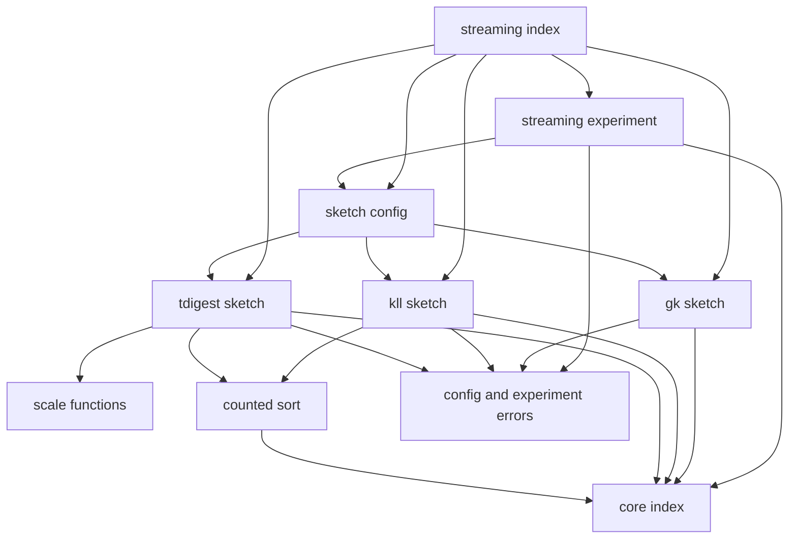
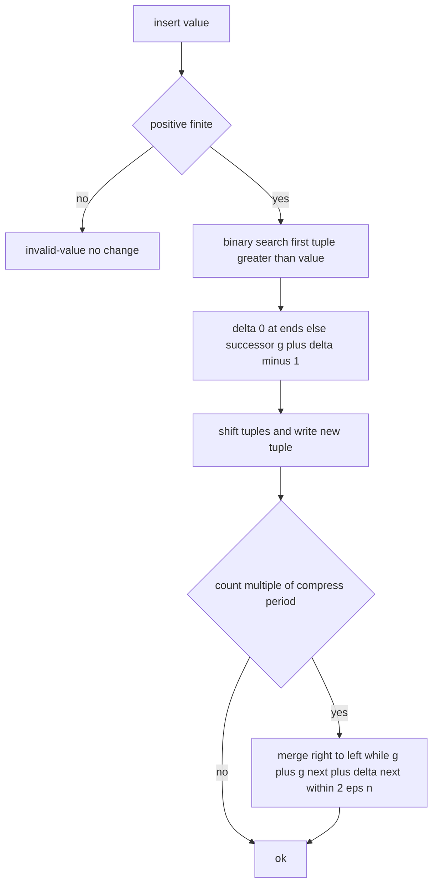
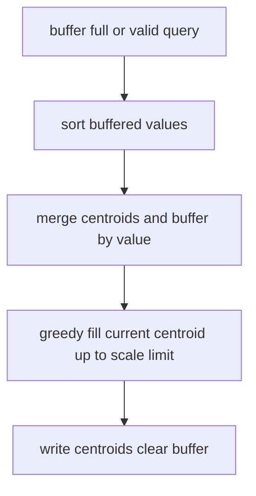
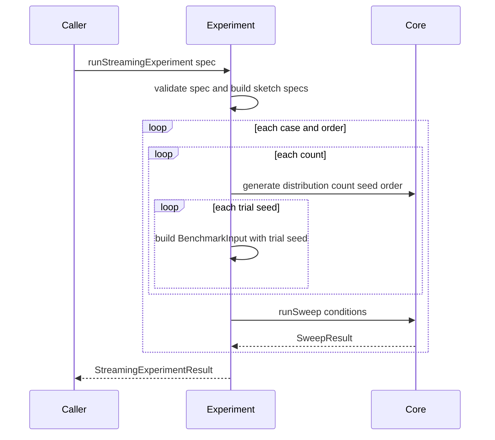

# Design Document

## Overview
Streaming Quantile Sketches は、メモリを制限してストリームから分位点を近似する 3 つの手法(GK、KLL、t-digest)と、パラメータ・データ件数・挿入順序・試行のシードを変えたときの誤差と費用を測る実験の仕組みを提供する。3 手法は percentile-lab-core の共通操作規約、操作数・メモリの数え方、誤差指標、計測ハーネスの上に載り、独自の誤差定義や計測手段を持たない。学習のため、各手法は内部状態(GK のタプル、KLL の段、t-digest の centroid)のスナップショットを返す。DOM に依存しない純粋な TypeScript で、Vitest の node 環境でテストできる。

**Purpose**: 決定的な順位誤差の保証(GK)、確率的な保証(KLL)、裾での精度と保証の弱さ(t-digest)の違いと、挿入順序の影響を、実装と実験で確かめられるようにする。
**Users**: 学習コンテンツの作者本人が、手法を実験条件に組み込むとき、内部状態を追うとき、保証の違いを文書と実験で確認するとき、後続のサイト基盤が実験データと内部状態を表示に使うときに利用する。
**Impact**: `src/streaming/` 配下のモジュール群、`docs/streaming/` 配下の文書、対応するテストを新規に追加する。`src/core/`、`src/histogram/`、`package.json` は変更しない。

### Goals
- GK、KLL、t-digest(スケール関数 k0、k1、k2)を、core の共通操作規約に従う形で提供する(1.1〜1.6、2.1〜2.8、3.1〜3.9、4.1〜4.8)。
- 各手法の内部状態を、状態を変えずに直列化可能な形で観察できる(5.1〜5.6)。
- 投入と問い合わせの費用、メモリを core の尺度で実測できる(6.1〜6.5)。
- 分布・件数・挿入順序・試行のシード・パラメータを変えた結果を、core の結果の形式で出力する(7.1〜7.8)。
- 保証の違いと順序の影響を、文書と、文書の数値・性質を検証するテストで説明する(8.1〜8.8)。

### Non-Goals
- sketch 同士のマージ API(概念は文書で説明するだけ)と、分散環境での評価。
- DDSketch、HDR Histogram(relative-error-sketches)と固定バケットのヒストグラム(histogram-percentile)。
- 相対誤差保証型との横断比較の定義(percentile-lab-site)。
- 学習ページ、グラフ描画、パラメータ操作 UI。
- 論文実装の厳密な再現(GK のバンド、t-digest のまとめる向きの交互切り替えなど)。簡略化した点は文書に記す。
- 厳密解、データ生成、誤差指標の定義(core の所掌)。

## Boundary Commitments

### This Spec Owns
- GK、KLL、t-digest の `PercentileSketch` 実装(状態、投入、問い合わせ、まとめ・圧縮の規則、操作数の数え方、メモリ見積もりに含める項目)。
- t-digest のスケール関数 k0、k1、k2 と、その上限の計算。
- KLL と t-digest が共有する計数付き整列。
- 各手法の `SketchSpec`(識別子の付け方、`params` の項目)と、手法の指定 `StreamingSketchConfig`。
- 内部状態のスナップショットの型(`GkState`、`KllState`、`TDigestState`)と `inspect()`。
- 分布・件数・挿入順序・試行のシード・手法を変える実験の組み立て(`runStreamingExperiment`)と、その結果の構造。
- 保証の違い・順序の影響・簡略化・マージの考え方を説明する文書(`docs/streaming/`)と、その数値を検証するテスト。

### Out of Boundary
- `PercentileSketch`、`SketchSpec`、`SketchError`、`OperationCounter`、`estimateBytes`、`nearestRank`、`createRng`、誤差指標の定義(core の所掌。参照だけする)。
- 計測ハーネス本体、データ生成、厳密解(core の所掌。実験はこれらを呼ぶだけで、複製や拡張はしない)。
- ヒストグラム近似、DDSketch、HDR Histogram の実装と、それらとの横断比較の定義。
- sketch 同士のマージ API、手法の登録機構、結果の表示形式。

### Allowed Dependencies
- 実行時依存は `src/core/index.ts` だけ。core の内部ファイルや `src/histogram/` を import してはならない。
- 外部の実行時依存・開発時依存は追加しない(`vitest` と `fast-check` は core が導入済みのものを使う)。
- 内部の依存方向: errors → sort → scale → (gk、kll、tdigest) → config → experiment → index。左から右への import だけを許し、逆は禁止する。`gk`、`kll`、`tdigest` は互いに import しない。`gk` は `sort` と `scale` を使わず、`kll` は `scale` を使わない。
- 後続 spec は `src/streaming/index.ts` だけを import する。

### Revalidation Triggers
次の変更は、percentile-lab-site など利用側の再確認が必要になる。
- `SketchSpec` の `id` の規則と `params` の項目名(結果の系列化と絞り込みに使われる)。
- `GkState`、`KllState`、`TDigestState` の構造(内部状態の表示に使われる)。
- `StreamingExperimentResult` の構造と `schemaVersion`、実験で使う `meta` の項目名と値。
- `StreamingSketchConfig` の判別子と項目、パラメータの許容範囲(`EPSILON_RANGE` など)。
- `ConfigError`、`StreamingExperimentError` の種別の追加・削除。

上流(core)の次の変更は、この spec の再確認が必要になる。
- `PercentileSketch`、`SketchSpec`、`SketchError`、`OperationCounter`、`estimateBytes` の型・意味。
- `nearestRank` の丸め規則(GK と KLL の目標順位、GK の保証の検証が依存する)。
- `createRng` の乱数列(KLL の結果と文書の数値が依存する)。
- `generate` の乱数の消費順序と並べ替えの規則(順序の実験の「同じ値の集まり」が依存する)。
- `runBenchmark`、`runSweep`、`BenchmarkInput`、`BenchmarkResult` の構造。

## Architecture

### Existing Architecture Analysis
`src/core/` は Foundation → Primitives → Domain → Harness → Entry の層構造で、後続 spec には `src/core/index.ts` だけを公開する。厳密解と histogram は、検証 → 状態更新 → 操作数の計数 → `Result` の返却という形で `PercentileSketch` を実装し、`xxxSpec()` で `SketchSpec` を作る。histogram は `src/histogram/` を平坦に置き、`index.ts` だけを公開し、`docs/histogram/` の数値を `docs-examples.test.ts` で検証する。この spec も同じ形に揃える。

- 値の検証は `checkPositiveFinite`、分位点の検証は `isQuantile` を使い、`query` は分位点 → 空の順に検査する。
- エラー時は状態・操作数を変えない。引数の検査、四則演算、添字の計算、ループの制御は操作数に数えない。
- 3 手法とも値域を制限しないので、`supportedRange` は指定しない(4.3)。

### Architecture Pattern & Boundary Map
選択したパターンは、依存方向を固定した小さな層構造である。3 手法は互いに独立したファイルにし、共有するのは計数付き整列とスケール関数だけにする。実験の組み立てだけが core のハーネスとデータ生成を呼ぶ。



**Architecture Integration**:
- 選択したパターン: 層構造のライブラリ。手法ごとのファイル(状態を持つ)、純粋関数の共有部品(整列、スケール関数)、実験の組み立てを分ける。
- 境界の分け方: 3 手法は互いを知らず、並行に実装・レビューできる。実験は `StreamingSketchConfig` を `SketchSpec` に変換して core のハーネスに渡すだけで、手法の内部を知らない。
- 維持するパターン: `Result` による入力エラーの返却、`xxxSpec()` による `SketchSpec` の作成、`OperationCounter` による計数、`index.ts` だけの公開、文書の数値のテストによる検証。
- 新規コンポーネントの理由: 手法の独立(brief の境界候補)、スケール関数の単体検証(3.2)、内部状態の観察(5.x)、順序と試行の実験(7.2、7.3)。
- Steering: steering の core ファイル(`product.md`、`tech.md`、`structure.md`)は未作成である。`roadmap.md` の制約(Node.js 22.12 以上、DOM 非依存、許容ライセンス、日本語の文書)に従う。

### Technology Stack

| Layer | Choice / Version | Role in Feature | Notes |
|-------|------------------|-----------------|-------|
| 言語 | TypeScript 7.0.2(core と同じ) | 型チェックは `tsc --noEmit` | `any` を使わない。既存の `tsconfig.json` をそのまま使う |
| テスト | Vitest 5.0.5(node 環境) | 単体・統合・文書の数値の検証 | `src/**/*.test.ts` が既存の設定で拾われる |
| 性質テスト | fast-check 4.10.2(開発時のみ) | 不変条件のテスト | シードを固定する |
| 乱数 | core の `createRng`(sfc32) | KLL の compaction の選択 | 新たな乱数生成器は持たない |
| 実行環境 | Node.js 22.12 以上 | core と同じ | 追加の要件なし |
| 依存 | 追加なし | — | `licenses:check` の結果は変わらない |

## File Structure Plan

### Directory Structure
```
src/streaming/
├── index.ts                  # 唯一の公開入口。後続 spec はここだけを import する
├── errors.ts                 # ConfigError、StreamingExperimentError の型
├── sort.ts                   # sortValues、sortWeighted(比較と移動を数える併合整列)
├── sort.test.ts
├── scale.ts                  # ScaleFunctionKind、SCALE_FUNCTIONS、scaleLimit(t-digest の centroid の上限)
├── scale.test.ts
├── gk.ts                     # createGk、gkSpec、GkSketch、GkState、EPSILON_RANGE
├── gk.test.ts
├── kll.ts                    # createKll、kllSpec、KllSketch、KllState、K_RANGE、KLL_SHRINK
├── kll.test.ts
├── tdigest.ts                # createTDigest、tdigestSpec、TDigestSketch、TDigestState、COMPRESSION_RANGE
├── tdigest.test.ts
├── config.ts                 # StreamingSketchConfig、streamingSketchSpec(設定から SketchSpec への変換)
├── config.test.ts
├── conformance.test.ts       # GK、KLL、t-digest(k0、k1、k2)で runConformance を通す
├── inspect.test.ts           # inspect の状態不変、直列化、複製、メモリ見積もりとの整合
├── cost.test.ts              # 操作数・メモリの増え方(件数、パラメータ)
├── properties.test.ts        # fast-check による不変条件(分布・順序・シード)
├── experiment.ts             # runStreamingExperiment(データ生成、SketchSpec の列挙、core ハーネス呼び出し)
├── experiment.test.ts
├── docs-examples.test.ts     # docs/streaming/ の数値が実装の出力と一致することを確認
└── public-api.test.ts        # index.ts だけから必要な API が使えること
docs/streaming/
├── overview.md               # 3 手法の保証の比較、簡略化した点と保証への影響、マージの考え方
├── gk.md                     # タプル、不変条件、問い合わせ規則、保証の導出、数値例
├── kll.md                    # 段と容量、compaction、重みの保存、確率的な保証、数値例
├── t-digest.md               # スケール関数、centroid の大きさ、補間、裾の精度、保証の弱さ、数値例
└── experiments.md            # パラメータと誤差・メモリ、試行のばらつき、裾の精度、挿入順序の影響
```

> 各ファイルの責務は 1 つである。テストは対象の隣に置く(core、histogram と同じ配置)。`index.ts` を除き、他の spec から直接 import しない。

### Modified Files
なし。`src/core/`、`src/histogram/`、`package.json`、`tsconfig.json`、`vite.config.ts` は変更しない。`.kiro/steering/roadmap.md` のチェックは、実装の完了後に利用者が更新する。

## System Flows

### GK の投入と問い合わせ(1.3〜1.5)


### t-digest のまとめ(3.4、3.5)


### 実験の実行(7.1〜7.8)


- `SketchSpec` は実験条件の検証の直後に 1 回だけ作り、すべての条件で使い回す(手法の設定はデータに依存しない)。設定の誤りは生成より前に `invalid-config` で返る。
- 1 つの条件には、厳密解 2 方式と、指定されたすべての手法を同じ `BenchmarkInput.sketches` に入れる。誤差は同じデータ・同じ基準値で比べられる。
- データは (ケース、順序、件数) ごとに 1 回だけ生成し、試行のシードの数だけ `BenchmarkInput` を作る。同じシードの `generate` は順序だけが違う同じ値の集まりを返すので、順序の比較は同じ値の集まりで行われる(7.2)。
- 検証エラー、生成エラー、ハーネスの入力エラーは `Result` のエラーとして返し、部分的な結果は返さない(7.8)。手法の実行時の失敗(例外)はハーネスが条件ごとに記録する。

## Requirements Traceability

| Requirement | Summary | Components | Interfaces | Flows |
|-------------|---------|------------|------------|-------|
| 1.1 | ε を目標とする GK を作る | Gk | `createGk`, `gkSpec` | — |
| 1.2 | 不正な ε でエラー、作らない | Gk, Errors | `ConfigError`, `EPSILON_RANGE` | — |
| 1.3 | 投入済みの値を返し順位誤差 ≤ εn | Gk | `query` | GK の投入と問い合わせ |
| 1.4 | q=0 は最小値、q=1 は最大値 | Gk | `query` | — |
| 1.5 | 保証を崩さずタプルをまとめる | Gk | 圧縮の規則 | GK の投入と問い合わせ |
| 1.6 | 乱数なし、同じ入力で同じ結果 | Gk | — | — |
| 2.1 | k で容量を決める KLL を作る | Kll | `createKll`, `kllSpec` | — |
| 2.2 | 不正な k でエラー、作らない | Kll, Errors | `ConfigError`, `K_RANGE` | — |
| 2.3 | 容量超過で整列し乱数で半分を上へ | Kll, Sort | compaction の規則 | — |
| 2.4 | 重みの合計 = 投入件数 | Kll | 不変条件 | — |
| 2.5 | 重みの累計で目標順位の要素を返す | Kll, Sort | `query` | — |
| 2.6 | 保持要素数は k に比例 | Kll | 容量の規則 | — |
| 2.7 | 同じ k・シード・入力で同じ結果 | Kll | `createRng` | — |
| 2.8 | シードで選択が変わる | Kll | `createRng` | — |
| 3.1 | δ とスケール関数で上限を決める | TDigest, Scale | `createTDigest`, `scaleLimit` | — |
| 3.2 | k0、k1、k2 の 3 種 | Scale | `ScaleFunctionKind` | — |
| 3.3 | 不正な δ・スケール関数でエラー | TDigest, Errors | `ConfigError`, `COMPRESSION_RANGE` | — |
| 3.4 | バッファ満杯か問い合わせでまとめる | TDigest, Sort, Scale | まとめの規則 | t-digest のまとめ |
| 3.5 | 重み + バッファ件数 = 投入件数 | TDigest | 不変条件 | t-digest のまとめ |
| 3.6 | 最小・最大を保持、q=0・1 で返す | TDigest | `query` | — |
| 3.7 | 重みの中心を結ぶ線形補間 | TDigest | `query` | — |
| 3.8 | 推定値は [最小, 最大] で単調 | TDigest | 事後条件 | — |
| 3.9 | 乱数なし、同じ入力で同じ結果 | TDigest | — | — |
| 4.1 | 共通規約に従う | Gk, Kll, TDigest | `PercentileSketch` | — |
| 4.2 | 適合確認を通る(t-digest は 3 種) | Gk, Kll, TDigest | `runConformance`(テスト) | — |
| 4.3 | 値域を制限しない | Gk, Kll, TDigest | `supportedRange` を省略 | — |
| 4.4 | 不正値・範囲外の分位点でエラー、状態不変 | Gk, Kll, TDigest | `insert`, `query` | — |
| 4.5 | 空はエラー | Gk, Kll, TDigest | `query` → `empty` | — |
| 4.6 | reset はパラメータを保ち、要素・操作数・乱数列を戻す | Gk, Kll, TDigest | `reset` | — |
| 4.7 | 手法とパラメータを `params` で公開 | Gk, Kll, TDigest, Config | `params` | — |
| 4.8 | 推定値は有限の正の数 | Gk, Kll, TDigest | 事後条件 | — |
| 5.1 | GK のタプル一覧 | Gk | `GkState`, `inspect` | — |
| 5.2 | KLL の段ごとの状態 | Kll | `KllState`, `inspect` | — |
| 5.3 | t-digest の centroid 一覧 | TDigest | `TDigestState`, `inspect` | — |
| 5.4 | inspect は状態を変えない | Gk, Kll, TDigest | `inspect` | — |
| 5.5 | 直列化可能、書き換えても影響なし | Gk, Kll, TDigest | 複製のスナップショット | — |
| 5.6 | 要素数とメモリ見積もりが整合 | Gk, Kll, TDigest | `memoryBytes` の式 | — |
| 6.1 | core の数え方で比較と移動を数える | Gk, Kll, TDigest, Sort | `OperationCounter` | — |
| 6.2 | 整列・まとめ・圧縮を引き起こした操作に含める | Gk, Kll, TDigest, Sort | 計数の規則 | — |
| 6.3 | 保持要素とカウンタからメモリを算出 | Gk, Kll, TDigest | `estimateBytes` | — |
| 6.4 | 件数を増やした実測比較 | Experiment | `counts` | 実験の実行 |
| 6.5 | パラメータを変えた実測確認 | Experiment, Config | `sketches` | 実験の実行 |
| 7.1 | 厳密解と同じデータで計測 | Experiment | `runStreamingExperiment` | 実験の実行 |
| 7.2 | 挿入順序ごとの結果 | Experiment | `orders` | 実験の実行 |
| 7.3 | 試行のシードごとの結果 | Experiment | `trialSeeds` | 実験の実行 |
| 7.4 | core の結果の形式のまま返す | Experiment | `StreamingExperimentResult` | — |
| 7.5 | 直列化可能、条件が結果から読める | Experiment | `params`, `meta`, `seed` | — |
| 7.6 | 同じ条件で処理時間を除き同じ結果 | Experiment | 決定的な生成・計測 | — |
| 7.7 | 複数の分布を並べて取得 | Experiment | `cases` | — |
| 7.8 | 不正な実験条件でエラー、部分的な結果なし | Experiment, Errors | `StreamingExperimentError` | 実験の実行 |
| 8.1 | GK の保証と導出の文書化 | Docs, Tests | `gk.md`, `experiments.md` | — |
| 8.2 | KLL の確率的な保証の文書化 | Docs, Tests | `kll.md`, `experiments.md` | — |
| 8.3 | t-digest の裾の精度と保証の弱さの文書化 | Docs, Tests | `t-digest.md`, `experiments.md` | — |
| 8.4 | 挿入順序の影響の文書化 | Docs, Tests | `experiments.md` | — |
| 8.5 | マージの考え方の文書化 | Docs | `overview.md` | — |
| 8.6 | 簡略化と保証への影響の文書化 | Docs | `overview.md`, 各手法の文書 | — |
| 8.7 | 文書の数値と実装の出力の一致 | Tests | `docs-examples.test.ts` | — |
| 8.8 | 性質テストで文書化した性質を確認 | Tests | `properties.test.ts` | — |
| 9.1 | ブラウザなしで動く | 全体 | DOM を使わない | — |
| 9.2 | 1 つの操作でテストを実行 | Tests | 既存の `npm test` | — |
| 9.3 | 新たな外部依存を追加しない | 全体 | — | — |
| 9.4 | 内部構成を知らずに利用できる | Entry | `src/streaming/index.ts` | — |

## Components and Interfaces

| Component | Domain/Layer | Intent | Req Coverage | Key Dependencies (P0/P1) | Contracts |
|-----------|--------------|--------|--------------|--------------------------|-----------|
| Errors | Foundation | 設定・実験のエラー型 | 1.2, 2.2, 3.3, 7.8 | core `GenerateError`, `HarnessError` (P0) | State |
| Sort | Primitives | 計数付きの併合整列 | 2.3, 2.5, 3.4, 6.1, 6.2 | core `OperationCounter` (P0) | Service |
| Scale | Primitives | スケール関数と centroid の上限 | 3.1, 3.2 | なし | Service |
| Gk | Domain | GK の `PercentileSketch` と状態の観察 | 1.1〜1.6, 4.1〜4.8, 5.1, 5.4〜5.6, 6.1〜6.3 | Errors (P0), core 検証・計数・見積もり・`nearestRank` (P0) | Service, State |
| Kll | Domain | KLL の `PercentileSketch` と状態の観察 | 2.1〜2.8, 4.1〜4.8, 5.2, 5.4〜5.6, 6.1〜6.3 | Sort (P0), Errors (P0), core `createRng`・検証・計数・見積もり (P0) | Service, State |
| TDigest | Domain | t-digest の `PercentileSketch` と状態の観察 | 3.1〜3.9, 4.1〜4.8, 5.3〜5.6, 6.1〜6.3 | Sort (P0), Scale (P0), Errors (P0), core 検証・計数・見積もり (P0) | Service, State |
| Config | Domain | 手法の指定から `SketchSpec` への変換 | 4.7, 6.5, 7.1 | Gk, Kll, TDigest (P0) | Service |
| Experiment | Harness | 実験条件の列挙と core ハーネスの呼び出し | 6.4, 6.5, 7.1〜7.8 | Config (P0), core `generate`, `runSweep`, 厳密解 (P0) | Service |
| Entry | Entry | 公開入口 | 9.4 | 全コンポーネント (P0) | — |
| Docs | 文書 | 保証・順序・簡略化・マージの説明 | 8.1〜8.6 | Experiment の実測値 (P0) | — |

### Foundation

#### Errors

| Field | Detail |
|-------|--------|
| Intent | 手法の設定と実験の指定の誤りを、判別可能な型で表す |
| Requirements | 1.2, 2.2, 3.3, 7.8 |

```typescript
/** 手法の設定が不正。field は不正な項目(例: 'epsilon', 'k', 'compression', 'scale', 'seed') */
export type ConfigError = {
  readonly kind: 'invalid-config';
  readonly field: string;
  readonly reason: string;
};

export type StreamingExperimentError =
  | ConfigError
  | { readonly kind: 'invalid-experiment'; readonly field: string; readonly reason: string }
  | { readonly kind: 'generate'; readonly error: GenerateError }
  | { readonly kind: 'harness'; readonly error: HarnessError };
```

- `reason` は人が読む説明であり、分岐には使わない(histogram の `SchemeError` と同じ扱い)。
- 実験で `sketches[i]` の設定が不正なときは、`field` を `sketches[<i>].<項目>` にして返す。

### Primitives

#### Sort

| Field | Detail |
|-------|--------|
| Intent | 値の列(と重みの列)を、比較と移動を数えながら昇順に並べる |
| Requirements | 2.3, 2.5, 3.4, 6.1, 6.2 |

**Responsibilities & Constraints**
- ボトムアップの併合整列で、安定(同値は元の並びを保つ)。core の厳密解(`sort-exact.ts`)と同じ数え方: 値と値の比較 1 回ごとに比較 1、作業領域への 1 要素の書き込みごとに移動 1。重み付きの場合、値と重みの組の書き込みは移動 2 と数える。
- 作業領域は呼び出しの中だけで使い、結果は入力の配列に書き戻す。書き戻しの移動も数える。
- 乱数は使わない。

**Contracts**: Service [x]

##### Service Interface
```typescript
/** values[0..length) を昇順に並べ替える。length は 0 以上 values.length 以下 */
export function sortValues(values: Float64Array, length: number, counter: OperationCounter): void;

/** values[0..length) を昇順に並べ、weights[0..length) を同じ並びに揃える */
export function sortWeighted(
  values: Float64Array,
  weights: Float64Array,
  length: number,
  counter: OperationCounter,
): void;
```
- Postconditions: `values[0..length)` は昇順、`[length..)` は変更しない。比較の回数は `length × ceil(log2 length)` 以下。
- Invariants: 同じ入力から同じ結果と同じ操作数。

#### Scale

| Field | Detail |
|-------|--------|
| Intent | t-digest のスケール関数と、centroid が覆ってよい分位点の上限を計算する |
| Requirements | 3.1, 3.2 |

**Responsibilities & Constraints**
- スケール関数(δ は圧縮パラメータ、n は総件数):
  - `k0(q) = δ × q / 2`
  - `k1(q) = (δ / (2π)) × asin(2q − 1)`
  - `k2(q) = (δ / Z(n)) × ln(q / (1 − q))`、`Z(n) = 4 × ln(max(n / δ, 1)) + 24`
- `scaleLimit(kind, qLeft, compression, total)` は `k⁻¹(k(qLeft) + 1)` を返す。centroid の左端の分位点が `qLeft` のとき、右端の分位点がこの値以下なら `k(q_right) − k(q_left) ≤ 1` を満たす。
  - `k0⁻¹(y) = 2y / δ`、`k1⁻¹(y) = (sin(2πy / δ) + 1) / 2`(`2πy / δ` は `[−π/2, π/2]` に収める)、`k2⁻¹(y) = 1 / (1 + exp(−y × Z(n) / δ))`。
  - `qLeft = 0` のとき、`k1` は `−δ/4`、`k2` は `−∞` として扱う(`k2` の上限は 0 になる)。
  - 戻り値は `[qLeft, 1]` に収める(浮動小数点の誤差対策)。
- 純粋関数で、操作数を数えない(呼び出し側が「上限に収まるか」の比較を数える)。

**Contracts**: Service [x]

##### Service Interface
```typescript
export type ScaleFunctionKind = 'k0' | 'k1' | 'k2';
export const SCALE_FUNCTIONS: readonly ScaleFunctionKind[];

/** qLeft は [0, 1]、compression は COMPRESSION_RANGE 内、total は 1 以上 */
export function scaleLimit(
  kind: ScaleFunctionKind,
  qLeft: number,
  compression: number,
  total: number,
): number;
```
- Postconditions: 戻り値は `qLeft` 以上 1 以下。`k0` では `qLeft` によらず `qLeft + 2/δ`(1 で頭打ち)、`k1` と `k2` では `qLeft` が 0.5 に近いほど `qLeft` との差が大きい(裾ほど centroid が小さい)。
- Invariants: 同じ入力から同じ値。

### Domain

3 手法は共通して次を守る。
- `insert(value)`: `checkPositiveFinite` で検証し、不正なら `invalid-value` を返す。状態も操作数も変えない(4.4)。範囲の制限はなく、`unsupported-value` は返さない(4.3)。
- `query(q)`: `isQuantile` → 空の順に検査し、`quantile-out-of-range`、`empty` を返す(4.4、4.5)。成功値は有限の正の数(4.8)。
- `reset()`: パラメータを保ち、保持要素・件数・操作数・(KLL は)乱数列を作成直後に戻す(4.6)。
- `inspect()`: 現在の状態の複製を返す。状態・操作数・メモリ見積もり・以後の推定値を変えず、操作数に数えない(5.4、5.5)。数値の配列は `number[]` の新しい配列で返す。
- `xxxSpec()` は `supportedRange` を持たない。`params` は `isParamRecord` を満たし、先頭に `algorithm`(`'gk'`、`'kll'`、`'tdigest'`)を持つ(4.7)。

#### Gk

| Field | Detail |
|-------|--------|
| Intent | タプル `(v, g, Δ)` の列で、順位誤差 ε を保証する分位点の要約を保持する |
| Requirements | 1.1, 1.2, 1.3, 1.4, 1.5, 1.6, 4.1〜4.8, 5.1, 5.4, 5.5, 5.6, 6.1, 6.2, 6.3 |

**Responsibilities & Constraints**
- 状態: タプルの値 `v`、`g`、`Δ` の 3 本の配列(値の昇順)、タプル数 `s`、投入件数 `n`、`OperationCounter`。`rmin_i = Σ_{j≤i} g_j`、`rmax_i = rmin_i + Δ_i`。
- 不変条件: すべてのタプルで `g_i + Δ_i ≤ max(1, ⌊2εn⌋)`。`Σ g_i = n`。先頭のタプルは最小値、最後のタプルは最大値で、どちらも `Δ = 0`。
- `insert(value)`(検証後):
  1. `v_i > value` を満たす最初のタプル `i` を二分探索で求める(同値は既存の後ろに入る)。比較は探索で実行した分だけ数える(最大 `ceil(log2(s + 1))` 回)。
  2. 新しいタプルの `Δ` は、`i = 0`(新しい最小値)または `i = s`(新しい最大値)なら 0、それ以外は `g_i + Δ_i − 1`(後続のタプル)。`g = 1`。
  3. `i` 以降のタプルを 1 つずつ後ろにずらし、新しいタプルを書く。ずらした各タプルで移動 3、新しいタプルで移動 3 と数える。配列の容量を広げるときは、複製したタプルごとに移動 3 と数える(厳密解と同じ扱い)。
  4. `n` を 1 増やす。`n` が圧縮の周期 `max(1, ⌊1/(2ε)⌋)` の倍数なら圧縮する。
- 圧縮: 閾値 `T = ⌊2εn⌋`。`i = s − 2` から `1` まで右から左に、`g_i + g_{i+1} + Δ_{i+1} ≤ T` なら、タプル `i` を `i + 1` に併合する(`g_{i+1} += g_i`、`i` を削除)。判定ごとに比較 1(histogram の累積件数の比較と同じ扱い)、併合で書き換えた `g` に移動 1、削除で詰めたタプルごとに移動 3 と数える。先頭(i = 0)は併合しないので最小値が残り、最大値は併合先にしかならないので残る(1.4)。
- `query(q)`(検証後): 目標順位 `r = nearestRank(n, q)`、許容幅 `e = ε × n`。
  - `q = 0` なら先頭のタプルの値(最小値)を返す(比較 0 回)。
  - それ以外は、先頭から `rmin` を累積しながら、`rmax_i > r + e` を満たす最初のタプル `i` を探し、`v_{i−1}` を返す。見つからなければ最後のタプルの値(最大値)を返す。調べたタプルごとに比較 1。`q = 1` では `rmax_i ≤ n` なので必ず最大値になる(1.4)。
  - 保証(1.3): `i ≥ 1`(`rmax_0 = 1 ≤ r + e`)。`rmax_{i−1} ≤ r + e`、かつ不変条件から `rmin_{i−1} ≥ rmax_i − (g_i + Δ_i) > r + e − 2εn = r − e`。`v_{i−1}` の真の順位は `[rmin_{i−1}, rmax_{i−1}]` にあるので、目標順位との差は `e` 以下。core の `rankError` は重複値の順位を目標に最も近づけるので、指標上の順位誤差も ε 以下になる。`⌊2εn⌋ = 0` の間は併合が起きず `Δ = 0` なので、要約は厳密である。
- `memoryBytes()`: `estimateBytes({ numbers: s, counters: 2s + 1 })`(値 `s` 個、`g` と `Δ` の `2s` 個、`n`)(5.6、6.3)。
- 乱数は使わない(1.6)。

**Dependencies**
- Inbound: Config、外部の利用者 — 作成 (P0)
- Outbound: Errors (P0)、core `checkPositiveFinite`, `isQuantile`, `nearestRank`, `estimateBytes`, `OperationCounter`, `ok`, `err` (P0)

**Contracts**: Service [x] / State [x]

##### Service Interface
```typescript
/** ε の許容範囲(両端を含む) */
export const EPSILON_RANGE: { readonly min: 0.0001; readonly max: 0.5 };

export interface GkOptions {
  readonly epsilon: number;
}

export interface GkTuple {
  readonly value: number;
  /** 直前のタプルとの最小順位の差 */
  readonly g: number;
  /** 順位の幅(rmax − rmin) */
  readonly delta: number;
}

export interface GkState {
  readonly algorithm: 'gk';
  readonly epsilon: number;
  readonly count: number;
  /** 値の昇順 */
  readonly tuples: readonly GkTuple[];
}

export interface GkSketch extends PercentileSketch {
  inspect(): GkState;
}

export function createGk(options: GkOptions): Result<GkSketch, ConfigError>;
export function gkSpec(options: GkOptions): Result<SketchSpec, ConfigError>;
```
- `gkSpec`: `id` は `gk-eps-<ε>`、`label` は `GK(ε=<ε>)`、`params` は `{ algorithm: 'gk', epsilon }`。`create` はシードを使わない。
- エラー: `epsilon` が有限の数でない、`EPSILON_RANGE` の外 → `invalid-config`(`field: 'epsilon'`)。

##### State Management
- State model: タプルの 3 本の配列、`s`、`n`、計数器。
- Persistence & consistency: メモリ内のみ。同期的で、1 つのインスタンスは単一のスレッドから使う。
- Concurrency strategy: 考慮しない。インスタンス同士は状態を共有しない。

**Implementation Notes**
- Integration: `inspect()` の `tuples.length` は `s`、`count` は `n`。`memoryBytes() = (3 × tuples.length + 1) × 8`(5.6)。
- Validation: 保証の導出は文書 `gk.md` に書き、性質テストで「すべての q で順位誤差 ≤ ε」を確認する。
- Risks: 簡略版の圧縮は空間の上限が証明されていない(research.md)。投入の移動はタプル数に比例し、ε が小さいと遅い。どちらも文書に書く。

#### Kll

| Field | Detail |
|-------|--------|
| Intent | 容量が等比で減る段(compactor)の列で、乱数による確率的な分位点の要約を保持する |
| Requirements | 2.1〜2.8, 4.1〜4.8, 5.2, 5.4, 5.5, 5.6, 6.1, 6.2, 6.3 |

**Responsibilities & Constraints**
- 状態: 段の列(段 `h` は値の配列と要素数、重みは `2^h`)、段数 `H`(1 以上)、投入件数 `n`、それまでの compaction の回数、`createRng(seed)` で作った乱数生成器、`OperationCounter`。
- 容量: `capacity(h) = max(2, ⌊k × (2/3)^(H−1−h)⌋)`。上の段ほど大きく、最上段は `k`。容量の合計は `3k + 2H` 以下(2.6)。
- `insert(value)`(検証後):
  1. 段 0 の末尾に書く(移動 1)。`n` を 1 増やす。
  2. 保持要素数の合計が容量の合計を超えたら、compaction を 1 回行う: 要素数が `capacity(h)` 以上の最も下の段 `h` を選ぶ(合計が超えているので必ず存在する)。`h` が最上段なら、先に段を 1 つ足す(容量は足したあとの `H` で計算し直す)。
- compaction(段 `h`、要素数 `m`):
  1. 段 `h` を `sortValues` で整列する。
  2. `m` が奇数なら、整列後の先頭(最小)の要素を段 `h` に残す。残りの偶数個 `m'` を対象にする。
  3. `offset = rng.nextIntBelow(2)` を引き、対象の `offset, offset + 2, …` 番目(`m'/2` 個)を段 `h + 1` の末尾に書く(各移動 1)。残りは捨てる。段 `h` に残す要素の書き戻しも移動 1 と数える。
  4. compaction の回数を 1 増やす。
  - 重み `2^h` の `m'` 個が重み `2^{h+1}` の `m'/2` 個になるので、重みの合計は変わらない(2.4)。乱数を引くのは compaction ごとに 1 回で、シードが同じなら選択も同じ(2.7)、違えば変わりうる(2.8)。
  - 1 回の compaction で要素数は 1 以上減るので、投入後の保持要素数は常に容量の合計以下になる。
- `query(q)`(検証後):
  1. 全段の要素を作業用の配列に集め(値と重み `2^h`)、`sortWeighted` で整列する。集める書き込みは、要素ごとに移動 2(値と重み)と数える(厳密解のクイックセレクトが問い合わせごとの複製を n 回の移動と数えるのと同じ扱い)。
  2. 目標順位 `r = nearestRank(n, q)`。先頭から重みを累積し、累計が初めて `r` 以上になる要素の値を返す。調べた要素ごとに比較 1(2.5)。
  - 問い合わせは状態を変えない。
- `memoryBytes()`: `estimateBytes({ numbers: 保持要素数, counters: H + 1 })`(段ごとの要素数 `H` 個と `n`)。compaction の回数は観察用であり、乱数の状態とともに見積もりに含めない(6.3)。
- `reset()`: 段を 1 つ(空)に戻し、`n`、compaction の回数、操作数を 0 にし、乱数生成器を同じシードで作り直す(4.6)。

**Dependencies**
- Inbound: Config、外部の利用者 — 作成 (P0)
- Outbound: Sort (P0)、Errors (P0)、core `createRng`, `checkPositiveFinite`, `isQuantile`, `nearestRank`, `estimateBytes`, `OperationCounter`, `ok`, `err` (P0)

**Contracts**: Service [x] / State [x]

##### Service Interface
```typescript
/** k の許容範囲(両端を含む整数) */
export const K_RANGE: { readonly min: 8; readonly max: 65536 };
/** 段の容量の縮小率 c */
export const KLL_SHRINK = 2 / 3;

export interface KllOptions {
  readonly k: number;
}

export interface KllLevel {
  readonly level: number;
  /** この段の要素 1 個が表す件数(2^level) */
  readonly weight: number;
  readonly capacity: number;
  /** 保持順(段 0 は投入順、上の段は送られてきた順) */
  readonly values: readonly number[];
}

export interface KllState {
  readonly algorithm: 'kll';
  readonly k: number;
  readonly count: number;
  readonly compactions: number;
  /** 段 0 から順に */
  readonly levels: readonly KllLevel[];
}

export interface KllSketch extends PercentileSketch {
  inspect(): KllState;
}

/** seed は 0 以上 2^32 未満の整数(core の createRng と同じ)。省略時は 1 */
export function createKll(options: KllOptions & { readonly seed?: number }): Result<KllSketch, ConfigError>;
/** create(seed) に不正なシードが渡されると例外を投げる(ハーネスが create 段階のエラーとして記録する) */
export function kllSpec(options: KllOptions): Result<SketchSpec, ConfigError>;
```
- `kllSpec`: `id` は `kll-k-<k>`、`label` は `KLL(k=<k>)`、`params` は `{ algorithm: 'kll', k, c: KLL_SHRINK }`。
- エラー: `k` が整数でない、`K_RANGE` の外 → `invalid-config`(`field: 'k'`)。`seed` が不正 → `invalid-config`(`field: 'seed'`)。

##### State Management
- State model: 段の列、`H`、`n`、compaction の回数、乱数生成器、計数器。
- Persistence & consistency / Concurrency strategy: Gk と同じ。

**Implementation Notes**
- Integration: `inspect()` の `levels.length` は `H`、`Σ values.length` は保持要素数、`Σ weight × values.length` は `count`(2.4、5.6)。
- Validation: 性質テストで、重みの保存、保持要素数 ≤ 容量の合計 ≤ `3k + 2H`、同じシードでの再現、シードによる推定値の違い(固定シードの組で少なくとも 1 組は異なる)を確認する。順位誤差は固定シードの集合で緩い上限(`k = 200`、`n = 10,000` で 0.05 以下)を確認し、実測の分布は文書に載せる。
- Risks: 容量の計算は `(2/3)^d` の浮動小数点の値を切り捨てるので、環境による差がありうる。端末間で同じ結果になることは文書の数値のテストで確認する。

#### TDigest

| Field | Detail |
|-------|--------|
| Intent | スケール関数で大きさを制限した centroid の列で、裾で精度の高い分位点の要約を保持する |
| Requirements | 3.1〜3.9, 4.1〜4.8, 5.3, 5.4, 5.5, 5.6, 6.1, 6.2, 6.3 |

**Responsibilities & Constraints**
- 状態: centroid の平均値と重みの 2 本の配列(平均値の昇順)、centroid 数 `c`、バッファ(容量 `⌈5δ⌉` の値の配列)と件数 `b`、最小値、最大値、投入件数 `n`、`OperationCounter`。
- 不変条件: `Σ 重み + b = n`(3.5)。最小値 ≤ すべての平均値 ≤ 最大値。
- `insert(value)`(検証後): バッファの末尾に書く(移動 1)。最小値・最大値を更新する(比較 2、更新した場合は移動 1)。`n` を 1 増やす。`b` が容量に達したら、まとめる(3.4)。
- まとめ(3.4、3.5):
  1. バッファを `sortValues` で整列する。
  2. 既存の centroid(平均値の昇順)と整列したバッファ(重み 1)を、値の順に 1 列として読む(2 列の先頭同士の比較ごとに比較 1)。
  3. 貪欲にまとめる: 現在の centroid の左端の分位点 `qLeft = (これまでに確定した重み) / n`、上限 `qLimit = scaleLimit(scale, qLeft, δ, n)`。次の項目を加えた右端 `(確定した重み + 現在の重み + 次の重み) / n` が `qLimit` 以下なら加えて加重平均を更新し、超えたら現在の centroid を確定して次の項目から新しい centroid を始める。判定ごとに比較 1。各 centroid には少なくとも 1 項目が入るので、上限が `qLeft` に等しくても処理は進む。
  4. 確定した centroid を書き出す(centroid ごとに移動 2)。`b = 0`。
  - まとめる向きは常に昇順とする(参照実装の交互切り替えは簡略化で省く。`overview.md` に書く)。
- `query(q)`(検証後): `b > 0` なら先にまとめる(その操作数は問い合わせに含める。6.2)。次に、点 `(0, 最小値)`、`(t_i, 平均値_i)`(`t_i = 前の centroid の重みの合計 + 重み_i / 2`)、`(n, 最大値)` を結ぶ折れ線で、目標位置 `t = q × n` の値を線形補間して返す(3.7)。調べた点ごとに比較 1。
  - `t_i` は狭義単調増加で、平均値は単調非減少なので、推定値は `q` について単調非減少であり、`[最小値, 最大値]` に収まる(3.8)。丸め対策として結果をこの区間に収める。`q = 0` は最小値、`q = 1` は最大値になる(3.6)。最小値が正なので、推定値は有限の正の数になる(4.8)。
- `memoryBytes()`: `estimateBytes({ numbers: c + b + 2, counters: c + 1 })`(平均値 `c` 個、バッファの値 `b` 個、最小値と最大値、重み `c` 個、`n`)。バッファは使用中の件数で数える(厳密解が容量でなく件数で数えるのと同じ)(6.3)。
- 乱数は使わない(3.9)。

**Dependencies**
- Inbound: Config、外部の利用者 — 作成 (P0)
- Outbound: Sort (P0)、Scale (P0)、Errors (P0)、core `checkPositiveFinite`, `isQuantile`, `estimateBytes`, `OperationCounter`, `ok`, `err` (P0)

**Contracts**: Service [x] / State [x]

##### Service Interface
```typescript
/** δ の許容範囲(両端を含む) */
export const COMPRESSION_RANGE: { readonly min: 10; readonly max: 10000 };

export interface TDigestOptions {
  readonly compression: number;
  readonly scale: ScaleFunctionKind;
}

export interface Centroid {
  readonly mean: number;
  readonly weight: number;
}

export interface TDigestState {
  readonly algorithm: 'tdigest';
  readonly compression: number;
  readonly scale: ScaleFunctionKind;
  readonly count: number;
  /** 空のときは null */
  readonly min: number | null;
  readonly max: number | null;
  /** まだまとめていない値の件数 */
  readonly buffered: number;
  /** 平均値の昇順 */
  readonly centroids: readonly Centroid[];
}

export interface TDigestSketch extends PercentileSketch {
  inspect(): TDigestState;
}

export function createTDigest(options: TDigestOptions): Result<TDigestSketch, ConfigError>;
export function tdigestSpec(options: TDigestOptions): Result<SketchSpec, ConfigError>;
```
- `tdigestSpec`: `id` は `tdigest-<scale>-c<δ>`、`label` は `t-digest(<scale>, δ=<δ>)`、`params` は `{ algorithm: 'tdigest', compression, scale, bufferCapacity }`。`create` はシードを使わない。
- エラー: `compression` が有限の数でない、`COMPRESSION_RANGE` の外 → `invalid-config`(`field: 'compression'`)。`scale` が `SCALE_FUNCTIONS` にない → `invalid-config`(`field: 'scale'`)。

##### State Management
- State model: centroid の 2 本の配列、バッファ、最小値・最大値、`n`、計数器。成功した問い合わせはバッファをまとめる(状態が変わる)。拒否された問い合わせと `inspect()` は状態を変えない。
- Persistence & consistency / Concurrency strategy: Gk と同じ。

**Implementation Notes**
- Integration: `inspect()` はバッファをまとめずに件数だけを返す。`memoryBytes() = (2 × centroids.length + buffered + 3) × 8`、`Σ weight + buffered = count`(3.5、5.6)。
- Validation: 適合確認は、拒否の直前・直後で操作数とメモリを読むので、成功した問い合わせでのまとめと衝突しない(research.md)。
- Risks: 順位誤差の上限は保証しない。整列済みの入力などで誤差が大きくなる条件は、実測してから文書に書く(8.3、8.4)。

#### Config

| Field | Detail |
|-------|--------|
| Intent | 手法の指定を 1 つの型にまとめ、`SketchSpec` に変換する |
| Requirements | 4.7, 6.5, 7.1 |

**Contracts**: Service [x]

##### Service Interface
```typescript
export type StreamingSketchConfig =
  | ({ readonly kind: 'gk' } & GkOptions)
  | ({ readonly kind: 'kll' } & KllOptions)
  | ({ readonly kind: 'tdigest' } & TDigestOptions);

/** kind に応じて gkSpec、kllSpec、tdigestSpec を呼ぶ。未知の kind は invalid-config(field: 'kind') */
export function streamingSketchSpec(config: StreamingSketchConfig): Result<SketchSpec, ConfigError>;
```
- Postconditions: 成功時の `SketchSpec` は、対応する `xxxSpec()` と同じ `id`、`label`、`params` を持つ。

### Harness

#### Experiment

| Field | Detail |
|-------|--------|
| Intent | 分布・件数・挿入順序・試行のシード・手法を変えた計測条件を作り、core のハーネスで実行する |
| Requirements | 6.4, 6.5, 7.1〜7.8 |

**Responsibilities & Constraints**
- 実験条件を検証し、`sketches` を `streamingSketchSpec` で `SketchSpec` に変換する(1 回だけ)。続いて `cases × orders` の各組み合わせについて、`counts` ごとに `generate({ distribution, count, seed, order })` でデータを作り、`trialSeeds` ごとに `BenchmarkInput` を作る。組み合わせごとに `runSweep` を 1 回呼ぶ。
- 1 つの `BenchmarkInput.sketches` は、次の順に並べる。
  1. 厳密解 2 方式: `sortExactSpec(...)`、`quickselectExactSpec(...)`(`definition` は `referenceDefinition`。省略時は core の既定)。
  2. 指定された `sketches` の順の各手法。
- `BenchmarkInput.seed` は試行のシード(KLL の乱数に使われ、`BenchmarkResult.seed` に記録される)。
- `meta`: `{ case, distribution, order, dataSeed, trial }`(`distribution` は分布の種類、`dataSeed` はデータのシード、`trial` は `trialSeeds` 内の添字)。`count` と試行のシードは core の結果が持つ(7.5)。
- 結果は `BenchmarkResult` と `SweepResult` をそのまま使い、新しい指標や変換を加えない(7.4)。各 `sweep.runs` は件数の昇順で、同じ件数は `trialSeeds` の順に並ぶ(`runSweep` の安定な並べ替え)。
- 乱数は `generate` のシードと試行のシードだけで、同じ条件なら処理時間を除き同じ結果になる(7.6)。

**Dependencies**
- Inbound: 外部の利用者(percentile-lab-site を含む) — 実験の実行 (P0)
- Outbound: Config (P0)、Errors (P0)、core `generate`, `runSweep`, `sortExactSpec`, `quickselectExactSpec` (P0)

**Contracts**: Service [x]

##### Service Interface
```typescript
export interface StreamingExperimentCase {
  /** ケースの識別。実験内で重複させない */
  readonly label: string;
  readonly distribution: Distribution;
}

export interface StreamingExperimentSpec {
  readonly cases: readonly StreamingExperimentCase[];
  /** データ件数の一覧 */
  readonly counts: readonly number[];
  /** データのシード */
  readonly seed: number;
  /** 挿入順序の一覧。省略時は ['random'] */
  readonly orders?: readonly DataOrder[];
  /** 試行のシードの一覧。省略時は [seed] */
  readonly trialSeeds?: readonly number[];
  readonly quantiles: readonly number[];
  readonly sketches: readonly StreamingSketchConfig[];
  /** 厳密解の定義。省略時は core の既定 */
  readonly referenceDefinition?: PercentileDefinition;
}

export interface StreamingExperimentResult {
  readonly schemaVersion: 1;
  /** ケースの順、同じケースの中は orders の順 */
  readonly cases: readonly {
    readonly label: string;
    readonly order: DataOrder;
    readonly sweep: SweepResult;
  }[];
}

export function runStreamingExperiment(
  spec: StreamingExperimentSpec,
): Result<StreamingExperimentResult, StreamingExperimentError>;
```
- Postconditions: 成功時、`cases` の要素数は `cases.length × orders.length`。各 run に厳密解 2 方式と指定したすべての手法の結果が入る。`JSON.stringify` に通せる。
- エラー(検証は次の順に行い、最初の 1 件を返す):
  - `invalid-experiment`: `cases`、`counts`、`sketches` が空、`label` が空または重複、`orders` が空・未知の値・重複、`trialSeeds` が空・0 以上 2^32 未満の整数でない・重複。
  - `invalid-config`: `sketches` のいずれかの設定が不正(`field` は `sketches[<i>].<項目>`)。
  - `invalid-experiment`: 設定から作った `id` が重複(同じ手法・同じパラメータの重複)。
  - `generate`: 件数やシード、分布のパラメータが不正(core の `GenerateError`)。
  - `harness`: 分位点が不正など(core の `HarnessError`)。

**Implementation Notes**
- Integration: 戻り値の各 `sweep` は core の `seriesByAlgorithm` にそのまま渡せる。試行が複数あると同じ件数に複数の点が並ぶので、利用側は `BenchmarkResult.seed` で区別する。
- Validation: 実験条件と設定の検査はハーネスの呼び出しより前に行い、部分的な結果を返さない(7.8)。
- Risks: 組み合わせの数は `cases × orders × counts × trialSeeds × (2 + sketches)` で、上限は設けない(呼び出し側の責任。重い実験は後続 spec が Web Worker に載せる)。

### Entry

- `src/streaming/index.ts`: 次の API だけを再エクスポートする。内部の補助関数(`sortValues`、`sortWeighted`、`scaleLimit` など)は公開しない。
  - `createGk`、`gkSpec`、`EPSILON_RANGE`、`GkOptions`、`GkSketch`、`GkState`、`GkTuple`
  - `createKll`、`kllSpec`、`K_RANGE`、`KLL_SHRINK`、`KllOptions`、`KllSketch`、`KllState`、`KllLevel`
  - `createTDigest`、`tdigestSpec`、`COMPRESSION_RANGE`、`TDigestOptions`、`TDigestSketch`、`TDigestState`、`Centroid`
  - `SCALE_FUNCTIONS`、`ScaleFunctionKind`
  - `streamingSketchSpec`、`StreamingSketchConfig`
  - `runStreamingExperiment`、`StreamingExperimentCase`、`StreamingExperimentSpec`、`StreamingExperimentResult`
  - `ConfigError`、`StreamingExperimentError`
- 後続 spec は、このファイルだけから、各手法の作成、内部状態の観察、`SketchSpec` の取得、実験の実行を行える(9.4)。

### 文書(Docs)

| 文書 | 内容 | 要件 |
|------|------|------|
| `overview.md` | 3 手法の保証の種類の比較表(決定的な順位誤差、確率的な順位誤差、保証なし・裾の精度)、簡略化した点(GK のバンドなしの圧縮、KLL の怠惰な compaction と下限容量 2、t-digest の昇順だけのまとめと `Z(n)` の下限)と保証への影響、マージの考え方(GK は誤差が足し合わさる、KLL は同じ段を連結して compaction、t-digest は centroid を合わせてまとめ直す)とマージ API を提供しないこと | 8.5, 8.6 |
| `gk.md` | タプルと `rmin`・`rmax`、不変条件、挿入の Δ、圧縮の規則、問い合わせ規則と保証の導出、小さな入力での `inspect()` の数値例 | 8.1, 8.6 |
| `kll.md` | 段と容量、compaction と乱数の役割、重みの保存、保持要素数の上限、確率的な保証、小さな k での `inspect()` の数値例 | 8.2, 8.6 |
| `t-digest.md` | 3 種のスケール関数と centroid の大きさ、まとめの規則、補間、裾の精度と順位誤差の上限がないこと、`inspect()` の数値例 | 8.3, 8.6 |
| `experiments.md` | ε・k・δ とメモリ・誤差の関係、件数とメモリの増え方(厳密解との比較)、KLL の試行間のばらつき、t-digest の裾と中央の誤差、挿入順序による違い | 8.1〜8.4 |

- 文書に載せる主張と数値は、先に固定のシードで実測してから書く(histogram と同じ)。
- `experiments.md` とほかの文書の数値例は、基準の定義を `nearest-rank`(`referenceDefinition: 'nearest-rank'`)、データのシードを 1、挿入順序をランダムにして作る(histogram-percentile、relative-error-sketches の文書と同じ運用)。挿入順序の影響を示す表だけは整列済み・逆順・ランダムを並べ、試行間のばらつきを示す表だけは複数の試行のシードを使う。それ以外の試行のシードは省略時の既定(データのシードと同じ 1)にする。使った条件は各文書の冒頭に書く。

## Data Models

### Domain Model
- 値: 有限の正の数。各手法は値域を制限しない。
- GK: タプル `(v, g, Δ)` の昇順の列。不変条件 `Σ g = n`、`g + Δ ≤ max(1, ⌊2εn⌋)`、先頭と末尾は `Δ = 0`。
- KLL: 段 `h` の値の列(重み `2^h`)。不変条件 `Σ_h 2^h × |段 h| = n`、保持要素数 ≤ 容量の合計。
- t-digest: centroid `(平均値, 重み)` の昇順の列とバッファ。不変条件 `Σ 重み + バッファ件数 = n`、最小値 ≤ 平均値 ≤ 最大値。
- 内部状態のスナップショット: 有限の数・文字列・`null`・配列・平坦なオブジェクトだけからなり、`JSON.stringify` / `JSON.parse` で同じ値に戻る。
- 実験条件: `params` と `meta` は core と同じく、有限の数・文字列・真偽値だけからなる平坦な記録。
- 結果: core の `BenchmarkResult` と `SweepResult` を使い、新しい永続化の形式は持たない。

## Error Handling

### Error Strategy
- 入力の誤りは例外ではなく `Result` のエラーで返す。プログラム上の誤り(契約違反、内部の矛盾)と、`kllSpec().create` に渡された不正なシードは例外を投げてよく、core のハーネスが捕捉して記録する。

### Error Categories and Responses
- 手法の設定の誤り(`invalid-config`): アルゴリズムを作らずにエラーを返す(1.2、2.2、3.3)。
- 値の誤り(`invalid-value`)、範囲外の分位点(`quantile-out-of-range`)、空(`empty`): 状態・操作数・メモリ見積もりを変えずにエラーを返す(4.4、4.5)。
- 実験条件の誤り(`invalid-experiment`、`invalid-config`、`generate`、`harness`): 部分的な結果を返さずにエラーを返す(7.8)。
- 手法の実行時の例外: core のハーネスが条件ごとに `status: 'error'` として記録し、残りの条件は続行する。

## Testing Strategy

### Unit Tests
- `sort.test.ts`: 昇順・安定・重みの追従、`length` より後ろを変えないこと、比較が `length × ceil(log2 length)` 以下、同じ入力で同じ操作数。
- `scale.test.ts`: `k0` の上限が `qLeft + 2/δ`、`k1`・`k2` で裾(`qLeft` が 0 や 0.99)の上限との差が中央(0.5)より小さいこと、戻り値が `[qLeft, 1]`、`qLeft = 0` の `k2` が 0 を返すこと(3.1、3.2)。
- `gk.test.ts`: ε の不正な指定の全区分(1.2)。小さな入力での `inspect()` のタプル(Δ の規則、圧縮の周期と併合)(1.5、5.1)。`q = 0`・`q = 1` が最小値・最大値(1.4)。推定値が投入済みの値のいずれか(1.3)。空・範囲外の分位点・不正値のエラーと状態不変(4.4、4.5)。`reset`(4.6)。`params` と `id`(4.7)。
- `kll.test.ts`: k とシードの不正な指定(2.2)。容量の計算と段の追加(2.1、2.6)。compaction で重みが保存され、奇数のとき最小の要素が残ること(2.3、2.4)。重みの累計による推定(2.5)。同じシードで同じ状態、違うシードで異なる状態(2.7、2.8)。`reset` で乱数列も戻ること(4.6)。
- `tdigest.test.ts`: δ とスケール関数の不正な指定(3.3)。バッファ満杯と問い合わせでのまとめ(3.4)。重みの保存(3.5)。最小値・最大値(3.6)。補間の数値例(重み 1 の centroid だけなら推定値が実データ、2 点の間の線形補間)(3.7)。k0 と k1 で裾の centroid の重みが異なること(3.2)。
- `config.test.ts`: 3 種の設定が対応する `xxxSpec()` と同じ `id`・`params` になること、未知の `kind` のエラー(4.7)。

### Integration Tests
- `conformance.test.ts`: GK(ε = 0.01、0.1)、KLL(k = 8、200)、t-digest(k0、k1、k2、δ = 100)で `runConformance` の失敗が 0 件(4.1、4.2、4.3)。
- `inspect.test.ts`: `inspect()` の前後で操作数・メモリ見積もり・推定値が同じ(5.4)。`JSON.stringify` / `parse` で同じ値、戻り値を書き換えても以後の `inspect()` と推定値が変わらない(5.5)。3 手法でメモリ見積もりの式とスナップショットの要素数が一致(5.6)。
- `cost.test.ts`: 投入と問い合わせの操作数が非負の整数で単調に増え、整列・圧縮・まとめの費用が引き起こした操作の増分に現れること(6.1、6.2)。件数 1,000 → 100,000 で厳密解のメモリが 100 倍、3 手法は 10 倍未満(6.4)。ε を小さく・k を大きく・δ を大きくするとメモリが増えること(6.5)。メモリ見積もりの式(6.3)。
- `experiment.test.ts`: 結果の構造(ケース × 順序の並び、厳密解 2 方式と全手法、件数の昇順と試行の順)(7.1、7.2、7.3、7.7)。core の結果の形式であること(7.4)。`JSON.stringify` / `parse` を通しても等しく、`meta` と `seed` から条件が読めること(7.5)。同じ条件の再実行が `withoutTiming` で等しい(7.6)。順序が違う条件のデータが同じ値の集まりであること(7.2)。GK と t-digest は試行間で同じ結果、KLL は異なりうること(7.3)。不正な実験条件の全区分(7.8)。
- `public-api.test.ts`: `src/streaming/index.ts` だけから、作成・`inspect`・`SketchSpec`・実験が使えること(9.4)。

### Property Tests(fast-check、シード固定)
- GK: 任意の分布・挿入順序・ε・件数で、すべての問い合わせの順位誤差(core の `rankError`)が ε 以下。推定値は投入済みの値(1.3、8.1、8.8)。タプルの不変条件 `Σ g = n`、`g + Δ ≤ max(1, ⌊2εn⌋)`。
- KLL: 任意の入力とシードで、重みの合計 = 投入件数、保持要素数 ≤ 容量の合計 ≤ `3k + 2H`(2.4、2.6、8.8)。
- t-digest: 任意の入力・スケール関数で、重みの合計 + バッファ件数 = 投入件数、推定値が `[最小値, 最大値]` で `q` について単調非減少、有限の正の数(3.5、3.8、4.8、8.8)。
- 3 手法: 同じ入力(と同じシード)で同じ推定値・操作数・メモリ見積もり・`inspect()`(1.6、2.7、3.9)。

### 文書との一致(`docs-examples.test.ts`)
- `gk.md`、`kll.md`、`t-digest.md` の数値例(`inspect()` の出力と推定値)が、実装の出力と等しいこと(8.7)。
- `experiments.md` の表の数値(誤差、メモリ、試行間のばらつき、順序ごとの結果)が、`runStreamingExperiment` を文書と同じ条件(`referenceDefinition: 'nearest-rank'`、データのシード 1、挿入順序はランダム。順序の表と試行の表はその文書に書いた順序・試行のシードの一覧)で再実行した出力と等しいこと(8.1〜8.4、8.7)。文書の表の行を読み取って比べる(histogram と同じ方法)。

## Optional Sections

### Performance & Scalability
- GK: 投入は二分探索 `O(log s)` の比較と、配列のずらしによる `O(s)` の移動(s はタプル数)。問い合わせは `O(s)`。
- KLL: 投入は償却で定数に近い(compaction の整列は容量に比例するが、まれに起きる)。問い合わせは保持要素の整列で `O(m log m)`(m は保持要素数、`3k` 程度)。
- t-digest: 投入は償却で `O(log δ)`(バッファの整列を `⌈5δ⌉` 件で割った分)。問い合わせはバッファが空なら `O(c)`。
- パラメータの許容範囲(`EPSILON_RANGE`、`K_RANGE`、`COMPRESSION_RANGE`)は、メモリと時間を極端に使わせないための防御である。
- 件数 1,000,000 の投入が、ε = 0.01、k = 200、δ = 100 で通常の開発機で数秒以内に終わること(目安であり、合否の基準にはしない)。

### Security Considerations
- 外部からの入力を処理する機能はなく、実行時依存も追加しない。
